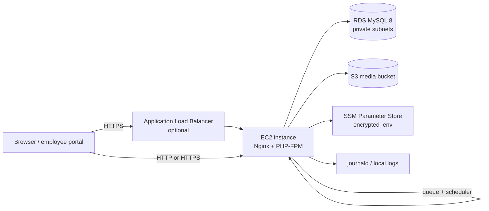

# AWS AMI deployment

This guide builds a reusable Amazon Machine Image (AMI) with Packer and launches it with Terraform. The result is a single application instance, a private RDS MySQL database, an S3 bucket for media/backups, and secure configuration delivered through SSM Parameter Store.

## Architecture



The default stack exposes the instance directly over HTTP and gives it an Elastic IP. Set `enable_alb = true` with a domain and ACM certificate to add HTTPS, health checks, and a stable DNS name.

## What gets created

| Layer | Resources |
| --- | --- |
| Packer | Ubuntu 24.04 AMI, PHP 8.3 FPM, Nginx, Composer, Node 22, Go 1.24, AWS CLI v2, SSM Agent, application code, Vite assets, Go payroll binary, systemd queue/scheduler/backup units |
| Terraform | VPC, public web subnet, private database subnets, security groups, EC2 + Elastic IP, RDS MySQL, S3 bucket, IAM role/profile, SSM SecureString environment, optional ALB/Route 53/ACM |

## Prerequisites

- An AWS account with permission to create VPC, EC2, RDS, S3, IAM, SSM, and optionally ELB/Route 53/ACM resources
- AWS CLI v2, configured for the target account
- [Packer](https://developer.hashicorp.com/packer/install) 1.10 or newer
- [Terraform](https://developer.hashicorp.com/terraform/install) 1.6 or newer
- Git
- A public Git repository containing the application, or another way for the Packer build instance to clone it
- A domain and ACM certificate if you want HTTPS (the certificate must cover both `hris.example.com` and `*.hris.example.com` for the employee portal)

> **Private repositories:** the default Packer template clones `app_repo` over HTTPS. For a private repository, use a short-lived token or prepare a release archive and adapt `deploy/aws/packer/scripts/04-app.sh`. Do not bake a long-lived token into the image.

## 1. Build the AMI

From the repository root:

```bash
cd deploy/aws/packer

packer init .
packer validate .
packer build -var 'app_ref=main' .
```

The build starts a temporary `t3.medium` instance, installs the runtime, clones the app, runs `composer install`, builds Vite assets, builds the Go payroll binary, installs the services, removes the temporary `.env`, and seals the image.

The resulting AMI is tagged with:

- `Component=hris`
- `AppRef=<app_ref>`
- `PHPVersion=<php_version>`

Terraform selects the newest AMI matching `Component=hris` and `AppRef`.

### Build variables

| Variable | Default | Purpose |
| --- | --- | --- |
| `aws_region` | `ap-southeast-1` | Region for the build |
| `instance_type` | `t3.medium` | Temporary build instance |
| `app_repo` | `https://github.com/kawayanmedia/openhrph.git` | Repository to clone |
| `app_ref` | `main` | Branch, tag, or commit to bake |
| `php_version` | `8.3` | PHP version; Ubuntu 24.04 ships 8.3 |
| `ami_name_prefix` | `hris` | AMI name prefix |

Examples:

```bash
packer build -var 'app_ref=v1.0.0' -var 'aws_region=ap-southeast-1' .
packer build -var 'php_version=8.4' .
```

> If `php_version` is not available in the Ubuntu archive, the provisioning script adds the `ondrej/php` PPA.

## 2. Configure Terraform

```bash
cd ../terraform
cp terraform.tfvars.example terraform.tfvars
```

Edit `terraform.tfvars`:

```hcl
aws_region  = "ap-southeast-1"
environment = "production"
app_ref     = "main"

instance_type     = "t3.medium"
db_instance_class = "db.t3.small"

# Optional HTTPS
enable_alb          = true
domain_name         = "hris.example.com"
route53_zone_id     = "Z0123456789ABCDEFGHIJ"
acm_certificate_arn = "arn:aws:acm:ap-southeast-1:123456789012:certificate/..."

# Leave empty to use Session Manager only
key_name          = ""
ssh_allowed_cidrs = []
```

For a first test without a domain, keep `enable_alb = false` and leave the domain fields empty. The output will include an `http://<elastic-ip>` URL.

### Remote state

Terraform state contains database passwords and the application key. Before using this in production, configure the encrypted S3 backend shown in `terraform/versions.tf`:

```hcl
backend "s3" {
  bucket       = "your-terraform-state-bucket"
  key          = "hris/production/terraform.tfstate"
  region       = "ap-southeast-1"
  encrypt      = true
  use_lockfile = true
}
```

Restrict access to the state bucket and enable versioning. If you lose the state, you lose the generated `APP_KEY` and database password.

## 3. Apply the stack

```bash
terraform init
terraform validate
terraform apply
```

Terraform creates the network, database, S3 bucket, IAM role, SSM parameters, and EC2 instance. The instance user-data runs `/usr/local/bin/hris-bootstrap`, which:

1. Fetches `/hris-production/env` from SSM with decryption.
2. Writes `/var/www/hris/.env` with mode `0640` and owner `www-data`.
3. Waits for RDS.
4. Applies `php artisan migrate --force`, which creates the full schema on a new database and upgrades an existing one in place.
5. Imports the statutory payroll tables and the 2026 NWPC wage orders.
6. Imports the 2026 holiday calendar when a company already exists.
7. Warms config, event, and view caches.
8. Starts Nginx, PHP-FPM, the queue worker, the scheduler timer, and the backup timer.
9. Polls `http://127.0.0.1/up` until the app is healthy.

The log is at `/var/log/hris-bootstrap.log`.

Schema changes ship as Laravel migrations in `database/migrations`; there is no SQL dump to import. The migrations are guarded with `Schema::hasTable` and `Schema::hasColumn`, so they also apply cleanly to a database created before the dumps were retired.

## 4. Verify the instance

Use Session Manager:

```bash
terraform output ssm_session_command
aws ssm start-session --target <instance-id> --region ap-southeast-1
```

Inside the instance:

```bash
sudo tail -f /var/log/hris-bootstrap.log
sudo systemctl status nginx php8.3-fpm hris-queue
curl -i http://127.0.0.1/up
sudo -u www-data php /var/www/hris/artisan about
sudo -u www-data php /var/www/hris/artisan payroll:engine --check
```

If the ALB is enabled, wait for the target group to report healthy:

```bash
aws elbv2 describe-target-health --target-group-arn <target-group-arn>
```

## 5. Create the first administrator

A fresh database has no users. Create the owner account from inside the instance:

```bash
sudo -u www-data php /var/www/hris/artisan admin:create
```

The command asks for a name, email, password, and company name. It creates the company and an owner user. It never prints the password.

Verify by opening:

```text
https://hris.example.com/app/login
```

or, without a domain:

```text
http://<elastic-ip>/app/login
```

## 6. Enable HTTPS

1. Request an ACM certificate in the same region as the ALB for:
   - `hris.example.com`
   - `*.hris.example.com` (employee portal and company subdomains)
2. Validate the certificate with DNS.
3. Set `enable_alb = true`, `domain_name`, `route53_zone_id`, and `acm_certificate_arn` in `terraform.tfvars`.
4. Run `terraform apply`.

Terraform creates:

- An ALB across both public subnets
- A target group with `/up` health checks
- An HTTP listener that redirects to HTTPS
- An HTTPS listener using your certificate
- Route 53 A records for the root and wildcard hostnames

If DNS is managed elsewhere, create equivalent A/ALIAS records pointing at the ALB DNS name.

## 7. Update the application

The AMI contains the application at the Git ref you built. You have two update paths.

### Rebuild the image (recommended for reproducibility)

```bash
cd deploy/aws/packer
packer build -var 'app_ref=v1.1.0' .

cd ../terraform
# set app_ref = "v1.1.0"
terraform apply
```

Terraform replaces the instance and runs the bootstrap again. The database and S3 bucket are preserved.

### Deploy in place (faster, less reproducible)

```bash
sudo /usr/local/bin/hris-deploy v1.1.0
```

The deploy helper fetches the ref, installs PHP and Node dependencies, rebuilds assets and the payroll binary, runs migrations, imports the statutory tables and 2026 wage orders, warms caches, and restarts services.

Always keep a database snapshot before a risky release. `hris-deploy` applies `php artisan migrate --force` before shifting traffic; see [Operations](operations.md#migrations) for the legacy-database baseline procedure.

## 8. Backups

- **Database:** RDS automated backups are enabled for `db_backup_retention_days`. Take a manual snapshot before major upgrades.
- **Uploaded files:** `hris-backup.timer` runs nightly and syncs `storage/app/public` to `s3://<bucket>/storage/public`.
- **Configuration:** the encrypted `.env` is in SSM Parameter Store. Back up the Terraform state separately.

See [Operations](operations.md) for restore and verification steps.

## 9. Costs

The stack creates billable resources even when idle:

- EC2 instance and EBS root volume
- Elastic IP (free while attached to a running instance)
- RDS instance, storage, backups, and snapshots
- S3 storage and requests
- Data transfer
- Optional ALB, Route 53 hosted zone, and ACM (ACM public certificates are free)
- Optional Multi-AZ RDS

Use the AWS Pricing Calculator for current regional prices. For a disposable test, set `db_instance_class = "db.t3.micro"`, `deletion_protection = false`, and `skip_final_snapshot = true`.

## 10. Teardown

For a disposable stack:

```hcl
deletion_protection = false
skip_final_snapshot = true
s3_force_destroy    = true
```

Then:

```bash
terraform destroy
```

For production, keep deletion protection and final snapshots, and delete the stack deliberately. Terraform does not delete the AMI or its snapshot automatically; deregister unused AMIs in EC2.

## Troubleshooting

### `data.aws_ami.hris` finds no AMI

The Packer build failed or the tags do not match. Check:

```bash
aws ec2 describe-images --owners self \
  --filters 'Name=tag:Component,Values=hris' \
  --query 'Images[*].[ImageId,Name,Tags]' --output table
```

The AMI must have `Component=hris` and `AppRef` equal to `var.app_ref`.

### Bootstrap cannot read SSM

- Confirm the instance profile has `ssm:GetParameter` on `/<name>/*`.
- Confirm the parameter exists: `aws ssm get-parameter --name /hris-production/env --with-decryption`.
- Confirm the SSM Agent is running: `sudo systemctl status snap.amazon-ssm-agent.amazon-ssm-agent.service`.

### Health check fails

```bash
sudo tail -n 200 /var/log/hris-bootstrap.log
sudo tail -n 200 /var/www/hris/storage/logs/laravel.log
sudo journalctl -u php8.3-fpm -n 100 --no-pager
sudo journalctl -u nginx -n 100 --no-pager
```

Common causes: missing `.env`, RDS security group, wrong database password, or a failed migration.

### Payroll engine missing

```bash
ls -l /var/www/hris/bin/payroll-engine
sudo -u www-data php /var/www/hris/artisan payroll:engine --check
```

Rebuild with `sudo /usr/local/bin/hris-deploy <ref>` or rerun `make -C payroll-engine build`.

### Queue jobs are not running

```bash
sudo systemctl status hris-queue
sudo journalctl -u hris-queue -n 100 --no-pager
```

The scheduler is a timer:

```bash
systemctl list-timers hris-scheduler.timer
```
