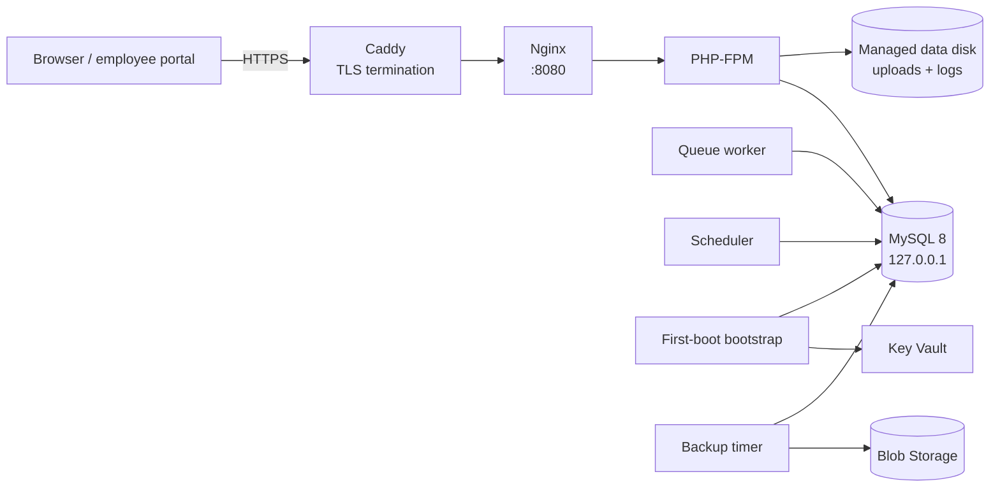

# Azure deployment

This guide builds a reusable Azure managed image with Packer and launches it with Terraform. The result is a single application VM, a private MySQL 8 database on a dedicated data disk, a Storage account for database and uploaded-file backups, and configuration delivered through Key Vault.

## Architecture



Caddy owns ports 80 and 443. It obtains a Let's Encrypt certificate when `APP_URL` uses a domain with HTTPS, and proxies to Nginx on `127.0.0.1:8080`.

The default stack exposes the VM through a static public IP. Set `domain_name` to enable automatic HTTPS.

## What gets created

| Layer | Resources |
| --- | --- |
| Packer | Ubuntu 24.04 managed image, PHP 8.4 FPM, Nginx, MySQL 8, Caddy, Composer, Node 22, Go 1.24, Azure CLI, application code, Vite assets, Go payroll binary, systemd queue/scheduler/bootstrap/backup units |
| Terraform | Resource group, VNet, subnet, NSG, static public IP, VM, user-assigned managed identity, Key Vault, Storage account/container for backups, MySQL data disk, optional Azure DNS records |

## Prerequisites

- An Azure subscription with permission to create resource groups, VMs, networking, managed identities, Key Vault, and Storage
- Azure CLI authenticated: `az login` and `az account set --subscription <id>`
- Registered providers:
  ```bash
  az provider register --namespace Microsoft.Compute
  az provider register --namespace Microsoft.Network
  az provider register --namespace Microsoft.KeyVault
  az provider register --namespace Microsoft.Storage
  az provider register --namespace Microsoft.ManagedIdentity
  ```
- [Packer](https://developer.hashicorp.com/packer/install) 1.10 or newer
- [Terraform](https://developer.hashicorp.com/terraform/install) 1.6 or newer
- Git
- An existing image resource group, for example `rg-hris-images`
- Permission to create role assignments (Owner or User Access Administrator) for the VM identity
- Permission to write secrets to Key Vault (`Key Vault Secrets Officer`) or an equivalent role
- An Azure DNS zone if you want Terraform to create records (optional)

> **Private repositories:** the default Packer template clones `app_repo` over HTTPS. For a private repository, use a short-lived token or prepare a release archive and adapt `deploy/azure/packer/scripts/04-app.sh`. Do not bake a long-lived token into the image.


> **Database schema:** schema changes ship as Laravel migrations in `database/migrations`. The bootstrap applies `php artisan migrate --force`, which creates the full schema on a new database and upgrades an existing one in place. There is no SQL dump to import. The migrations are guarded with `Schema::hasTable` and `Schema::hasColumn`, so they also apply cleanly to a database created before the dumps were retired.

## 1. Build the image

Create the image resource group once:

```bash
az group create --name rg-hris-images --location southeastasia
```

Build the image:

```bash
export AZURE_SUBSCRIPTION_ID=your-subscription-id
export AZURE_IMAGE_RESOURCE_GROUP=rg-hris-images

cd deploy/azure
make image
```

Or directly:

```bash
cd deploy/azure/packer
packer init .
packer validate \
  -var "subscription_id=$AZURE_SUBSCRIPTION_ID" \
  -var "image_resource_group=$AZURE_IMAGE_RESOURCE_GROUP" \
  .
packer build \
  -var "subscription_id=$AZURE_SUBSCRIPTION_ID" \
  -var "image_resource_group=$AZURE_IMAGE_RESOURCE_GROUP" \
  -var 'app_ref=main' \
  .
```

The build starts a temporary `Standard_B2s` VM, installs the runtime, clones the app, runs `composer install`, builds Vite assets, builds the Go payroll binary, installs MySQL and the services, removes the temporary `.env`, and generalizes the image.

The resulting managed image is named `hris-<sanitized-app-ref>-<timestamp>` and tagged with:

- `component=hris`
- `app_ref=<sanitized app ref>`
- `managed_by=packer`

Terraform selects the newest image matching `^hris-<sanitized-app-ref>-`.

### Build variables

| Variable | Default | Purpose |
| --- | --- | --- |
| `subscription_id` | required | Azure subscription |
| `image_resource_group` | required | Resource group for the managed image |
| `location` | `southeastasia` | Build region |
| `vm_size` | `Standard_B2s` | Temporary build VM size |
| `app_repo` | `https://github.com/kawayanmedia/openhrph.git` | Repository to clone |
| `app_ref` | `main` | Branch, tag, or commit to bake |
| `php_version` | `8.4` | PHP version; the build adds the `ondrej/php` PPA when needed |
| `image_prefix` | `hris` | Managed image name prefix |

Examples:

```bash
packer build \
  -var "subscription_id=$AZURE_SUBSCRIPTION_ID" \
  -var "image_resource_group=$AZURE_IMAGE_RESOURCE_GROUP" \
  -var 'app_ref=v1.0.0' \
  .
```

## 2. Configure Terraform

```bash
cd deploy/azure/terraform
cp terraform.tfvars.example terraform.tfvars
```

Edit `terraform.tfvars`:

```hcl
subscription_id     = "your-subscription-id"
resource_group_name = "rg-hris-production"
location            = "southeastasia"

project     = "hris"
environment = "production"
app_ref     = "main"

image_resource_group = "rg-hris-images"
image_prefix         = "hris"

vm_size        = "Standard_B2s"
disk_size      = 40
db_disk_size   = 50

admin_username = "azureuser"
ssh_public_key = "ssh-ed25519 AAAA... you@example.com"

# Optional HTTPS and DNS
domain_name    = "hris.example.com"
dns_zone_name  = "example.com"
dns_record_name = "hris"
acme_email     = "ops@example.com"

# Leave empty to use the generated password
ssh_allowed_cidrs = []
```

For a first test without a domain, leave the domain fields empty. The output includes an `http://<public-ip>` URL.

Set production mail settings before the first boot. The environment template defaults to `MAIL_MAILER=log`; edit `terraform/templates/env.tftpl` and set `MAIL_*` (and any AI provider keys) before `terraform apply`, or update the secret afterwards and re-run the bootstrap.


### Remote state

Terraform state contains the database password and the application key. Before production use, configure the encrypted Azure Storage backend shown in `terraform/versions.tf`:

```hcl
backend "azurerm" {
  resource_group_name  = "your-terraform-state-rg"
  storage_account_name = "yourstateaccount"
  container_name       = "tfstate"
  key                  = "hris/production.tfstate"
}
```

Restrict access to the state storage and enable versioning. If you lose the state, you lose the generated `APP_KEY` and database password.

## 3. Apply the stack

```bash
make apply
```

Or:

```bash
terraform init
terraform validate
terraform apply
```

Terraform creates the resource group, network, NSG, public IP, VM, managed identity, Key Vault, storage account, and MySQL data disk. The VM custom data writes `/etc/hris/bootstrap.conf` and starts `hris-bootstrap.service`, which:

1. Signs in with the user-assigned managed identity.
2. Fetches the `hris-env` secret from Key Vault.
3. Writes `/var/www/hris/.env` with mode `0640` and owner `www-data`.
4. Starts MySQL on the dedicated data disk and creates the database and application user.
5. Applies `php artisan migrate --force`, which creates the full schema on a new database and upgrades an existing one in place.
6. Imports the statutory payroll tables and the 2026 NWPC wage orders.
7. Imports the 2026 holiday calendar when a company already exists.
8. Warms config, event, and view caches.
9. Writes `/etc/caddy/Caddyfile` and reloads Caddy.
10. Starts Nginx, PHP-FPM, the queue worker, the scheduler timer, and the backup timer.
11. Polls `http://127.0.0.1:8080/up` until the app is healthy.

The log is at `/var/log/hris-bootstrap.log`.

## 4. Verify the VM

With an SSH key:

```bash
terraform output ssh_command
ssh azureuser@<public-ip>
```

Without a key, retrieve the generated password:

```bash
terraform output -raw vm_admin_password
```

Inside the VM:

```bash
sudo tail -f /var/log/hris-bootstrap.log
sudo systemctl status nginx php8.4-fpm mysql caddy hris-queue
curl -i http://127.0.0.1:8080/up
curl -i http://127.0.0.1/up
sudo -u www-data php /var/www/hris/artisan about
sudo -u www-data php /var/www/hris/artisan payroll:engine --check
```

Check the MySQL data disk:

```bash
findmnt /var/lib/mysql
df -h /var/lib/mysql
```

## 5. Create the first administrator

A fresh database has no users. Create the owner account:

```bash
sudo -u www-data php /var/www/hris/artisan admin:create
```

Without SSH access, use the Azure run command from your workstation:

```bash
terraform output -raw create_admin_command
# or
az vm run-command invoke \
  --resource-group rg-hris-production \
  --name hris-production-app \
  --command-id RunShellScript \
  --scripts "sudo -u www-data php /var/www/hris/artisan admin:create"
```

The command asks for a name, email, password, and company name. It creates the company and an owner user. It never prints the password.

Open:

```text
https://hris.example.com/app/login
```

or, without a domain:

```text
http://<public-ip>/app/login
```

## 6. Enable HTTPS

Caddy obtains and renews certificates automatically. You need:

1. A DNS record for the application host pointing at the public IP.
2. Inbound ports 80 and 443 open in the NSG (already configured).
3. `domain_name` and `acme_email` set in `terraform.tfvars`.

Terraform creates A records for the application host and `portal.<domain>` when `dns_zone_name` is set. If DNS is managed elsewhere, create:

- `A hris.example.com -> <public-ip>`
- `A portal.hris.example.com -> <public-ip>`

Then run `terraform apply`. The bootstrap writes a Caddy site block for the application and portal hosts and reloads Caddy. Certificate issuance can take a minute after DNS resolves.

Changing `domain_name` or `app_url` does not restart the VM. Re-run the bootstrap with SSH:

```bash
sudo systemctl restart hris-bootstrap.service
```

Or without SSH:

```bash
az vm run-command invoke \
  --resource-group rg-hris-production \
  --name hris-production-app \
  --command-id RunShellScript \
  --scripts "systemctl restart hris-bootstrap.service"
```

> Employee-tenant subdomains use wildcard host names. Caddy's HTTP challenge cannot issue wildcard certificates. Add explicit A records and site blocks for each host, or configure a DNS challenge with your DNS provider and a wildcard certificate.

## 7. Update the application

### Rebuild the image (recommended for reproducibility)

```bash
cd deploy/azure/packer
packer build \
  -var "subscription_id=$AZURE_SUBSCRIPTION_ID" \
  -var "image_resource_group=$AZURE_IMAGE_RESOURCE_GROUP" \
  -var 'app_ref=v1.1.0' \
  .

cd ../terraform
# set app_ref = "v1.1.0"
terraform apply
```

Terraform replaces the VM. The MySQL data disk and Storage account are separate resources and survive the replacement, so the new VM mounts the same database. Take a backup before replacing the VM.

### Deploy in place (faster, less reproducible)

```bash
sudo /usr/local/bin/hris-deploy v1.1.0
```

The deploy helper fetches the ref, installs PHP and Node dependencies, rebuilds assets and the payroll binary, runs migrations, imports the statutory tables and 2026 wage orders, warms caches, and restarts services.

Always take a database backup before a risky release. For a database created before the SQL dumps were retired, follow the migration baseline procedure in [Operations](operations.md#migrations).

## 8. Backups

`hris-backup.timer` runs nightly at 18:30 server time. The Storage account is a backup target; media remains on the local disk unless you add a Flysystem Azure Blob adapter.

- `mysqldump` is compressed and uploaded to `<storage-account>/media/database/`.
- `storage/app/public` is uploaded to `<storage-account>/media/storage/public/`.

Run an on-demand backup:

```bash
sudo /usr/local/bin/hris-backup
```

Restore the database:

```bash
az storage blob download \
  --account-name <storage-account> \
  --container-name media \
  --name database/hris-YYYYMMDDHHMMSS.sql.gz \
  --file /tmp/hris.sql.gz \
  --auth-mode login

gunzip -c /tmp/hris.sql.gz | sudo mysql --protocol=socket -uroot hris
```

Restore uploaded files:

```bash
az storage blob download-batch \
  --account-name <storage-account> \
  --source media \
  --pattern "storage/public/*" \
  --destination /tmp/hris-media \
  --auth-mode login

sudo mkdir -p /var/www/hris/storage/app/public
sudo cp -a /tmp/hris-media/storage/public/. /var/www/hris/storage/app/public/
sudo chown -R www-data:www-data /var/www/hris/storage/app/public
```

Test a restore before you need it.

## 9. Costs

The stack creates billable resources even when idle:

- Virtual machine and OS disk
- Managed MySQL data disk
- Static public IP
- Storage account and requests
- Key Vault operations
- Network egress
- Optional Azure DNS zone and queries

Use the Azure Pricing Calculator for current regional prices. Deallocate the VM when it is not needed; the disks, public IP, and storage remain billable.

## 10. Teardown

```bash
make destroy
```

Terraform deletes the VM, network, storage account, managed identity, and data disk. Key Vault purge protection and soft delete can keep the vault name reserved for the retention period. Delete the Packer image and image resource group separately.

## Troubleshooting

### Terraform cannot find the image

```bash
az image list \
  --resource-group rg-hris-images \
  --query "[?contains(name, 'hris-')].[name,tags.app_ref]" \
  --output table
```

The `app_ref` is sanitized: `v1.0.0` becomes `v1-0-0`. Terraform applies the same transformation.

### Bootstrap cannot read Key Vault

```bash
sudo journalctl -u hris-bootstrap -n 200 --no-pager
az keyvault secret show --vault-name <key-vault> --name hris-env --query value -o tsv
```

Role assignments can take a minute to propagate. The bootstrap retries for five minutes. Confirm the VM has the user-assigned identity and that it has `Key Vault Secrets User` on the vault.

### MySQL does not start

```bash
sudo systemctl status hris-mysql-data.service
sudo journalctl -u hris-mysql-data -n 200 --no-pager
findmnt /var/lib/mysql
```

The data disk attachment is created just after the VM. The mount unit waits up to ten minutes for `/etc/hris/bootstrap.conf` and the device. If the disk is missing, confirm `azurerm_virtual_machine_data_disk_attachment.mysql` exists and LUN 0 is attached in the portal.

### Caddy certificate fails

- Confirm the DNS A record points at the public IP.
- Confirm ports 80 and 443 are open in the NSG.
- Check `sudo journalctl -u caddy -n 200 --no-pager`.
- Check that `APP_URL` uses the same host name.

### Health check fails

```bash
sudo tail -n 200 /var/log/hris-bootstrap.log
sudo tail -n 200 /var/www/hris/storage/logs/laravel.log
sudo journalctl -u php8.4-fpm -n 100 --no-pager
sudo journalctl -u nginx -n 100 --no-pager
sudo journalctl -u mysql -n 100 --no-pager
```

Common causes: missing `.env`, a failed migration, wrong database credentials, or a full disk.

### Queue jobs are not running

```bash
sudo systemctl status hris-queue
sudo journalctl -u hris-queue -n 100 --no-pager
systemctl list-timers hris-scheduler.timer
```

### Payroll engine missing

```bash
ls -l /var/www/hris/bin/payroll-engine
sudo -u www-data php /var/www/hris/artisan payroll:engine --check
```

Rebuild the image, or run `sudo /usr/local/bin/hris-deploy <ref>`.

## Security and maintenance

- Patch the image monthly or when Ubuntu publishes security updates. Rebuild and roll it out.
- Keep MySQL bound to `127.0.0.1`.
- Restrict SSH with `ssh_allowed_cidrs`, Azure Bastion, or a VPN. Use SSH keys rather than passwords.
- Keep `APP_DEBUG=false` and `APP_ENV=production`.
- Rotate the database password and `APP_KEY` deliberately. Rotating `APP_KEY` can invalidate encrypted data and sessions.
- Keep the Terraform state encrypted and access-controlled.
- For stricter isolation, restrict Key Vault and Storage to private endpoints and disable their public network access after the bootstrap has run.
- Review the [open-source release checklist](../security/open-source-checklist.md) before sharing infrastructure code.
