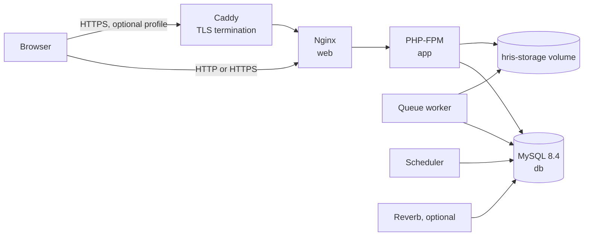

# Docker deployment

This guide runs OpenHR PH as a self-hosted Docker Compose stack. It is the shortest path from a Git checkout to a working production-like environment and the same image can be published to any container registry.

For managed hosting, see [Laravel Cloud](laravel-cloud.md). For golden-image VMs, see [AWS](aws-ami.md), [GCP](gcp.md), or [Azure](azure.md).

## Architecture



| Service | Purpose |
| --- | --- |
| `web` | Nginx on port 80. Proxies PHP to `app:9000` and serves built assets. |
| `app` | PHP-FPM runtime. Runs the application code. |
| `init` | One-shot bootstrap. Applies migrations and imports the statutory tables, wage orders, and holiday calendar, then exits. |
| `queue` | `php artisan queue:work` worker. |
| `scheduler` | `php artisan schedule:work`. |
| `reverb` | Optional WebSocket server. Enabled with the `reverb` profile. |
| `db` | MySQL 8.4 with a persistent volume. |
| `caddy` | Optional TLS reverse proxy in `compose.tls.yaml`. |

Application data lives in two named volumes: `hris_hris-db` (MySQL) and `hris_hris-storage` (uploads, logs, framework cache, and compiled views).

## Prerequisites

- Docker Engine 24 or newer with Compose v2 (`docker compose version`)
- OpenSSL CLI, unless you set `APP_KEY` yourself
- At least 2 vCPU, 4 GB RAM, and 20 GB free disk for a small production deployment
- A DNS name if you want automatic HTTPS
- Ports 80 and 443 (or your chosen HTTP port) reachable from clients


> **Database schema:** schema changes ship as Laravel migrations in `database/migrations`. The `init` service applies `php artisan migrate --force` on every start, so a fresh database is created without importing a SQL dump and an existing database is upgraded in place. The migrations are guarded with `Schema::hasTable` and `Schema::hasColumn`, so they also apply cleanly to a database created before the SQL dumps were retired. Take a backup before every release that changes the schema or payroll logic.

## 1. Configure the environment

```bash
cd deploy/docker
cp .env.example .env
chmod 0600 .env
```

Edit `.env` and set at minimum:

| Variable | Notes |
| --- | --- |
| `APP_URL` | Public URL, for example `https://hris.example.com` or `http://203.0.113.10:8080`. |
| `APP_PORTAL_URL` | Portal URL, for example `https://portal.hris.example.com`. |
| `APP_PORTAL_SUBDOMAIN` | Portal host name without a scheme. |
| `FILAMENT_URL` | Admin panel URL, normally `${APP_URL}/admin`. |
| `APP_KEY` | Leave empty and `scripts/deploy.sh` generates one. Never reuse a key across environments. |
| `DB_PASSWORD` | Application database password. Replace the example value. |
| `DB_ROOT_PASSWORD` | MySQL root password. Replace the example value. |
| `MAIL_*` | SMTP settings for invitations, password resets, and payroll mail. |
| `HRIS_DOMAIN` | Only for the Caddy TLS profile. Set the public host name. |

Keep `APP_ENV=production`, `APP_DEBUG=false`, `SESSION_SECURE_COOKIE=false` until HTTPS is enabled, and `TRUSTED_PROXIES=*` because only the Compose network reaches PHP-FPM.

Generate a key yourself if you prefer:

```bash
printf 'base64:%s\n' "$(openssl rand -base64 32 | tr -d '\n')"
```

## 2. Build and start

```bash
./scripts/deploy.sh
```

The script:

1. Creates `.env` from `.env.example` when missing.
2. Generates `APP_KEY` when it is empty.
3. Builds the image (`hris:local` by default).
4. Starts MySQL and waits for its health check.
5. Runs the `init` service, which applies `php artisan migrate --force` and imports the statutory tables, the 2026 NWPC wage orders, and the 2026 holiday calendar.
6. Starts PHP-FPM, Nginx, the queue worker, and the scheduler.
7. Polls `/up` until the application is healthy.

Build on a server with the right architecture:

```bash
PLATFORM=linux/amd64 ./scripts/build.sh          # most cloud VMs
PLATFORM=linux/arm64 ./scripts/build.sh          # ARM servers and Apple Silicon
```

The Dockerfile produces a single image that is reused by every service. To publish it:

```bash
APP_IMAGE=ghcr.io/your-org/openhrph:1.0.0 ./scripts/build.sh --push
APP_IMAGE=ghcr.io/your-org/openhrph:1.0.0 ./scripts/deploy.sh --no-build
```

Set `APP_IMAGE` in `.env` so later `docker compose` commands use the same tag.

## 3. Verify

```bash
docker compose ps
docker compose logs --tail=100 init app web
curl -fsS http://127.0.0.1:8080/up
```

Open the application:

- Admin panel: `http://localhost:8080/admin`
- Admin workspace login: `http://localhost:8080/app/login`
- Health check: `http://localhost:8080/up`

Create the first administrator:

```bash
docker compose exec -u www-data app php artisan admin:create
```

The command creates a company and an owner account. It never prints the password.

## 4. Enable HTTPS with Caddy

Caddy obtains and renews a Let's Encrypt certificate automatically. It needs a public DNS record pointing at the host and inbound ports 80 and 443.

1. Set `HRIS_DOMAIN=hris.example.com` in `.env`.
2. Set `APP_URL=https://hris.example.com`, `APP_PORTAL_URL=https://portal.hris.example.com`, `SESSION_DOMAIN=.hris.example.com`, and `SESSION_SECURE_COOKIE=true`.
3. Create the DNS records:
   - `A hris.example.com -> <server IP>`
   - `A portal.hris.example.com -> <server IP>` (or a wildcard when the portal uses tenant subdomains)
4. Run:

```bash
./scripts/deploy.sh --tls
```

Caddy listens on 80/443 and proxies to `web:80`. Keep `HTTP_PORT=8080` when using Caddy; the base web port is only for local checks and can be firewalled from the internet.

Caddy's default configuration covers `HRIS_DOMAIN` only. If the employee portal uses a separate host, uncomment the portal block in `deploy/docker/caddy/Caddyfile` and set the host name. Wildcard tenant subdomains require a DNS challenge or a wildcard certificate; the HTTP challenge cannot issue wildcards.

If you terminate TLS at a cloud load balancer instead, keep `SESSION_SECURE_COOKIE=true` and forward `X-Forwarded-Proto`.

## 5. Enable Reverb

Set the Reverb variables in `.env`, then start the profile:

```bash
./scripts/deploy.sh --reverb
```

Reverb listens on port 8080 inside the container. `REVERB_HOST_PORT` publishes it (8081 by default). Expose it through your TLS proxy and set:

```dotenv
BROADCAST_CONNECTION=reverb
REVERB_HOST=hris.example.com
REVERB_PORT=443
REVERB_SCHEME=https
```

The Nginx template does not proxy the Reverb WebSocket endpoints. Terminate the WebSocket route at Caddy or your external proxy, or publish the Reverb port directly.

## 6. Update the application

```bash
git pull
./scripts/deploy.sh
```

Compose recreates services whose image changed. The `init` service applies `php artisan migrate --force` and refreshes the statutory tables, wage orders, and holiday calendar. To force the bootstrap after a configuration-only change:

```bash
docker compose run --rm init
```

The holiday calendar is company-scoped, so `payroll:holidays:import` logs a skip until the first company exists. Run `docker compose run --rm init` again after `admin:create` to import it.

For a registry-based rollout:

```bash
docker compose pull
docker compose up -d --remove-orphans
```

Keep a database backup before every release that changes schema or payroll logic.

## 7. Backups and restore

Run a manual backup:

```bash
./scripts/backup.sh
```

Backups are written to `deploy/docker/backups/` as a compressed SQL dump and a tar archive of uploaded files. Set `BACKUP_S3_URI=s3://bucket/prefix` and install the AWS CLI to upload them as well. Schedule the script with cron, for example:

```cron
30 2 * * * cd /srv/openhrph/deploy/docker && BACKUP_S3_URI=s3://hris-backups/production ./scripts/backup.sh >> /var/log/hris-backup.log 2>&1
```

Restore:

```bash
gunzip -c backups/hris-db-YYYYMMDDHHMMSS.sql.gz \
  | docker compose exec -T db sh -c 'exec mysql -uroot -p"$MYSQL_ROOT_PASSWORD" "$MYSQL_DATABASE"'

docker compose exec -T app \
  sh -c 'rm -rf /var/www/html/storage/app/public/*'

docker compose exec -T app \
  tar -xzf - -C /var/www/html/storage/app/public \
  < backups/hris-storage-YYYYMMDDHHMMSS.tar.gz

docker compose exec -u www-data app php artisan optimize:clear
```

After a restore, verify `/up`, run `php artisan payroll:engine --check`, and confirm the correct company and payroll data.

## 8. Operations

| Task | Command |
| --- | --- |
| Service status | `docker compose ps` |
| Application logs | `docker compose logs -f web app` |
| Queue logs | `docker compose logs -f queue` |
| Scheduler logs | `docker compose logs -f scheduler` |
| Laravel shell | `docker compose exec -u www-data app php artisan tinker` |
| Run an artisan command | `docker compose exec -u www-data app php artisan <command>` |
| MySQL shell | `docker compose exec db mysql -uroot -p` |
| Restart a service | `docker compose restart web app` |
| Rebuild assets and binary | `./scripts/build.sh && docker compose up -d` |

The image sets `LOG_CHANNEL=stderr`, so container logs are the primary application log. If you switch to `LOG_STACK=daily`, the files land in the `hris-storage` volume under `storage/logs`.

## 9. Scaling and limitations

The default stack is a single-host deployment:

- MySQL runs in a container. For multi-host or high-availability production, move to a managed MySQL service and only run the application services.
- Uploaded files use a local volume. Use shared object storage or a shared filesystem before running the web tier on more than one host.
- Sessions, cache, and queues use the database by default. Redis is a better choice at scale; set `REDIS_CLIENT=predis` (already installed) and add a Redis service.
- Run exactly one scheduler. Run one or more queue workers; `queue:work` is safe to scale horizontally.
- The payroll engine is CPU-bound. Give the host enough CPU for the largest payroll run or raise `PAYROLL_ENGINE_INLINE_THRESHOLD` and rely on workers.

## 10. Security checklist

- Replace every example password and keep `.env` at mode `0600`.
- Keep `APP_DEBUG=false` and `APP_ENV=production`.
- Do not publish port 3306.
- Enable HTTPS before setting `SESSION_SECURE_COOKIE=true`.
- Rotate `APP_KEY` only deliberately; rotating it invalidates encrypted data and sessions.
- Patch the base image monthly: `docker compose build --pull && docker compose up -d`.
- Restrict SSH access to the host and use a firewall.
- Review the [open-source release checklist](../security/open-source-checklist.md).

## Troubleshooting

### `init` exits with a database error

```bash
docker compose logs db init
docker compose exec db mysql -uroot -p -e 'SHOW DATABASES;'
```

Confirm `DB_DATABASE`, `DB_USERNAME`, `DB_PASSWORD`, and `DB_ROOT_PASSWORD` in `.env`. The MySQL image only applies `MYSQL_*` variables when the data volume is empty. If you change credentials after the first boot, update them inside MySQL as well or recreate the volume deliberately.

### The web container returns 502

```bash
docker compose ps
docker compose logs app
docker compose exec app php artisan about
```

The web container waits for the `app` health check, but a crashed PHP-FPM process after startup returns 502. Check `storage/logs/laravel.log` and the container logs.

### `APP_KEY` errors

`scripts/deploy.sh` generates a key only when `APP_KEY` is empty. If you changed `.env`, run:

```bash
docker compose exec -u www-data app php artisan config:cache
docker compose restart app queue scheduler
```

### Assets are missing

The image builds Vite assets during `docker build`. Rebuild after changing `resources/`:

```bash
./scripts/build.sh
docker compose up -d
```

### Payroll engine missing

```bash
docker compose exec app ls -l /var/www/html/bin/payroll-engine
docker compose exec -u www-data app php artisan payroll:engine --check
```

The Go binary is built in the Docker image. Rebuild the image if it is missing.

## Teardown

Stop the stack:

```bash
./scripts/destroy.sh
```

Delete the database and uploaded-file volumes as well:

```bash
./scripts/destroy.sh --volumes
```

Take a backup first. The volumes are not recoverable after deletion.
