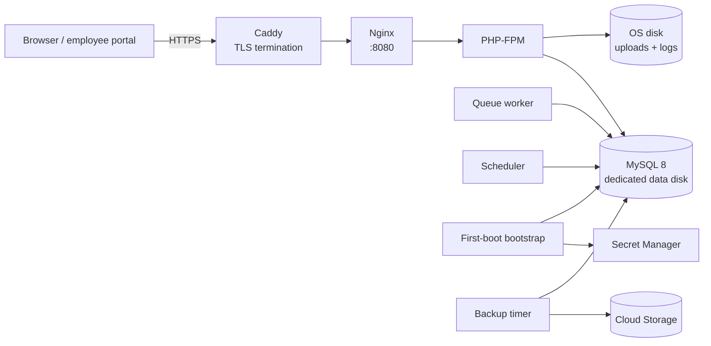

# GCP deployment

This guide builds a reusable Google Cloud image with Packer and launches it with Terraform. The result is a single application VM, a private MySQL 8 database on the same host, a Cloud Storage bucket for database and uploaded-file backups, and configuration delivered through Secret Manager.

## Architecture



Caddy owns ports 80 and 443. It obtains a Let's Encrypt certificate when `APP_URL` uses a domain with HTTPS, and proxies to Nginx on `127.0.0.1:8080`.

The default stack exposes the instance through a static external IP. Set `domain_name` to enable automatic HTTPS.

## What gets created

| Layer | Resources |
| --- | --- |
| Packer | Ubuntu 24.04 image, PHP 8.4 FPM, Nginx, MySQL 8, Caddy, Composer, Node 22, Go 1.24, Google Cloud CLI, application code, Vite assets, Go payroll binary, systemd queue/scheduler/bootstrap/backup units |
| Terraform | VPC, subnet, firewall, static external IP, service account, Cloud Storage backup bucket, Secret Manager secret, Compute Engine instance, persistent MySQL data disk, optional Cloud DNS records |

## Prerequisites

- A Google Cloud project with billing enabled
- `gcloud` authenticated: `gcloud auth login` and `gcloud auth application-default login`
- The following APIs enabled:
  ```bash
  gcloud services enable \
    compute.googleapis.com \
    secretmanager.googleapis.com \
    storage.googleapis.com \
    iam.googleapis.com \
    --project=your-project-id
  ```
- [Packer](https://developer.hashicorp.com/packer/install) 1.10 or newer
- [Terraform](https://developer.hashicorp.com/terraform/install) 1.6 or newer
- Git
- Permission to create Compute, Storage, Secret Manager, and IAM resources, or a project owner for the first apply
- A DNS zone if you want Terraform to create DNS records (optional)

The Packer build account needs Compute Instance Admin, Service Account User, and Storage Object Admin. The Terraform account needs Compute Admin, Storage Admin, Secret Manager Admin, Service Account Admin, and Project IAM Admin.

> **Private repositories:** the default Packer template clones `app_repo` over HTTPS. For a private repository, use a short-lived token or prepare a release archive and adapt `deploy/gcp/packer/scripts/04-app.sh`. Do not bake a long-lived token into the image.


> **Database schema:** schema changes ship as Laravel migrations in `database/migrations`. The bootstrap applies `php artisan migrate --force`, which creates the full schema on a new database and upgrades an existing one in place. There is no SQL dump to import. The migrations are guarded with `Schema::hasTable` and `Schema::hasColumn`, so they also apply cleanly to a database created before the dumps were retired.

## 1. Build the image

```bash
export GCP_PROJECT_ID=your-project-id
cd deploy/gcp
make image
```

Or directly:

```bash
cd deploy/gcp/packer
packer init .
packer validate -var "gcp_project_id=$GCP_PROJECT_ID" .
packer build -var "gcp_project_id=$GCP_PROJECT_ID" -var 'app_ref=main' .
```

The build starts a temporary `e2-medium` instance, installs the runtime, clones the app, runs `composer install`, builds Vite assets, builds the Go payroll binary, installs MySQL and the services, removes the temporary `.env`, and seals the image.

The resulting image is labeled with:

- `component=hris`
- `app_ref=<sanitized app ref>`
- `managed_by=packer`

Terraform selects the newest image with `component=hris` and the `app_ref` matching `var.app_ref`.

### Build variables

| Variable | Default | Purpose |
| --- | --- | --- |
| `gcp_project_id` | required | Project for the build |
| `gcp_zone` | `asia-southeast1-b` | Zone for the temporary build instance |
| `machine_type` | `e2-medium` | Temporary build instance type |
| `disk_size` | `40` | Build disk size in GB |
| `app_repo` | `https://github.com/kawayanmedia/openhrph.git` | Repository to clone |
| `app_ref` | `main` | Branch, tag, or commit to bake |
| `php_version` | `8.4` | PHP version; the build adds the `ondrej/php` PPA when needed |
| `image_prefix` | `hris` | Image name and family prefix |

Examples:

```bash
packer build -var "gcp_project_id=$GCP_PROJECT_ID" -var 'app_ref=v1.0.0' .
packer build -var "gcp_project_id=$GCP_PROJECT_ID" -var 'php_version=8.3' .
```

## 2. Configure Terraform

```bash
cd deploy/gcp/terraform
cp terraform.tfvars.example terraform.tfvars
```

Edit `terraform.tfvars`:

```hcl
project_id = "your-project-id"
region     = "asia-southeast1"
zone       = "asia-southeast1-b"

project     = "hris"
environment = "production"
app_ref     = "main"

machine_type = "e2-medium"
disk_size    = 40
db_disk_size = 50

# Optional HTTPS and DNS
domain_name      = "hris.example.com"
dns_managed_zone = "example-com"
acme_email       = "ops@example.com"

# 35.235.240.0/20 enables IAP with OS Login. Leave empty to disable SSH.
ssh_allowed_cidrs = ["35.235.240.0/20"]
```

For a first test without a domain, leave the domain fields empty. The output includes an `http://<static-ip>` URL.

Set production mail settings before the first boot. The environment template defaults to `MAIL_MAILER=log`; edit `terraform/templates/env.tftpl` and set `MAIL_*` (and any AI provider keys) before `terraform apply`, or update the secret afterwards and re-run the bootstrap.


### Remote state

Terraform state contains the database password and the application key. Before production use, configure the encrypted GCS backend shown in `terraform/versions.tf`:

```hcl
backend "gcs" {
  bucket = "your-terraform-state-bucket"
  prefix = "hris/production"
}
```

Restrict access to the state bucket and enable versioning. If you lose the state, you lose the generated `APP_KEY` and database password.

## 3. Apply the stack

```bash
make apply
```

Or:

```bash
terraform init
terraform validate
terraform apply
```

Terraform creates the network, firewall, static IP, service account, bucket, secret, and instance. The instance startup script writes `/etc/hris/bootstrap.conf` and starts `hris-bootstrap.service`, which:

1. Fetches the `hris-production-env` secret from Secret Manager.
2. Writes `/var/www/hris/.env` with mode `0640` and owner `www-data`.
3. Starts MySQL and creates the database and application user.
4. Applies `php artisan migrate --force`, which creates the full schema on a new database and upgrades an existing one in place.
5. Imports the statutory payroll tables and the 2026 NWPC wage orders.
6. Imports the 2026 holiday calendar when a company already exists.
7. Warms config, event, and view caches.
8. Writes `/etc/caddy/Caddyfile` and reloads Caddy.
9. Starts Nginx, PHP-FPM, the queue worker, the scheduler timer, and the backup timer.
10. Polls `http://127.0.0.1:8080/up` until the app is healthy.

The log is at `/var/log/hris-bootstrap.log`.

## 4. Verify the instance

Use IAP and OS Login:

```bash
gcloud compute ssh hris-production-app \
  --zone=asia-southeast1-b \
  --tunnel-through-iap \
  --project=your-project-id
```

Inside the instance:

```bash
sudo tail -f /var/log/hris-bootstrap.log
sudo systemctl status nginx php8.4-fpm mysql caddy hris-queue
curl -i http://127.0.0.1:8080/up
curl -i http://127.0.0.1/up
sudo -u www-data php /var/www/hris/artisan about
sudo -u www-data php /var/www/hris/artisan payroll:engine --check
findmnt /var/lib/mysql
df -h /var/lib/mysql
```

## 5. Create the first administrator

A fresh database has no users. Create the owner account:

```bash
sudo -u www-data php /var/www/hris/artisan admin:create
```

The command asks for a name, email, password, and company name. It creates the company and an owner user. It never prints the password.

Open:

```text
https://hris.example.com/app/login
```

or, without a domain:

```text
http://<static-ip>/app/login
```

## 6. Enable HTTPS

Caddy obtains and renews certificates automatically. You need:

1. A DNS record for the application host pointing at the static IP.
2. Inbound ports 80 and 443 open in the firewall (already configured).
3. `domain_name` and `acme_email` set in `terraform.tfvars`.

Terraform creates A records for the root host and `portal.<domain>` when `dns_managed_zone` is set. If DNS is managed elsewhere, create:

- `A hris.example.com -> <static-ip>`
- `A portal.hris.example.com -> <static-ip>`

Then run `terraform apply`. The bootstrap writes a Caddy site block for the application and portal hosts and reloads Caddy. Certificate issuance can take a minute after DNS resolves.

Changing `domain_name` or `app_url` does not restart the instance. Re-run the bootstrap on the VM so Caddy and `.env` pick up the new URL:

```bash
sudo systemctl restart hris-bootstrap.service
```

Or reboot the instance; the metadata startup script runs the bootstrap on every boot.

> Employee-tenant subdomains use wildcard host names. Caddy's HTTP challenge cannot issue wildcard certificates. Add explicit A records and site blocks for each host, or configure a DNS challenge with your DNS provider and a wildcard certificate.

## 7. Update the application

### Rebuild the image (recommended for reproducibility)

```bash
cd deploy/gcp/packer
packer build -var "gcp_project_id=$GCP_PROJECT_ID" -var 'app_ref=v1.1.0' .

cd ../terraform
# set app_ref = "v1.1.0"
terraform apply
```

Terraform replaces the instance and runs the bootstrap again. The MySQL data disk is a separate persistent resource, so the new instance mounts the same database. Take a backup before replacing the instance, and confirm `findmnt /var/lib/mysql` after the replacement.

### Deploy in place (faster, less reproducible)

```bash
sudo /usr/local/bin/hris-deploy v1.1.0
```

The deploy helper fetches the ref, installs PHP and Node dependencies, rebuilds assets and the payroll binary, runs migrations, imports the statutory tables and 2026 wage orders, warms caches, and restarts services.

Always take a database backup before a risky release. For a database created before the SQL dumps were retired, follow the migration baseline procedure in [Operations](operations.md#migrations).

## 8. Backups

`hris-backup.timer` runs nightly at 18:30 server time. The bucket is a backup target; media remains on the local disk unless you add a Flysystem GCS adapter.

- `mysqldump` is compressed and uploaded to `gs://<bucket>/database/`.
- `storage/app/public` is synced to `gs://<bucket>/storage/public`.

Run an on-demand backup:

```bash
sudo /usr/local/bin/hris-backup
```

Restore the database:

```bash
gcloud storage cp gs://<bucket>/database/hris-YYYYMMDDHHMMSS.sql.gz /tmp/
gunzip -c /tmp/hris-YYYYMMDDHHMMSS.sql.gz \
  | sudo mysql --protocol=socket -uroot hris
```

Restore uploaded files:

```bash
sudo gcloud storage rsync --recursive \
  gs://<bucket>/storage/public \
  /var/www/hris/storage/app/public
sudo chown -R www-data:www-data /var/www/hris/storage/app/public
```

Test a restore before you need it.

## 9. Costs

The stack creates billable resources even when idle:

- Compute Engine instance, boot disk, and MySQL data disk
- Cloud Storage bucket and requests
- Secret Manager secret versions
- Static external IP (charged when unattached; attached addresses are generally free)
- Network egress
- Optional Cloud DNS zone and queries

Use the Google Cloud Pricing Calculator for current regional prices. Stop the instance when it is not needed; the disk and bucket remain billable.

## 10. Teardown

For a disposable stack:

```hcl
deletion_protection   = false
bucket_force_destroy  = true
```

Then:

```bash
make destroy
```

The Packer image is not deleted by Terraform. Delete old images and their storage separately.

## Troubleshooting

### Terraform cannot find the image

```bash
gcloud compute images list \
  --filter='labels.component=hris' \
  --format='table(name,labels.app_ref,creationTimestamp)'
```

The `app_ref` label is sanitized: `v1.0.0` becomes `v1-0-0`. Terraform applies the same transformation. Confirm the Packer build completed and `project_id`/`image_project` are correct.

### Bootstrap cannot read Secret Manager

```bash
sudo journalctl -u hris-bootstrap -n 200 --no-pager
gcloud secrets versions access latest \
  --secret=hris-production-env \
  --project=your-project-id
```

Confirm the instance service account has `roles/secretmanager.secretAccessor` on the secret, and that the OS Login/IAP user can access the instance.

### Caddy certificate fails

- Confirm the DNS A record points at the static IP.
- Confirm ports 80 and 443 are open.
- Check `sudo journalctl -u caddy -n 200 --no-pager`.
- Check that `APP_URL` uses the same host name.

### MySQL does not start

```bash
sudo systemctl status hris-mysql-data.service
sudo journalctl -u hris-mysql-data -n 200 --no-pager
findmnt /var/lib/mysql
```

The mount unit waits up to ten minutes for `/etc/hris/bootstrap.conf` and the attached disk. Confirm the disk is attached:

```bash
ls -l /dev/disk/by-id/google-*-mysql-data
gcloud compute disks list --filter='name~mysql-data'
```

### Health check fails

```bash
sudo tail -n 200 /var/log/hris-bootstrap.log
sudo tail -n 200 /var/www/hris/storage/logs/laravel.log
sudo journalctl -u php8.4-fpm -n 100 --no-pager
sudo journalctl -u nginx -n 100 --no-pager
sudo journalctl -u mysql -n 100 --no-pager
```

Common causes: missing `.env`, a failed migration, wrong database credentials, or a full disk.

### Payroll engine missing

```bash
ls -l /var/www/hris/bin/payroll-engine
sudo -u www-data php /var/www/hris/artisan payroll:engine --check
```

Rebuild the image, or run `sudo /usr/local/bin/hris-deploy <ref>`.

### Queue jobs are not running

```bash
sudo systemctl status hris-queue
sudo journalctl -u hris-queue -n 100 --no-pager
systemctl list-timers hris-scheduler.timer
```

## Security and maintenance

- Patch the image monthly or when Ubuntu publishes security updates. Rebuild and roll it out.
- Keep MySQL bound to `127.0.0.1`.
- Use IAP with OS Login instead of opening SSH. If SSH is required, restrict `ssh_allowed_cidrs`.
- Keep `APP_DEBUG=false` and `APP_ENV=production`.
- Rotate the database password and `APP_KEY` deliberately. Rotating `APP_KEY` can invalidate encrypted data and sessions.
- Keep the Terraform state encrypted and access-controlled.
- Review the [open-source release checklist](../security/open-source-checklist.md) before sharing infrastructure code.
