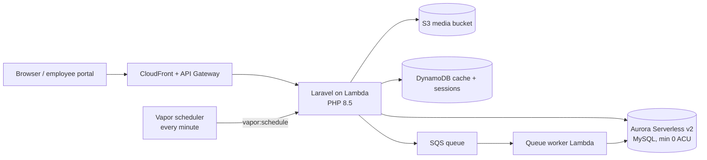
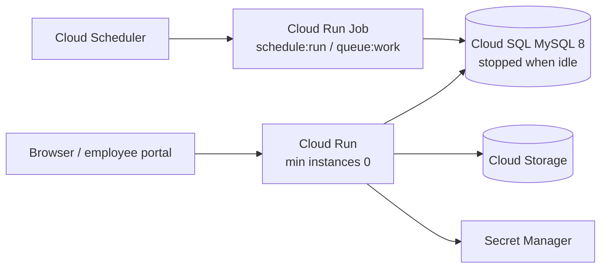
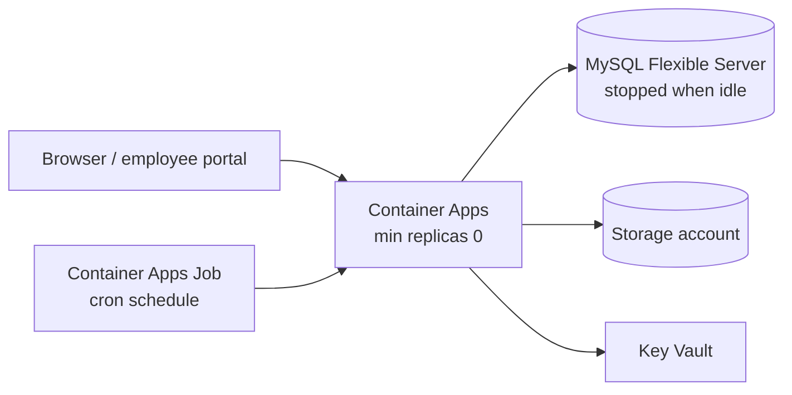

# Serverless and pause-when-idle deployment

Every other cloud path in this section keeps billable capacity running around the clock, even when nobody signs in. This guide covers the four ways to stop paying for an idle installation:

1. [AWS Vapor + Aurora Serverless v2](#option-1--aws-vapor-and-aurora-serverless-v2-recommended) — the only option that reaches a true zero for both compute and database.
2. [GCP Cloud Run](#option-2--gcp-cloud-run) — compute scales to zero; Cloud SQL is stopped on a schedule.
3. [Azure Container Apps](#option-3--azure-container-apps) — compute scales to zero; MySQL Flexible Server is stopped on a schedule.
4. [Pause the existing VM stacks](#option-4--pause-the-existing-vm-stacks) — no application changes, just stop the instance and database when the office is closed.

| Option | Idle compute | Idle database | Effort | Resume latency | Best for |
| --- | --- | --- | --- | --- | --- |
| Vapor + Aurora Serverless v2 | ~$0 | storage only | Medium (manifest, S3, SQS) | 1–3 s (HTTP), seconds (database) | New installs, demos, multi-tenant pilots |
| Cloud Run + scheduled Cloud SQL stop | ~$0 | $0 only while stopped | Medium (container, GCS) | Seconds for compute, minutes for the database | Existing GCP estate |
| Container Apps + scheduled MySQL stop | ~$0 | $0 only while stopped | Medium (container, Blob) | Seconds for compute, minutes for the database | Existing Azure estate |
| Paused VM stack | $0 while stopped | $0 while stopped | Low (no app changes) | 1–3 minutes | Single agency, office hours, "cheapest to run" |

> **What "no activity" means.** Idle means no HTTP request, no queued job, and no scheduled invocation. A monitor that pings `/up` every five minutes keeps the whole stack awake and defeats the purpose. Monitor on a schedule that tolerates downtime, or only start the system when someone needs it.

## What actually reaches zero

| Resource | Reaches $0 when idle? | Notes |
| --- | --- | --- |
| Lambda / Cloud Run / Container Apps compute | Yes | Scale-to-zero is the default on Cloud Run and Container Apps; Vapor Lambdas have no idle cost |
| Aurora Serverless v2 (min capacity 0 ACU) | Yes, after auto-pause | Pause takes ~15 minutes with zero connections; storage and backups keep billing |
| RDS MySQL, Cloud SQL, Azure Database for MySQL | No | Provisioned instances bill while running; only a stop/start schedule removes the cost |
| ElastiCache, Memorystore, Azure Cache | No | Hourly. Use DynamoDB, the database, or an encrypted cookie instead |
| Application Load Balancer, NAT Gateway | No | Roughly $16–$35 per month each; avoid them on zero-idle designs, but a privately attached database usually forces a NAT gateway or VPC endpoints |
| S3 / GCS / Blob storage | Per GB, always | Uploaded documents and payslips are business records; do not delete them to save pennies |
| CloudFront, CDN egress | Small, per request | Billing continues but scales with traffic |
| Route 53 hosted zone, domain, certificates | Fixed (ACM certificates are free) | A domain is required for HTTPS |
| Snapshots and backups | Per GB | Keep these; they are the cheapest insurance you have |

The practical consequence: **Vapor is the only path here where idle capacity itself disappears.** You still pay a fixed Vapor subscription, object storage, backups, and whatever VPC egress you need — but not for compute or database capacity nobody is using. Cloud Run and Container Apps remove the compute bill but not the database bill unless you stop the database, and a stopped database means the application cannot serve requests until it is started again.

## Application requirements for scale-to-zero

These apply to every option. They are properties of the deployment, not of any single platform.

### Stateless web tier

Nothing may be written to the container filesystem and expected to survive: instances are created and destroyed freely, so local files are per-instance and disappear with the instance.

The block below shows the AWS shape used by Vapor. On Cloud Run or Container Apps, replace the queue, cache, and session drivers with `database` (while the database is running) or `cookie` for sessions.

```dotenv
APP_ENV=production
APP_DEBUG=false
LOG_CHANNEL=stderr
LOG_STACK=stderr
TRUSTED_PROXIES=*
TELESCOPE_ENABLED=false
FILESYSTEM_DISK=s3
MEDIA_DISK=s3
QUEUE_CONNECTION=sqs
CACHE_STORE=dynamodb
SESSION_DRIVER=dynamodb
PAYROLL_ENGINE_INLINE_THRESHOLD=0
PAYROLL_ENGINE_TIMEOUT=780
```

- `LOG_CHANNEL=stderr` — the platform collects stdout/stderr; the local `storage/logs` directory is not durable.
- `TRUSTED_PROXIES=*` — every option terminates TLS in front of the application, so registration throttling and URLs must see the forwarded client IP.
- `TELESCOPE_ENABLED=false` — Telescope writes to the database on every request and is disabled by default in this project.
- Session, cache, and queue drivers must be shared between instances. DynamoDB, SQS, and the database all work; `file` does not.
- Cache `config`, `route`, `event`, and `view` during the build so each cold start does not re-parse the framework.

### Media, documents, and generated PDFs

Leave `FILESYSTEM_DISK` and `MEDIA_DISK` on the object store. On Vapor also set `ENABLE_MEDIA_LIBRARY_VAPOR_UPLOADS=true`; Spatie Media Library then uploads straight from the browser to S3 through Vapor's signed storage URL instead of proxying the file through a Lambda. Without it, large document uploads hit the Lambda payload and request-size limits.

### Scheduler

Production paths use systemd timers; serverless platforms have no long-running process. The schedule itself is small — two daily tasks in `routes/console.php` — so a platform cron is enough:

| Platform | Replacement for `hris-scheduler.timer` |
| --- | --- |
| Vapor | Enable the scheduler for the environment; the platform invokes `php artisan vapor:schedule` every minute, and `vapor:schedule` calls `schedule:run` once per minute at the start of the minute |
| Cloud Run | Cloud Scheduler → Cloud Run Job running `php artisan schedule:run` every minute |
| Container Apps | Container Apps Job with the cron `* * * * *` running `php artisan schedule:run` |
| Paused VM | The timer already exists; it only needs to run once after each start |

Each scheduled invocation bills a few hundred milliseconds, about 1,440 times a day. If that is unacceptable, schedule the two commands directly (`payroll_date:generate`, `blank_timesheet:generate`) instead of running `schedule:run` every minute.

### Queues and payroll

A payroll run above `payroll.engine.inline_threshold` (50 employees) is queued by `ProcessPayrollJob`; below it the job is dispatched synchronously **inside the HTTP request**. That does not survive a serverless HTTP gateway timeout, so set `PAYROLL_ENGINE_INLINE_THRESHOLD=0` and let the queue carry every run.

`ProcessPayrollJob` declares `public int $timeout = 900`, which is exactly the hard maximum for a Lambda invocation. Lower `PAYROLL_ENGINE_TIMEOUT` (780 seconds leaves room for boot and persistence) and keep runs under the platform limit. A payroll group that cannot finish in twelve minutes needs to be split into two groups or given the batch treatment described in [Operations](operations.md#queues-and-schedulers).

`$tries = 1` is deliberate: a partially written payroll must not be silently retried. If the worker is killed at the platform timeout, the SQS message is redelivered; the next invocation sees the attempt count exceeded, marks the job failed, and `failed()` reopens the payroll date — so the operator sees a failed run instead of a stuck one.

### The payroll engine binary

`App\Services\Payroll\Engine\GoPayrollEngine` shells out to `bin/payroll-engine`, which connects to MySQL itself using `PAYROLL_ENGINE_DSN`. On serverless:

- The binary must ship inside the deployment package or container image, at `bin/payroll-engine`, with its execute bit set.
- It needs direct network access to the database. On Vapor that means the Lambda must be attached to the same VPC as Aurora.
- Verify it after every deploy with `php artisan payroll:engine --check`; the command fails non-zero when the binary is missing or not executable.
- `PAYROLL_ENGINE_DRIVER=php` remains a fallback. It is parity-locked to the Go engine by the shared corpus but slower, which matters when a run has a twelve-minute budget.

### Migrations and reference data

Never migrate on boot: several instances would race. Run migrations and the idempotent reference-data imports as a release step, after the new code is live and before traffic is shifted.

## Option 1 — AWS Vapor and Aurora Serverless v2 (recommended)

Vapor runs the application on Lambda behind API Gateway, serves assets from CloudFront, stores media in S3, queues jobs in SQS, caches in DynamoDB, and schedules `vapor:schedule`. With an Aurora Serverless v2 cluster whose minimum capacity is 0 ACU, the database pauses when nothing is connected, so an idle environment bills for storage and backups only.



### What it costs when idle

| Item | Idle behaviour |
| --- | --- |
| Lambda, API Gateway, CloudFront | No invocations, no charge |
| Aurora Serverless v2 | Auto-pauses after ~15 minutes with no connections; you pay storage and backups |
| S3, DynamoDB, SQS | Per request and per GB; effectively zero with no traffic |
| NAT Gateway, ALB, Redis | Not needed by Lambdas alone. A database in a private VPC does need a NAT gateway or interface endpoints, which is a fixed hourly charge |
| Vapor subscription | A fixed monthly platform fee per project; check current plans before promising a saving |
| Scheduler | 1,440 tiny invocations per day; the two daily tasks briefly wake the database |

### 1. Prerequisites

- An AWS account and a Vapor account with a linked AWS provider (`vapor provider`).
- `laravel/vapor-cli` and `laravel/vapor-core` are already direct dependencies of this project.
- A Vapor project. The repository ships a `vapor.yml`, but treat the manifest below as the source of truth: the committed version has the asset build commented out, never builds the payroll binary, and sets no ignore list.

### 2. Create the environment resources

In the Vapor dashboard, for the environment you are deploying:

1. **Storage** — create the bucket used for media and generated documents.
2. **Caches** — create a DynamoDB cache and note its table name.
3. **Queues** — create the SQS queue used for payroll and mail, and note its name and prefix.
4. **Network** — create a private network if the database will live in a VPC, then note the NAT gateway and subnet CIDR.
5. **Scheduler** — enable it.

Attach the network to the environment so Lambdas run inside the VPC and can reach Aurora.

### 3. Create the Aurora Serverless v2 cluster

Vapor's own `vapor database` command provisions a provisioned RDS instance, which never scales to zero. Create the cluster yourself and point the application at it.

```bash
# Subnet group: reuse the private subnets of the Vapor network.
aws rds create-db-subnet-group \
  --db-subnet-group-name openhrph-aurora \
  --db-subnet-group-description "OpenHR PH serverless database" \
  --subnet-ids subnet-aaaa1111 subnet-bbbb2222

# Security group that accepts MySQL from the Vapor network only.
aws ec2 create-security-group \
  --group-name openhrph-aurora \
  --description "MySQL from the Vapor network" \
  --vpc-id vpc-0123456789abcdef0

aws ec2 authorize-security-group-ingress \
  --group-id sg-0123456789abcdef0 \
  --protocol tcp --port 3306 --cidr 10.0.0.0/16

# Cluster: minimum capacity 0 ACU is what enables auto-pause.
aws rds create-db-cluster \
  --db-cluster-identifier openhrph-aurora \
  --engine aurora-mysql \
  --engine-version 8.0.mysql_aurora.3.08.0 \
  --engine-mode provisioned \
  --serverless-v2-scaling-configuration MinCapacity=0,MaxCapacity=2 \
  --master-username hris \
  --master-user-password '<strong-password>' \
  --db-subnet-group-name openhrph-aurora \
  --vpc-security-group-ids sg-0123456789abcdef0 \
  --backup-retention-period 7

# One Serverless v2 instance in the cluster.
aws rds create-db-instance \
  --db-instance-identifier openhrph-aurora-1 \
  --db-cluster-identifier openhrph-aurora \
  --db-instance-class db.serverless \
  --engine aurora-mysql
```

Notes that cost real debugging time:

- **Auto-pause needs a 0 ACU minimum.** Check that the engine version supports it for your region; `create-db-cluster` rejects the scaling configuration when it does not.
- **Do not enable `database-proxy`.** An RDS Proxy keeps pooled connections open, so the cluster never sees zero connections and never pauses. If you need a proxy for connection limits, accept an always-warm database instead.
- **Warm Lambda containers hold connections.** After the last real request, the cluster can take up to ~15 minutes to pause. That is expected; it is also why a five-minute health check defeats the whole design.
- **Resume is fast, cold start is not.** Aurora resumes in seconds, but the first request also pays the PHP cold start. Both happen once, after an idle period.

### 4. Corrected `vapor.yml`

The committed manifest is a starter file. Use this instead; it builds the assets and the Go payroll binary, and it keeps the payroll binary executable inside the Lambda package.

```yaml
id: 52820
name: SahodApp

ignore:
  - .github
  - .vscode
  - docs
  - docs-site
  - e2e
  - nativephp
  - test-results
  - tests

environments:
  production:
    memory: 1024
    cli-memory: 1024
    runtime: 'php-8.5:al2023'
    # octane: true
    database-proxy: false
    build:
      - 'composer install --no-dev --prefer-dist --no-interaction --optimize-autoloader'
      - 'npm ci && npm run build && rm -rf node_modules'
      - 'make -C payroll-engine build'
      - 'chmod +x bin/payroll-engine'
      - 'php artisan event:cache'
      - 'php artisan config:cache'
      - 'php artisan route:cache'
      - 'php artisan view:cache'
```

Why each line is there:

- `cli-memory: 1024` — the queue worker runs the Go engine as a child process; 512 MB is tight on a large payroll.
- `make -C payroll-engine build` plus `chmod +x` — without the binary, `payroll:engine --check` fails and every payroll errors with "The payroll engine binary was not found".
- `route:cache` and `config:cache` — cold starts are shorter, which is the entire latency budget on Lambda.
- `octane` stays commented out. Vapor supports Octane only on specific runtime images; benchmark cold start before enabling it.
- `ignore` — keeps the documentation, tests, and e2e suite out of the Lambda zip. Keep an eye on size: Lambda caps zip deployments at 50 MB zipped / 250 MB unzipped. A clean `composer install --no-dev` for this project is roughly 160–180 MB unzipped, so the archive fits but without much headroom. Run `vapor build` and check the archive before the first deploy; if it does not fit, switch the environment to Vapor's container runtime (`runtime: docker`) instead of trimming packages.

Configure the **deploy hook** in the Vapor dashboard, not in the manifest:

```bash
php artisan migrate --force
```

Run the reference data once after the first deploy, through `vapor command`:

```bash
vapor command "php artisan openhr:install --sector=Private --country=PH --no-interaction"
vapor command "php artisan payroll:wage-orders:import"
vapor command "php artisan payroll:holidays:import"
vapor command "php artisan admin:create"
```

`openhr:install` imports the statutory schedule unless `--skip-statutory` is passed. `payroll:holidays:import` is company-scoped, so run it after the first company exists.

### 5. Environment variables

```bash
vapor env:pull production   # produces .env.production, edit it, then:
vapor env:push production
```

| Variable | Value |
| --- | --- |
| `APP_ENV` / `APP_DEBUG` | `production` / `false` |
| `APP_KEY` | From `php artisan key:generate --show`; store it as a secret (`vapor secret`) |
| `DB_CONNECTION` | `mysql` |
| `DB_HOST` / `DB_PORT` / `DB_DATABASE` | Aurora writer endpoint / `3306` / `openhrph` |
| `DB_USERNAME` / `DB_PASSWORD` | `hris` / the cluster password (use a secret) |
| `PAYROLL_ENGINE_DSN` | `mysql:host=<writer-endpoint>;port=3306;dbname=openhrph` with credentials, or leave blank to reuse `DB_*` |
| `PAYROLL_ENGINE_INLINE_THRESHOLD` | `0` |
| `PAYROLL_ENGINE_TIMEOUT` | `780` |
| `QUEUE_CONNECTION` | `sqs` |
| `SQS_QUEUE` / `SQS_PREFIX` | The queue name and prefix shown in the Vapor dashboard |
| `CACHE_STORE` | `dynamodb` |
| `DYNAMODB_CACHE_TABLE` | The cache table from the dashboard |
| `SESSION_DRIVER` | `dynamodb` |
| `FILESYSTEM_DISK` / `MEDIA_DISK` | `s3` |
| `ENABLE_MEDIA_LIBRARY_VAPOR_UPLOADS` | `true` |
| `LOG_CHANNEL` / `LOG_STACK` | `stderr` |
| `TRUSTED_PROXIES` | `*` |
| `TELESCOPE_ENABLED` | `false` |

`laravel/vapor-core` fills in the SQS, DynamoDB, and Redis credentials from the role Vapor attaches to the functions, so the AWS keys never appear in the environment file.

### 6. Deploy and verify

```bash
vapor deploy production

vapor command "php artisan payroll:engine --check"
vapor command "php artisan db:ensure-schema --check"
curl -fsS https://<environment-domain>/up

# Queue path: needs a payroll above the threshold, or any queued mail/job.
vapor command "php artisan queue:monitor default"
```

Then confirm the idle behaviour: stop using the environment, wait twenty minutes, and check the cluster's capacity metric — it should report 0 ACU once the cluster has paused:

```bash
aws cloudwatch get-metric-statistics \
  --namespace AWS/RDS \
  --metric-name ServerlessDatabaseCapacity \
  --dimensions Name=DBClusterIdentifier,Value=openhrph-aurora \
  --start-time "$(date -u -v-30M '+%Y-%m-%dT%H:%M:%SZ')" \
  --end-time "$(date -u '+%Y-%m-%dT%H:%M:%SZ')" \
  --period 300 --statistics Average
```

The first request after that resumes the cluster; expect one slow page, not an error.

### 7. Limits and caveats

- **Fifteen minutes per invocation.** API Gateway integration timeouts are far shorter (~30 seconds), so nothing long may run in the request. This is why the inline payroll threshold is `0`.
- **Cold starts.** The first request after idle pays PHP boot plus database resume. Keep caches warm in the build and keep the image small.
- **No WebSockets.** Broadcasting defaults to `null` in this project. Enabling Reverb on Vapor requires a separate always-on service, which reintroduces a fixed hourly cost.
- **`/tmp` is the only writable path**, and it is per-invocation. Anything the application keeps must be in S3 or the database.
- **Connection count is per container.** Aurora Serverless v2 scales with connections, so leaving the maximum at 2 ACU keeps cost predictable; a burst of cold containers is the usual cause of a surprise bill.
- **VPC egress is the residual fixed cost.** A Lambda attached to a private VPC needs a NAT gateway (~$32/month plus data processing) or interface endpoints to reach AWS APIs. That is still far below a 24/7 EC2 + RDS stack, but it is not zero — budget for it or use gateway endpoints for S3 and DynamoDB.
- **Maintenance windows still apply.** Aurora pauses between backups; a paused cluster resumes for its backup window.

## Option 2 — GCP Cloud Run

Cloud Run scales instances to zero when no request is in flight. Cloud SQL has no auto-pause, so the database cost only goes away when you stop the instance, and the application is unavailable while it is stopped.



### 1. Build a single container that serves HTTP

The Compose stack splits Nginx and PHP-FPM into two containers that share an image (`deploy/docker/Dockerfile`). Cloud Run needs one process tree listening on `$PORT`, so run both under a supervisor in a thin extension of that image. Add these two files to your fork (they are not committed in this repository):

`deploy/serverless/supervisord.conf`

```ini
[supervisord]
nodaemon=true
user=root
logfile=/dev/stdout
logfile_maxbytes=0

[program:php-fpm]
command=php-fpm -F
priority=10
autorestart=true
stdout_logfile=/dev/stdout
stdout_logfile_maxbytes=0

[program:nginx]
command=nginx -g 'daemon off;'
priority=20
autorestart=true
stdout_logfile=/dev/stdout
stdout_logfile_maxbytes=0
```

`deploy/serverless/Dockerfile`

```dockerfile
FROM <your-registry>/openhrph:latest

RUN apt-get update && apt-get install -y --no-install-recommends supervisor \
    && rm -rf /var/lib/apt/lists/*

COPY deploy/serverless/supervisord.conf /etc/supervisor/conf.d/openhrph.conf

# Cloud Run assigns PORT=8080 by default; keep NGINX_PORT in step with it.
ENV NGINX_PORT=8080
EXPOSE 8080
CMD ["supervisord", "-c", "/etc/supervisor/conf.d/openhrph.conf", "-n"]
```

Alternatively use Laravel Octane (`php artisan octane:start --server=frankenphp --host=0.0.0.0 --port=${PORT}`), which needs FrankenPHP or Swoole added to the image. The supervisor route matches the existing image and needs no extension changes.

The Go payroll binary is already built into `bin/` by the existing Dockerfile; verify it is executable in the image with `docker run --rm <image> bin/payroll-engine --version`.

### 2. Deploy

Keep the non-secret settings in a YAML file; Cloud Run splits `--set-env-vars` on commas, which makes `TRUSTED_PROXIES=*` awkward to quote inline.

`cloudrun.env.yaml`

```yaml
APP_ENV: production
APP_DEBUG: "false"
LOG_CHANNEL: stderr
LOG_STACK: stderr
TRUSTED_PROXIES: "*"
TELESCOPE_ENABLED: "false"
DB_CONNECTION: mysql
DB_SOCKET: /cloudsql/PROJECT:asia-southeast1:openhrph-mysql
DB_DATABASE: openhrph
DB_USERNAME: hris
QUEUE_CONNECTION: database
CACHE_STORE: database
SESSION_DRIVER: database
PAYROLL_ENGINE_INLINE_THRESHOLD: "0"
PAYROLL_ENGINE_TIMEOUT: "780"
PAYROLL_ENGINE_DSN: "mysql:unix_socket=/cloudsql/PROJECT:asia-southeast1:openhrph-mysql;dbname=openhrph"
```

```bash
gcloud artifacts repositories create openhrph --repository-format=docker --location=asia-southeast1
gcloud builds submit --tag asia-southeast1-docker.pkg.dev/PROJECT/openhrph/app:$(git rev-parse --short HEAD)

gcloud run deploy openhrph \
  --image asia-southeast1-docker.pkg.dev/PROJECT/openhrph/app:$(git rev-parse --short HEAD) \
  --region asia-southeast1 \
  --allow-unauthenticated \
  --min-instances=0 \
  --max-instances=10 \
  --cpu=1 --memory=1Gi \
  --concurrency=20 \
  --timeout=300 \
  --add-cloudsql-instances=PROJECT:asia-southeast1:openhrph-mysql \
  --env-vars-file=cloudrun.env.yaml \
  --set-secrets=APP_KEY=openhrph-app-key:latest,DB_PASSWORD=openhrph-db-password:latest
```

Run the deploy hook (`php artisan migrate --force`) as the final build step or from a one-off Cloud Run Job, never at container start.

### 3. Queues and scheduled tasks

With no SQS equivalent in this project's dependencies, use the `database` queue and run the worker as a Cloud Run Job, or add Cloud Tasks later:

```bash
IMAGE=asia-southeast1-docker.pkg.dev/PROJECT/openhrph/app:$(git rev-parse --short HEAD)

gcloud run jobs create openhrph-queue \
  --image "$IMAGE" \
  --region asia-southeast1 \
  --command php --args=artisan,queue:work,--stop-when-empty,--tries=1,--timeout=780 \
  --add-cloudsql-instances=PROJECT:asia-southeast1:openhrph-mysql \
  --env-vars-file=cloudrun.env.yaml

gcloud run jobs create openhrph-schedule \
  --image "$IMAGE" \
  --region asia-southeast1 \
  --command php --args=artisan,schedule:run \
  --add-cloudsql-instances=PROJECT:asia-southeast1:openhrph-mysql \
  --env-vars-file=cloudrun.env.yaml

# Every minute: schedule:run (the two daily tasks stay authoritative in routes/console.php).
gcloud scheduler jobs create http openhrph-scheduler \
  --schedule='* * * * *' \
  --uri='https://asia-southeast1-run.googleapis.com/apis/run.googleapis.com/v1/namespaces/PROJECT/jobs/openhrph-schedule:run' \
  --oauth-service-account-email=openhrph-scheduler@PROJECT.iam.gserviceaccount.com
```

`queue:work --stop-when-empty` matters: a job that outlives its Cloud Run Job execution is killed, and `$tries = 1` on `ProcessPayrollJob` means it will not be retried silently. `schedule:run` every minute is parity with the VM timer; running the two commands directly is cheaper if you only need the daily cadence.

### 4. Stop the database on schedule

```bash
# Stop after hours; the instance is unreachable until it is started again.
gcloud sql instances patch openhrph-mysql --activation-policy=NEVER

# Start before the office opens.
gcloud sql instances patch openhrph-mysql --activation-policy=ALWAYS
```

Drive those commands from Cloud Scheduler (HTTP target with a small Cloud Run function) or from a CI job. Two caveats:

- A stopped instance returns connection errors, so schedule the stop outside business hours and start it before the first user. There is no transparent resume.
- Cloud SQL stops are not free of risk: a restart applies pending maintenance, and the first connection after start can take a minute.

### 5. Storage and gaps

- `FILESYSTEM_DISK=gcs` needs `league/flysystem-google-cloud-storage`, which this project does not install. Either add that dependency deliberately (it changes `composer.json`) or keep media on S3-compatible storage.
- Sessions and cache on the database work while the database is running; an encrypted cookie session (`SESSION_DRIVER=cookie`) also survives scale-to-zero without touching the database.
- Payroll still needs the VPC connector or the Cloud SQL socket; the Go engine reads the DSN directly, so set `PAYROLL_ENGINE_DSN` to the socket path form as well.

**Verdict:** compute can reach $0; the database cannot without downtime. Use this option when the agency accepts "the system is off outside office hours".

## Option 3 — Azure Container Apps

Container Apps scales to zero replicas with HTTP and KEDA rules. Azure Database for MySQL Flexible Server also has no auto-pause, so the database is stopped by schedule, with the same downtime trade-off as Cloud Run.



### 1. Deploy

```bash
az containerapp env create --name cae-openhrph --resource-group rg-openhrph --location southeastasia

az containerapp create \
  --name openhrph \
  --resource-group rg-openhrph \
  --environment cae-openhrph \
  --image myregistry.azurecr.io/openhrph:latest \
  --target-port 8080 \
  --ingress external \
  --min-replicas 0 \
  --max-replicas 3 \
  --cpu 1.0 --memory 2.0Gi \
  --env-vars APP_ENV=production APP_DEBUG=false LOG_CHANNEL=stderr TRUSTED_PROXIES='*' \
             QUEUE_CONNECTION=database CACHE_STORE=database SESSION_DRIVER=database \
             PAYROLL_ENGINE_INLINE_THRESHOLD=0 PAYROLL_ENGINE_TIMEOUT=780 TELESCOPE_ENABLED=false \
  --secrets app-key=keyvaultref:https://openhrph.vault.azure.net/secrets/app-key,identityref:system \
            db-password=keyvaultref:https://openhrph.vault.azure.net/secrets/db-password,identityref:system
```

The same single-container requirement applies as on Cloud Run: Nginx and PHP-FPM must run under one supervisor, or the image must switch to Octane, and Nginx has to listen on the platform's port.

### 2. Queue worker and scheduler

```bash
# Queue worker: there is no native KEDA scaler for the jobs table, so run on a timer.
az containerapp job create \
  --name openhrph-queue \
  --resource-group rg-openhrph \
  --environment cae-openhrph \
  --trigger-type Schedule \
  --cron-expression "*/5 * * * *" \
  --replica-timeout 900 \
  --replica-retry-limit 0 \
  --image myregistry.azurecr.io/openhrph:latest \
  --command "/bin/sh" "-c" "php artisan queue:work --stop-when-empty --tries=1 --timeout=780"

# Scheduler: every minute, matching the existing routes/console.php schedule.
az containerapp job create \
  --name openhrph-scheduler \
  --resource-group rg-openhrph \
  --environment cae-openhrph \
  --trigger-type Schedule \
  --cron-expression "* * * * *" \
  --replica-timeout 120 \
  --replica-retry-limit 0 \
  --image myregistry.azurecr.io/openhrph:latest \
  --command "/bin/sh" "-c" "php artisan schedule:run"
```

A five-minute queue tick is a latency trade-off, not a correctness one: queued payrolls simply start later. Shorten the interval if operators expect immediate results.

### 3. Stop the database on schedule

```bash
az mysql flexible-server stop  --resource-group rg-openhrph --name openhrph-mysql
az mysql flexible-server start --resource-group rg-openhrph --name openhrph-mysql
```

- A stopped Flexible Server **auto-starts after seven days**; if the installation should stay off longer, stop it again or use `az mysql flexible-server delete` with a backup.
- While stopped, every request fails. Schedule the stop and start with Azure Automation, Logic Apps, or a pipeline stage — not with a Container Apps Job, which needs the database it is trying to start.
- A restart can take several minutes and may apply maintenance.

### 4. Storage and gaps

- Azure Blob needs a Flysystem adapter that is not installed (`league/flysystem-azure-blob-storage`); adding it changes `composer.json` and needs approval. Until then, keep media on S3-compatible storage or accept local ephemeral storage for trials only.
- Azure SQL's serverless auto-pause tier does **not** help: this application targets MySQL 8, and porting the schema to SQL Server is out of scope.

**Verdict:** the same as Cloud Run — cheap compute, database downtime outside office hours.

## Option 4 — Pause the existing VM stacks

If a rewrite is not on the table, the fastest way to stop paying is to stop what already exists. This changes no application code and keeps every existing guide valid.

| Platform | Stop | Start |
| --- | --- | --- |
| AWS | `aws ec2 stop-instances --instance-ids i-...` and `aws rds stop-db-instance --db-instance-identifier hris` | `aws ec2 start-instances ...` and `aws rds start-db-instance ...` |
| GCP | `gcloud compute instances stop hris --zone=asia-southeast1-b` and `gcloud sql instances patch hris --activation-policy=NEVER` | `gcloud compute instances start ...` and `--activation-policy=ALWAYS` |
| Azure | `az vm deallocate --resource-group rg-hris --name hris` and `az mysql flexible-server stop ...` | `az vm start ...` and `az mysql flexible-server start ...` |
| Docker Compose | `docker compose stop` on the host, or schedule the host itself | `docker compose start` |

### Schedule it

A platform scheduler or a cron entry on the instance works the same way. EventBridge cron expressions are UTC, so anchor them to `Asia/Manila` (UTC+8) explicitly.

```bash
# Stop at 22:00 Manila (14:00 UTC), Monday to Friday.
aws scheduler create-schedule \
  --name hris-weeknight-stop \
  --schedule-expression "cron(0 14 ? * MON-FRI *)" \
  --flexible-time-window Mode=OFF \
  --target '{"Arn":"arn:aws:scheduler:::aws-sdk:ec2:stopInstances","RoleArn":"arn:aws:iam::123456789012:role/hris-scheduler","Input":"{\"InstanceIds\":[\"i-0123456789abcdef0\"]}"}'

# Start at 06:00 Manila (22:00 UTC the previous day), Monday to Friday.
aws scheduler create-schedule \
  --name hris-weekday-start \
  --schedule-expression "cron(0 22 ? * SUN-THU *)" \
  --flexible-time-window Mode=OFF \
  --target '{"Arn":"arn:aws:scheduler:::aws-sdk:ec2:startInstances","RoleArn":"arn:aws:iam::123456789012:role/hris-scheduler","Input":"{\"InstanceIds\":[\"i-0123456789abcdef0\"]}"}'
```

Add the same pair with `arn:aws:scheduler:::aws-sdk:rds:stopDBInstance` / `startDBInstance` for the database, or put both calls in a small Step Functions state machine so the instance and the database stop in the right order. Cloud Scheduler, `gcloud`, `az`, systemd timers, or a GitHub Actions `schedule` workflow with OIDC cover the same pattern on the other stacks.

### What still bills while stopped

| Still billed | Why it matters |
| --- | --- |
| EBS / managed disk / boot disk | Smaller than the instance, but not zero |
| RDS/Cloud SQL/MySQL storage, backups, snapshots | Pausing compute does not pause storage |
| Elastic IP | Free only while attached to a **running** instance; release it or use a dynamic public IP |
| ALB, NAT Gateway | Fixed hourly charge, unrelated to the instance state |
| S3/GCS/Blob, Route 53, CloudWatch logs | Small, usage-based |
| AWS RDS auto-start | A stopped RDS instance restarts after seven days; re-stop it weekly |
| Azure MySQL auto-start | A stopped Flexible Server restarts after seven days; same caveat |

### Before every stop

```bash
php artisan about                      # confirm environment and caches
mysql -e "select id, status from payrolls where status = 'running'"   # must be empty
php artisan queue:monitor default      # must be empty or paused
sudo /usr/local/bin/hris-backup        # or the platform-appropriate backup
```

Never stop the instance or database while `payrolls.status = 'running'`: the Go engine writes payroll details in a single transaction, and killing the process mid-run leaves the payroll date in a running state.

### After every start

```bash
curl -fsS https://your-host/up
sudo systemctl status hris-queue hris-scheduler.timer
sudo -u www-data php /var/www/hris/artisan schedule:run   # catch up if a daily task was due
sudo -u www-data php /var/www/hris/artisan payroll:engine --check
```

`payroll_date:generate` and `blank_timesheet:generate` are daily and idempotent, but a system that was off across midnight still needs one `schedule:run` to catch up.

## Choosing an option

| Situation | Recommendation |
| --- | --- |
| New installation, tight budget, tolerates cold starts | Vapor + Aurora Serverless v2 with 0 ACU minimum |
| Single agency, fixed office hours, no appetite for a platform migration | Pause the existing VM stack |
| Existing GCP estate, compute must scale to zero | Cloud Run, with Cloud SQL stopped outside hours |
| Existing Azure estate and the same requirement | Container Apps, with MySQL stopped outside hours |
| Demo or trial environment that is used a few times a week | Vapor, or a paused VM if only one person uses it |
| Compliance requirement that data never leaves a region | Any of the four, pinned to that region; Vapor and Cloud Run both support regional pinning |
| Payroll runs longer than twelve minutes | Vapor with split payroll groups, or a VM with a paused schedule — not a synchronous serverless request |

## Cost worksheet

Fill this in with current regional prices before committing; the purpose is to see which line items do not move when the system is idle.

| Item | Billing unit | Qty | Idle cost | Active cost |
| --- | --- | --- | --- | --- |
| Compute (Lambda requests / vCPU-seconds / instance hours) | | | | |
| Database compute (ACU-hours or instance hours) | | | | |
| Database storage and backups | GB-month | | | |
| Object storage | GB-month | | | |
| Queue and cache requests | million requests | | | |
| Load balancer / NAT gateway (if used) | hour | | | |
| Domain and DNS | month | | | |
| Egress | GB | | | |

## Verification checklist

- [ ] `curl -fsS /up` returns 200 on the first request after an idle period, even if slow
- [ ] `php artisan payroll:engine --check` passes inside the serverless runtime
- [ ] A payroll above the inline threshold queues, runs, and reaches `processed`
- [ ] A payroll is **not** processed synchronously in an HTTP request (`PAYROLL_ENGINE_INLINE_THRESHOLD=0`)
- [ ] Scheduled tasks ran at least once from the platform cron
- [ ] Uploads land in the object store, not the container filesystem
- [ ] Sessions survive an instance replacement (sign in, wait for scale-in, refresh)
- [ ] Logs are visible in the platform log viewer without personal data
- [ ] The database reports zero capacity after ~15 minutes idle (Vapor) or is stopped on schedule (Cloud Run/Azure)
- [ ] Backups run and a restore has been tested once

## Troubleshooting

### The first request after idle times out

Cold start plus database resume can exceed a 30-second gateway timeout. Raise the HTTP function timeout, keep `config:cache`/`route:cache` in the build, and avoid Octane unless you have measured it. Do not add a five-minute health check to "warm" the system: that restores the always-on bill.

### `SQLSTATE[HY000] [2002] Connection refused` right after a pause

The cluster or instance is still resuming. Aurora resumes in seconds; Cloud SQL and Azure MySQL can take minutes. For queued work, let the queue retry; for a payroll job with `$tries = 1`, rerun the payroll rather than the job. If this is common, stop pausing the database and accept the database bill.

### Payroll jobs die at 900 seconds

That is the Lambda ceiling. Lower `PAYROLL_ENGINE_TIMEOUT`, split the payroll group, or move that operation to a non-serverless worker. Check `payrolls.failed_reason` and `storage`/platform logs for the engine's stderr.

### `The payroll engine binary was not found`

The binary is missing from the package or lost its execute bit. Rebuild with `make -C payroll-engine build`, keep `chmod +x bin/payroll-engine` in the manifest build steps, and confirm the `ignore` list does not exclude `bin/`.

### Uploads disappear after a deploy

`FILESYSTEM_DISK`/`MEDIA_DISK` still point at `local`/`public`. Set both to the object store, and on Vapor enable `ENABLE_MEDIA_LIBRARY_VAPOR_UPLOADS`.

### Queued jobs never run

- Vapor: the SQS queue exists in the dashboard, `SQS_QUEUE`/`SQS_PREFIX` match it, and the queue worker function has a timeout long enough for payroll.
- Cloud Run/Azure: the worker job is scheduled, and `--stop-when-empty` is set so executions terminate instead of being killed mid-job.

### Scheduled tasks never fire

- Vapor: the scheduler is enabled for the environment, and the cache store is `dynamodb` (the `vapor:schedule` lock needs redis, memcached, DynamoDB, or the database — `file` falls back to running unlocked).
- Cloud Run/Azure: the cron expression is in UTC unless the scheduler is configured otherwise, and the timezone in `APP_TIMEZONE` must match the schedule's intent.

### Costs did not go down

Open the bill and look for the fixed items: ALB, NAT Gateway, ElastiCache/Memorystore, provisioned RDS, unattached Elastic IPs, and long log retention. A scale-to-zero application with an always-on load balancer has not solved the problem.

## Related guides

- [Deployment overview](README.md) — the other deployment paths
- [Operations](operations.md) — queues, backups, migrations, and scaling for the VM stacks
- [Laravel Cloud](laravel-cloud.md) — managed hosting and demo configuration
