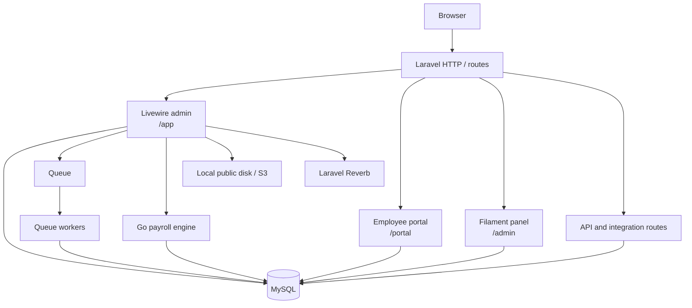
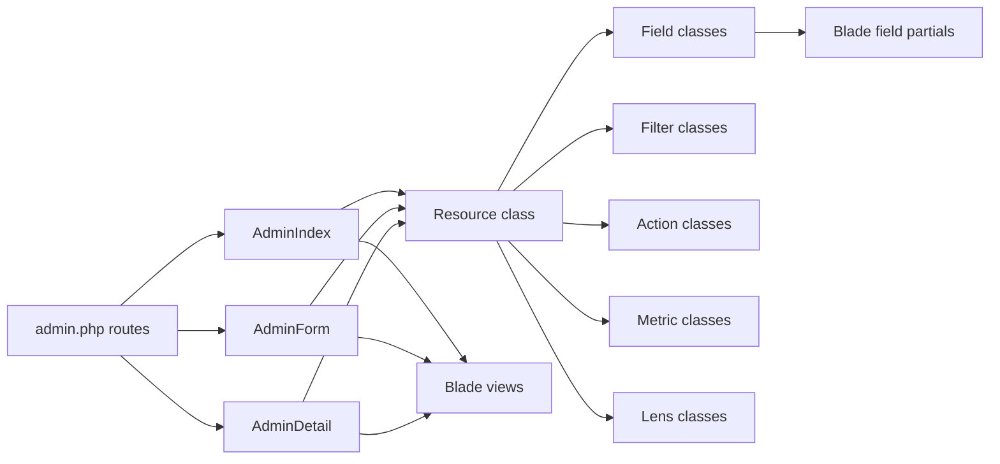
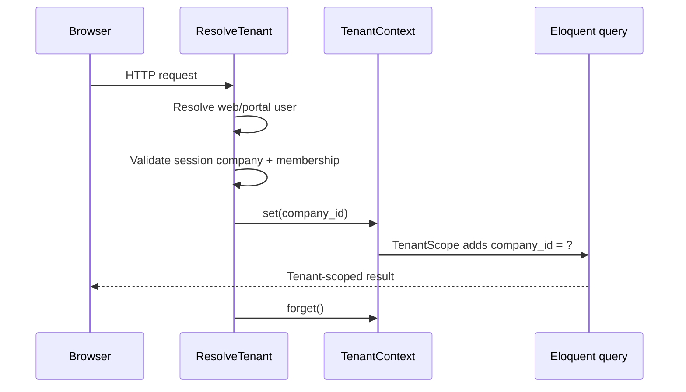
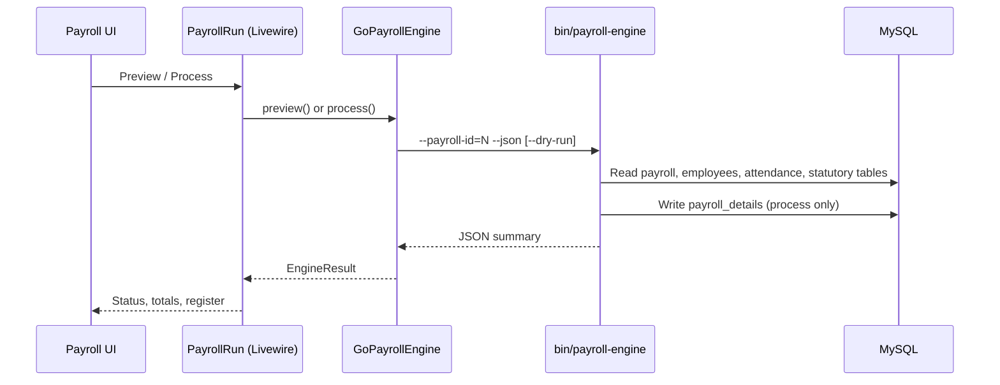

# Architecture

OpenHR PH is a Laravel 13 application with a first-party Livewire admin, a separate employee portal, an optional Filament panel, and a Go payroll engine. This page explains the main layers and the paths a request takes.

## Runtime requirements

- PHP 8.3 or newer
- MySQL 8 in production
- Node 22 for building assets
- Go 1.24 for the payroll engine
- A queue worker and the Laravel scheduler in production
- Optional Redis for cache/queues and Laravel Reverb for WebSockets

Laravel 13 requires PHP 8.3+.

## High-level view

## Request lifecycle

`bootstrap/app.php` configures the application:

- web routes from `routes/web.php`
- API routes from `routes/api.php`
- console routes from `routes/console.php`
- broadcast channels from `routes/channels.php`
- a health endpoint at `/up`
- guest redirects for the portal, admin, and default login
- the `ResolveTenant` middleware on the web and API groups
- the `tenant.api-key` middleware alias for integration routes
- CSRF exceptions for `contis/*` and `face/*`

The admin routes in `routes/admin.php` use the `web` middleware, the `auth` middleware, and the `viewAdmin` gate from `config/admin.php`. The employee portal uses the `portal` guard.

Trusted proxies are configured from `TRUSTED_PROXIES`. Set this to `*` behind an AWS ALB so HTTPS and client IPs are detected correctly.

## The Livewire admin

The first-party admin is intentionally independent of Filament.

### Resources

`App\Livewire\Admin\Resource` is the base class. A resource declares:

- `public static string $model`
- `public static string $title`
- `public static int $priority`
- `public static string $group`
- `public static array $search`
- `fields(Request $request): array`
- optional `indexFields`, `detailFields`, `formFields`, `cards`, `filters`, `actions`, `lenses`
- optional authorization and redirect hooks

`ResourceRegistry` discovers resource classes under `app/Livewire/Admin/Resources`, resolves them by URI key, and sorts them by priority.

### Fields

Field classes live in `app/Livewire/Admin/Fields`. They describe the attribute, component, validation rules, display callbacks, and form behavior. The matching Blade partial lives in `resources/views/livewire/admin/fields` and is wrapped by `resources/views/components/admin/field.blade.php`.

### Filters, actions, metrics, and lenses

- Filters extend `App\Livewire\Admin\Filters\Filter` and implement `apply()` and `options()`.
- Actions extend `App\Livewire\Admin\Actions\Action` and implement `handle()`. They can run on the index, the detail page, a table row, or the index toolbar.
- Metrics extend the metric base class and provide dashboard cards.
- Lenses extend the lens base class and provide alternate index queries.

## Multi-tenancy

The application uses a single database with shared tables, scoped by `company_id`.

Key points:

- `ResolveTenant` runs on web and API requests and resolves the company from the signed-in user, session, membership, or public domain.
- `TenantContext` holds the active company for the request.
- Models using `BelongsToTenant` get a global `TenantScope`. Without a tenant, the scope fails closed.
- Queue payloads carry `company_id`; the tenancy service provider restores and clears it around jobs.
- Cache and media paths use tenant-aware helpers.
- `TENANCY_STRICT=true` turns missing-tenant reads into exceptions instead of silent empty results.

Read the full [multi-tenancy guide](../tenancy.md) before changing tenant-owned models.

## Payroll engine

The Go engine reads MySQL directly and writes payroll details in a transaction. PHP keeps a fallback driver for debugging; it is parity-locked to the Go engine by a shared corpus (`payroll-engine/internal/payroll/testdata/parity`) so both runtimes produce the same payslips. Statutory rates live in effective-dated tables so historical runs remain reproducible.

See [Payroll engine](payroll-engine.md) for build and operation details.

## Queues, events, and broadcasting

- The default queue connection is `database`.
- Large payroll runs are queued; smaller runs process inline.
- The scheduler runs through `php artisan schedule:run` every minute in production.
- Laravel Reverb is available for broadcasting. It is disabled by default in the AWS image; enable it only when you have a WebSocket proxy and the required environment variables.
- Laravel Pennant is available for feature flags.

## Storage

- Local uploads use the `public` disk and `storage/app/public`.
- Some resources use the `s3` disk.
- The AWS image uses local storage on the instance and syncs uploads to S3 nightly. If you run multiple application instances, move media to S3 or shared storage first.

## Laravel 13

The application runs Laravel 13 and requires PHP 8.3+. Keep the framework constraint in `composer.json` and the PHP version in the deployment images in step when you upgrade either one.

## Further reading

- [Admin panel](admin-panel.md)
- [Payroll engine](payroll-engine.md)
- [Testing](testing.md)
- [Multi-tenancy](../tenancy.md)
- [AWS AMI deployment](../deployment/aws-ami.md)
