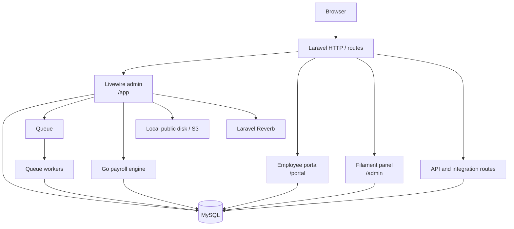
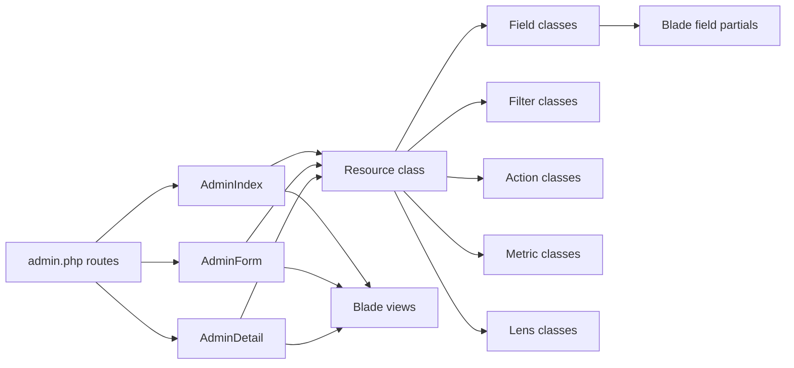
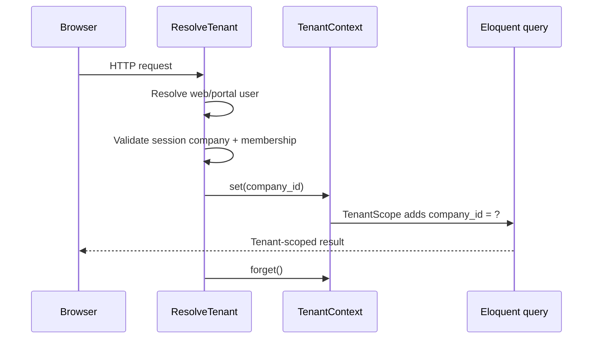
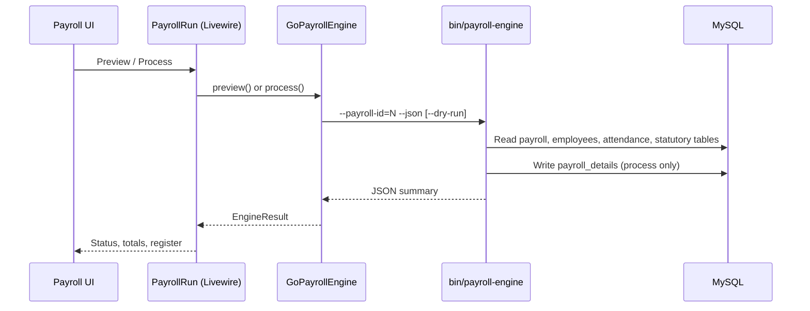

# Architecture

OpenHR PH is a Laravel 13 application with a first-party Livewire admin, a separate employee portal, an optional Filament panel, and a Go payroll engine. This page explains the main layers and the paths a request takes.

## Runtime requirements

- PHP 8.3 or newer
- MySQL 8 in production
- Node 22 for building assets
- Go 1.24 for the payroll engine
- A queue worker and the Laravel scheduler in production
- Optional Redis for cache/queues and Laravel Reverb for WebSockets

Laravel 13 requires PHP 8.3+.

The optional [desktop build](../deployment/desktop.md) runs the same application inside Electron with a bundled PHP
runtime. There NativePHP forces SQLite, so the desktop profile (`App\Providers\DesktopServiceProvider`) selects the PHP
payroll driver and local-first mail, queue, session, and filesystem settings. The web deployment is unchanged.

## High-level view

## Request lifecycle

`bootstrap/app.php` configures the application:

- web routes from `routes/web.php`
- API routes from `routes/api.php`
- console routes from `routes/console.php`
- broadcast channels from `routes/channels.php`
- a health endpoint at `/up`
- guest redirects for the portal, admin, and default login
- the `ResolveTenant` middleware on the web and API groups
- the `tenant.api-key` middleware alias for integration routes
- CSRF exceptions for `contis/*` and `face/*`

The admin routes in `routes/admin.php` use the `web` middleware, the `auth` middleware, and the `viewAdmin` gate from `config/admin.php`. The employee portal uses the `portal` guard.

Trusted proxies are configured from `TRUSTED_PROXIES`. Set this to `*` behind an AWS ALB so HTTPS and client IPs are detected correctly.

## The Livewire admin

The first-party admin is intentionally independent of Filament.

### Resources

`App\Livewire\Admin\Resource` is the base class. A resource declares:

- `public static string $model`
- `public static string $title`
- `public static int $priority`
- `public static string $group`
- `public static array $search`
- `fields(Request $request): array`
- optional `indexFields`, `detailFields`, `formFields`, `cards`, `filters`, `actions`, `lenses`
- optional authorization and redirect hooks

`ResourceRegistry` discovers resource classes under `app/Livewire/Admin/Resources`, resolves them by URI key, and sorts them by priority.

### Fields

Field classes live in `app/Livewire/Admin/Fields`. They describe the attribute, component, validation rules, display callbacks, and form behavior. The matching Blade partial lives in `resources/views/livewire/admin/fields` and is wrapped by `resources/views/components/admin/field.blade.php`.

### Filters, actions, metrics, and lenses

- Filters extend `App\Livewire\Admin\Filters\Filter` and implement `apply()` and `options()`.
- Actions extend `App\Livewire\Admin\Actions\Action` and implement `handle()`. They can run on the index, the detail page, a table row, or the index toolbar.
- Metrics extend the metric base class and provide dashboard cards.
- Lenses extend the lens base class and provide alternate index queries.

## Company management

Companies are platform-wide records (`companies`), while their business data is tenant-scoped by
`company_id`. Company management is deliberately outside the tenant scope:

- `App\Policies\CompanyPolicy` allows platform administrators to manage every company and company
  owners to manage the companies they own. Any owner may create another company.
- `App\Models\User` exposes `isPlatformAdmin()`, `ownsCompany()`, `ownsAnyCompany()`, and
  `tenantIds()`. Platform administrators come from the `users.owner` flag or
  `TENANCY_PLATFORM_ADMINS`; per-company ownership lives on `company_user.is_owner`.
- `App\Services\Company\CompanyProvisioner` seeds a new company's settings, Administrator group,
  payroll group and dates, office, department, employment types, reference rates, and the default
  bank-file template. It runs inside `TenantContext::run()`.
- The `viewAdmin` gate in `AppServiceProvider` now also admits company owners, so a user who owns a
  company can reach the admin workspace even before a group is assigned.
- The Company resource scopes its index to the user's memberships; the `companies` navigation
  permission maps to **Company Settings**.

## Remittances and report centre

- `App\Services\Payroll\RemittanceReport` is the single source for the summary, component, SSS,
  PhilHealth, Pag-IBIG, GSIS, BIR, COA, and loans working papers. The `payroll:remittance` command
  and the admin report centre both call it.
- `App\Services\Payroll\PayrollRegisterReport` backs `payroll:register`.
- `App\Models\PayrollRemittance` stores filing/payment state per payroll and agency.
  `App\Services\Payroll\RemittanceSchedule` derives pending rows from the agency summary and keeps
  filed/paid rows when the schedule is regenerated.
- Routes: `/app/reports/remittances`, `/app/reports/remittances/{payroll}/download/{format}`, and
  `/app/reports/remittances/{payroll}/download-all`. Due-date defaults live in
  `config/payroll.php` under `remittances.due_days`.

## Payroll bank files

- `employees` carries `bank_id`, `bank_account_name`, `bank_account_number`, `bank_branch`, and
  `pay_mode`.
- `App\Models\BankFileTemplate` stores per-company column mappings, delimiters, header/footer
  rows, amount units, and date formats. `App\Services\Payroll\BankFileGenerator` resolves the
  supported `source` keys, applies token replacement, and reports missing or duplicate accounts.
- Routes: `/app/payroll/{payroll}/bank-file` and `/app/payroll/{payroll}/bank-file/download`.
  Company debit accounts are managed through the `company-bank` resource.

## Employee master file and 201 file

- `App\Services\Employees\EmployeeMasterFileQuery` owns the filters, sorting, and CSV columns for
  the master file. The Livewire page and the CSV controller share it.
- Routes: `/app/reports/employee-master-file`, `/app/reports/employee-master-file.csv`, and
  `/app/employees/{employee}/201`. The 201 view is a printable Blade view and uses the same tenant
  scope as the employee record.
- Bank details and statutory identifiers are shown in the master file and 201 file; the 201 file
  uses the `employee_identifiers` rows when present.

## Universal search

`App\Services\Search\GlobalSearchService` groups results into navigation, quick actions, and
records. It respects `ResourceRegistry` sector/jurisdiction filters, resource `viewAny` policies,
and tenant scoping (including `User::forTenant()` for the global users table). The
`App\Livewire\Admin\GlobalSearch` component is mounted once in `layouts.admin` and opens on
`⌘/Ctrl + /`; the AI assistant keeps `⌘/Ctrl + K`.

## Portal UI

The portal and public job board share the admin design tokens (`navy`/`teal`, `ui-*` classes) and
support dark mode. `portal_company_name()` and `portal_company_logo()` are tenant-safe helpers for
unauthenticated screens. Layouts live in `resources/views/layouts/portal*.blade.php` and
`job.blade.php`; shared presentation stays in Blade partials/components so Livewire property and
action names remain unchanged.

## Jurisdictions

An installation serves one country. The country plugin owns statutory law, payroll earning rules, holidays, leave, identifiers, documents and reports. Resolve it through `JurisdictionManager`; a country is a module under `app/Jurisdictions`. See [Jurisdictions](jurisdictions.md).

## Sectors

An installation serves one sector: Government or Private. `App\Sectors\SectorManager`
resolves the active `SectorPolicy` from the installation setting, the legacy
`IS_GOVERNMENT` flag, or the configured default. The policy selects statutory
agencies, catalogues, leave/compensation defaults, document checklists, reports,
settings fields and menu visibility. The jurisdiction's `Config/sector.php` holds the
country differences; `config/sectors.php` only carries the installation default. Rates stay in the effective-dated `statutory_*` tables.

The installer pins every company to the installation sector. Payroll resolves per
company so legacy rows keep working. `Non-Profit` follows the Private policy.

See [Government and Private sectors](sectors.md) for the requirements matrix,
research citations and the policy contract.

## Multi-tenancy

The application uses a single database with shared tables, scoped by `company_id`.

Key points:

- `ResolveTenant` runs on web and API requests and resolves the company from the signed-in user, session, membership, or public domain.
- `TenantContext` holds the active company for the request.
- Models using `BelongsToTenant` get a global `TenantScope`. Without a tenant, the scope fails closed.
- Queue payloads carry `company_id`; the tenancy service provider restores and clears it around jobs.
- Cache and media paths use tenant-aware helpers.
- `TENANCY_STRICT=true` turns missing-tenant reads into exceptions instead of silent empty results.

Read the full [multi-tenancy guide](../tenancy.md) before changing tenant-owned models.

## Payroll engine

The Go engine reads MySQL directly and writes payroll details in a transaction. PHP keeps a fallback driver for debugging; it is parity-locked to the Go engine by a shared corpus (`payroll-engine/internal/payroll/testdata/parity`) so both runtimes produce the same payslips. Statutory rates live in effective-dated tables so historical runs remain reproducible, and the PHP calculators are split per agency (SSS, PhilHealth, Pag-IBIG, BIR) under `App\Jurisdictions\Philippines\Statutory`.

See [Payroll engine](payroll-engine.md) for build and operation details.

## Queues, events, and broadcasting

- The default queue connection is `database`.
- Large payroll runs are queued; smaller runs process inline.
- The scheduler runs through `php artisan schedule:run` every minute in production.
- Laravel Reverb is available for broadcasting. It is disabled by default in the AWS image; enable it only when you have a WebSocket proxy and the required environment variables.
- Laravel Pennant is available for feature flags.

## Storage

- Local uploads use the `public` disk and `storage/app/public`.
- Some resources use the `s3` disk.
- The AWS image uses local storage on the instance and syncs uploads to S3 nightly. If you run multiple application instances, move media to S3 or shared storage first.

## Laravel 13

The application runs Laravel 13 and requires PHP 8.3+. Keep the framework constraint in `composer.json` and the PHP version in the deployment images in step when you upgrade either one.

## Further reading

- [Admin panel](admin-panel.md)
- [Payroll engine](payroll-engine.md)
- [Testing](testing.md)
- [Multi-tenancy](../tenancy.md)
- [AWS AMI deployment](../deployment/aws-ami.md)
