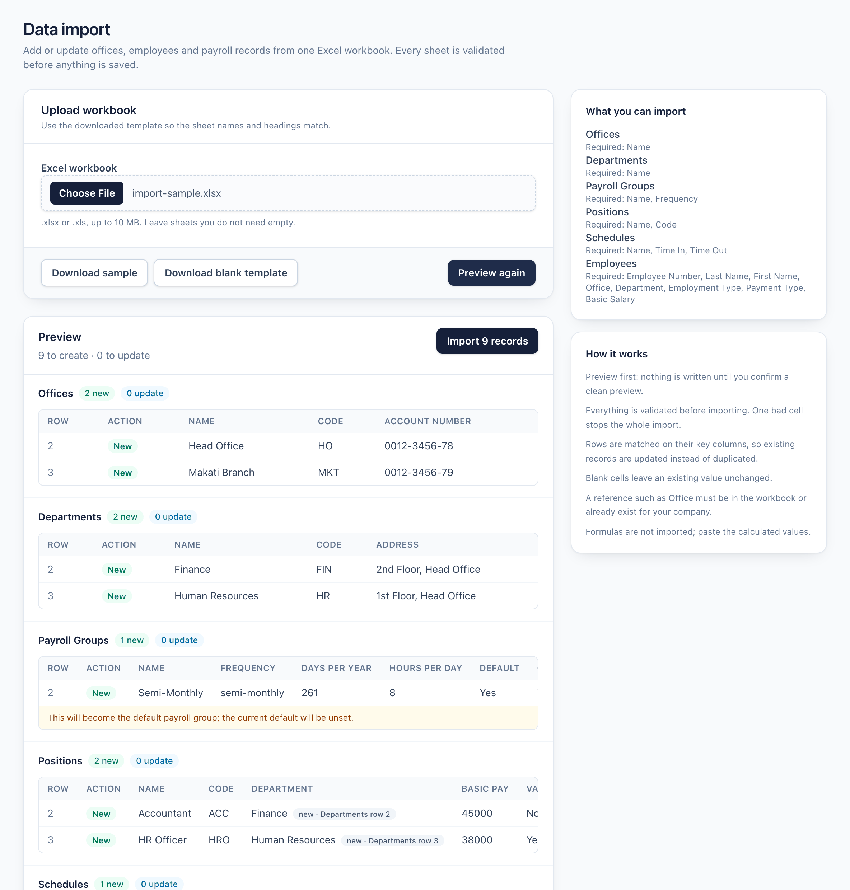

# Data import

This page helps you add or update many records at once from one Excel workbook instead of typing them one by one.

Open **Settings → Company → Data Import**.

You need the admin permission for this area. If the menu entry is missing, ask an administrator to grant it, as described in [Settings and access](settings-and-access.md).

## What one workbook can do

One workbook holds up to six sheets. Each sheet maps to a record type in the workspace:

| Sheet | Brings in | Required columns |
| --- | --- | --- |
| Offices | Offices | Name |
| Departments | Departments | Name |
| Payroll Groups | Payroll groups and their payroll dates | Name, Frequency |
| Positions | Positions (job titles) | Name, Code |
| Schedules | Work schedules and shifts | Name, Time In, Time Out |
| Employees | Employees | Employee Number, Last Name, First Name, Office, Department, Employment Type, Payment Type, Basic Salary |

The sheets are processed in that order, so offices, departments, payroll groups, positions, and schedules exist before the employees that point at them are saved.

- The **Instructions** sheet in the downloaded template is ignored. Any other sheet that is not on this list is reported as a problem, so delete sheets you do not need.
- Leave a sheet empty if you do not need it. An empty sheet is skipped, not treated as an error.
- Each sheet name also accepts the singular form (for example **Office** for **Offices**), and column headings ignore capitals, spacing, punctuation, and a trailing `*`.

## Before you start

- Decide which **company** you are importing into. The import only touches the company you are signed in to.
- Create the **employment types** you use (for example Regular, Probationary) under **Settings → Employee → Employment Type**. Employment types are not part of the workbook, and every employee row needs one that already exists.
- Check existing records you plan to keep. A row that matches an existing record updates it instead of creating a duplicate.

## Step by step

1. Download a template from the upload card:
   - **Download sample** gives a filled-in workbook with example rows, useful to see the expected values.
   - **Download blank template** gives the same sheets and headings with no rows.
2. Fill in the rows you need. Keep the heading row exactly as the template provides it.
3. Select the file and choose **Preview workbook**.
4. Review the preview and fix anything listed under **Import stopped**. Nothing has been saved yet.
5. When the preview has no problems, choose **Import N records**.
6. Read the **Import completed** panel; it lists how many records were created and updated per sheet.

## How the preview decides between New and Update

Each row is matched against existing records using its key columns:

| Sheet | Matching column | A row that matches |
| --- | --- | --- |
| Offices | Name | Updates the office |
| Departments | Name | Updates the department |
| Payroll Groups | Name | Updates the payroll group |
| Positions | Name | Updates the position |
| Schedules | Name | Updates the schedule |
| Employees | Employee Number | Updates the employee |

So re-uploading the same workbook a second time updates the same records instead of creating duplicates.

Two rules keep existing data safe:

- **Blank cells leave the existing value unchanged.** Only the columns with a value are written, so you can fix one field without retyping the whole row.
- **References must exist somewhere.** Office, Department, Payroll Group, Position, and Employment Type values must appear in the workbook or already exist for the company. The importer never creates an employment type for you.

## What the preview shows

The preview is a dry run: it validates every cell and reports what the import would change.

- A **New** or **Update** badge for each row.
- Per-sheet counts of records to create and to update, and a total on the **Import** button.
- The values as they will be saved, with the reference that will be used.
- A `new · Offices row 2` badge when a row points at a record that this same workbook creates, and `existing` when it points at a record that already exists.
- **Warnings** for changes that affect other records, such as a payroll group or schedule that will replace the current default.
- An **Import stopped** panel listing the problems it found, grouped by sheet, with the row, column, heading, and a description.

The panel lists the first 200 problems. If there are more, choose **Download problem report** for a CSV file with all of them.

## Importing is all or nothing

One invalid cell stops the whole workbook; no sheet is saved. Fix the rows in Excel, upload the corrected file, and preview again.

This is deliberate: a payroll group is never saved with half of its employees.

## Accepted values

| Kind of column | What to enter |
| --- | --- |
| Yes/No columns | `Yes` or `No`. `y`, `n`, `true`, `false`, `1`, and `0` also work. |
| Dates | `YYYY-MM-DD` (also `YYYY/MM/DD`, `MM/DD/YYYY`, `DD/MM/YYYY`, or an Excel date cell). |
| Times | `HH:MM` in 24-hour time, for example `08:00` (also `8:00 AM`). |
| Frequency | `monthly` or `semi-monthly`. |
| Payment Type | `monthly` or `daily`. |
| Money | Plain numbers. Currency symbols, commas, and spaces are removed, so `₱50,000` becomes `50000`. |
| Pay Date on Non-Working Day | `Pay date before non working day`, `Pay date after non working day`, or `Remain as schedule pay date`. |
| SSS / PhilHealth / HDMF Schedule | `First Pay`, `Last Pay`, or `Every Pay`. |
| Government numbers | Follow the template examples: TIN `000-000-000-000`, SSS `00-0000000-0`, PhilHealth `00-000000000-0`, HDMF `0000-0000-0000`. |

**Formulas are not imported.** A cell that starts with `=` is reported as a problem. Copy the calculated value and paste it as a number or text.

## Payroll group details

Payroll groups carry the most rules:

- **First Cut-off** and **First Pay Date** are day numbers from 1 to 31 and are required when you create a group.
- **Second Cut-off** and **Second Pay Date** are required for a semi-monthly group and must be left blank for a monthly group.
- The second dates must be later than the first dates.
- A group marked **Default** becomes the default for new employees and unsets the previous default.
- Saving a group generates its payroll dates, so the payroll calendar is ready to use.

## Limits

| Limit | Value |
| --- | --- |
| File types | `.xlsx` or `.xls` |
| File size | 10 MB |
| Data rows per sheet | 5,000 |
| Rows shown per sheet in the preview | 5 (the counts still cover every row) |
| Problems listed on the page | 200 (download the report for the rest) |

An administrator can change these values with the `IMPORT_MAX_UPLOAD_KB`, `IMPORT_MAX_ROWS`, `IMPORT_PREVIEW_ROWS`, and `IMPORT_DISPLAY_PROBLEMS` environment variables.

## What the import does not do

- It does not read formulas; paste the calculated values.
- It does not delete records. Removing rows from the workbook does not remove them from the workspace.
- It does not create employment types, compensations, deductions, loans, users, or portal logins.
- It does not import attendance, leave, or payroll transactions.
- It does not cross company boundaries. Only the signed-in company is affected.

## Common messages

| Message | What to do |
| --- | --- |
| `Required column "Code" is missing from the header row.` | Use the downloaded template, or restore the missing heading. |
| `is not a column of this sheet. Remove it or check the spelling.` | Delete the extra column or correct its heading. |
| `is used more than once.` | Two columns match the same field. Remove one. |
| `... is not part of the import template.` | Delete the extra sheet or rename it to one of the six sheets. |
| `Duplicates row 2. ... must be unique in the sheet.` | Two rows use the same key (for example the same employee number). Keep one. |
| `contains a value but column E has no heading.` | Add the heading or delete the value. |
| `contains a formula.` | Replace the formula with its calculated value. |
| `Office "..." was not found in the Offices sheet or in your company offices.` | Add the office row to the Offices sheet, or create the office first. The same applies to departments, payroll groups, positions, and employment types. |
| `Frequency must be monthly or semi-monthly.` | Correct the spelling. |
| `Monthly payroll groups do not use a second cut-off or second pay date.` | Clear both second date columns. |
| `must be Yes or No.` | Use an accepted Yes/No value. |
| `must be a date written as YYYY-MM-DD.` | Reformat the date. |
| `The TIN must look like 000-000-000-000.` | Correct the government number format. |
| `The workbook does not contain any data rows.` | Fill in at least one sheet and upload it again. |
| `has 6000 data rows; the maximum per import is 5000.` | Split the workbook and import it in batches. |
| `A company must be selected before data can be imported.` | Switch to a company at the top of the screen and try again. |
| The page does not react when you choose **Preview workbook**. | Refresh the page and try again. If it still does not respond, report it to your administrator; see [Troubleshooting](troubleshooting.md). |

## Related pages

- [Employees](employees.md) — the fields an employee row fills in.
- [Settings and access](settings-and-access.md) — offices, departments, employment types, schedules, and payroll groups.
- [Payroll](payroll.md) — what a correct payroll group produces.
- [Troubleshooting](troubleshooting.md) — when an import file will not go through.
