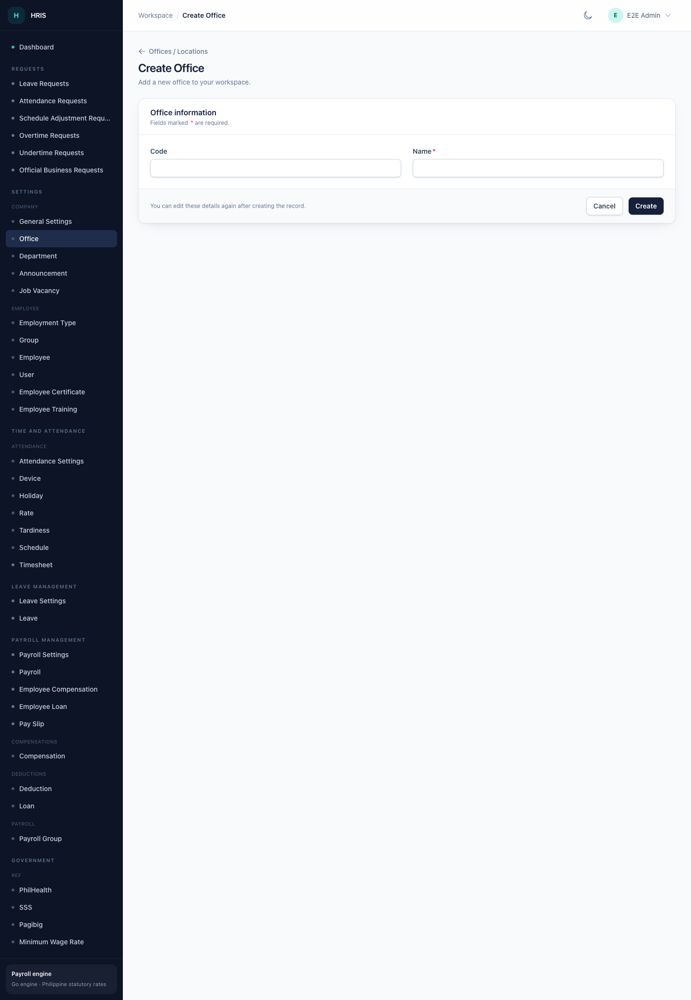

# Employees

This page helps you keep employee records complete and ready for attendance and payroll.

## Before you start

- Decide on a consistent employee-number format. Payroll and attendance reports use it.
- Prepare the employee's office, department, position, employment type, schedule, and payroll group.
- Have the employee's government numbers and salary details ready.
- Check whether the employee needs a portal login. If so, you will set an email and password on the employee record.

## Find an employee

1. Open **Settings → Employee → Employee**.
2. Use the search box to search by name, employee number, or another visible column.
3. Use the filters to narrow the list.
4. Select a row to view it, or choose **Edit** to change it.

## Create an employee

1. Select **Create Employee**.
2. Fill in the required fields. Fields marked with **\*** are required.
3. Work through the sections in order:
   - **Identity** — employee number, name, biometric ID, and contact details.
   - **Assignment** — office, department, position, employment status, and employment type.
   - **Schedule and payroll** — schedule, payroll group, payment type, basic salary, and daily rate.
   - **Government numbers** — TIN, SSS, PhilHealth, and Pag-IBIG/HDMF.
   - **Leave balances** — vacation, sick, and personal leave totals.
   - **Portal access** — login email and password if the employee will use the employee portal.
4. Select **Create**.

The employee now appears in the list and can be selected in attendance and payroll screens.

## Edit an employee

1. Find the employee in the list.
2. Select **Edit**.
3. Change the details.
4. Select **Update**.

Changes to salary, payroll group, or schedule can affect future payroll runs. Review the payroll preview after making these changes.

## Related employee records

The employee detail page can show related records such as:

- allowances and recurring allowances
- bonuses and commissions
- deductions and loans
- schedules
- certificates and trainings
- plantilla items
- compensation history

Open the related record from the employee detail page or from the relevant menu under **Payroll Management** or **Settings**.

## Import employees

If your group has access to the import action, you can add many employees from a spreadsheet.

1. Open the Employee list.
2. Choose the import action from the toolbar.
3. Download or prepare the template expected by the import.
4. Fill in the rows. Keep employee numbers unique.
5. Upload the file and confirm the import.
6. Review the imported rows and fix any validation errors.

Start with a small file of two or three employees before importing a large batch.

## Before the first payroll run

Check the following for every employee who should be paid:

- Employee number and name are correct.
- Office, department, position, and employment status are set.
- Payroll group and payment type are set.
- Basic salary and daily rate are correct.
- Government numbers are present where required.
- Schedule and attendance records are up to date.
- Allowances, deductions, and loans have the correct effectivity dates.
- The employee is active and not marked as resigned or retired.

See [Payroll](payroll.md) for the next step.

## Common questions

**Why can I not see the Employee menu?**
Your group may not have the Employees permission. Ask your administrator.

**Why is an employee missing from payroll?**
Check the employee's payroll group, employment status, date hired, and attendance for the period. Also confirm that the payroll run includes the correct payroll group.

**Can I delete an employee?**
Deletion is controlled by your permissions and may be a soft delete. If you need to remove someone who has payroll history, ask your administrator before deleting. Consider marking the employee inactive or resigned instead so history stays intact.
