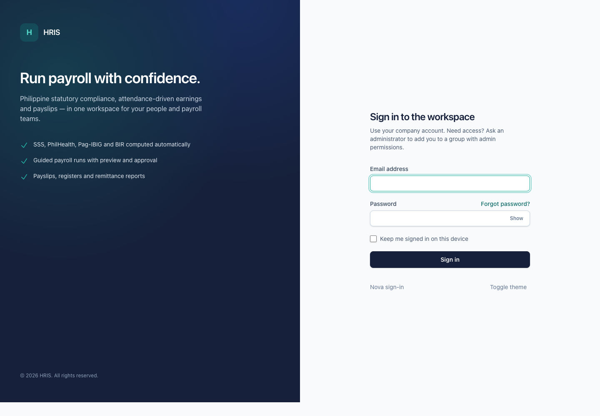
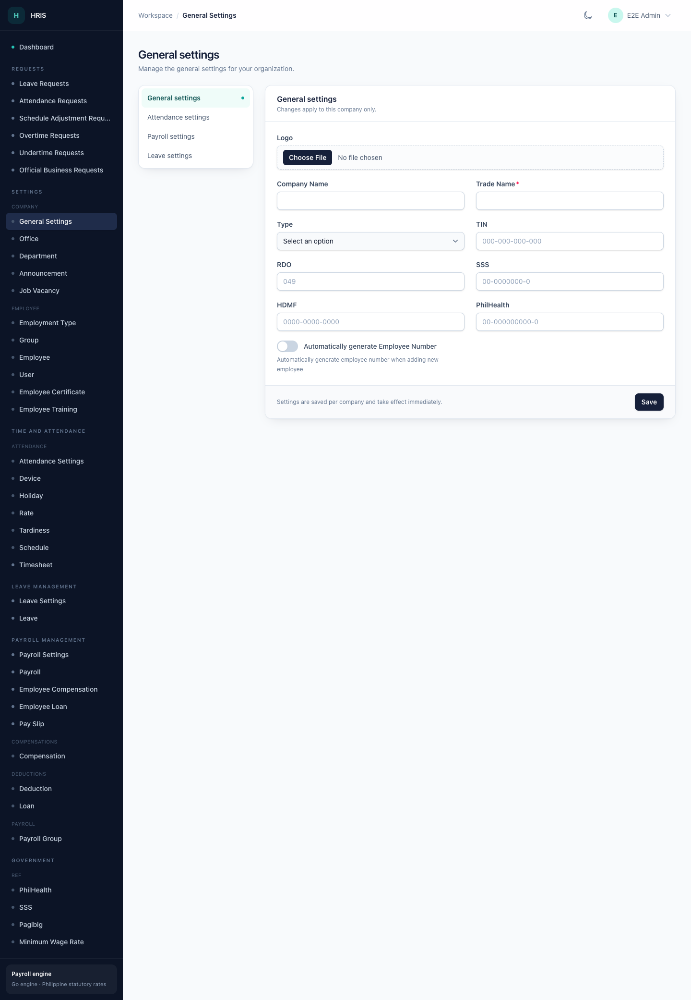
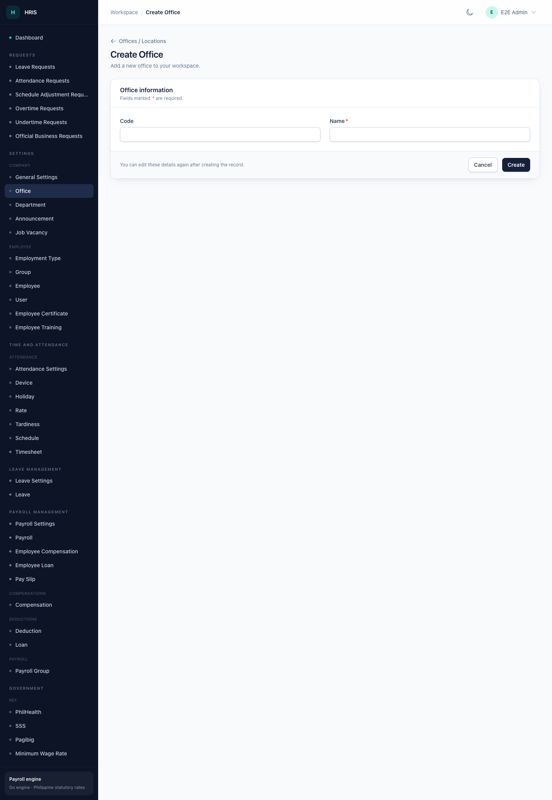

# Company to payslip: a step-by-step setup guide

This guide takes you from a newly created company to a printed payslip. Follow the steps in order the first time you set up payroll, then use the individual feature guides for day-to-day work.

The guide assumes:

- your company record and your company owner sign-in already exist, created once by your system administrator;
- you can sign in to the admin workspace at `/app`;
- you are setting up the first payroll for the active company.

> **Where the company record comes from:** the admin workspace has no **Create Company** screen. A system administrator creates the company record and the first owner sign-in once from the server with `php artisan admin:create`. If you cannot sign in, or the header shows no company, ask your administrator before continuing. From Step 2 onward, everything in this guide — the company profile, employees, payroll, and payslips — is done in the browser.

This guide marks each major screen with a placeholder line, for example:

> **Screenshot placeholder** — Screen name (`file-name.png`).

Replace the placeholders with your own screenshots when you localise the guide for your team.

## Who does what

| Steps | Usually done by |
| --- | --- |
| 1–4, 6, and 7: sign-in, company profile, defaults, reference data, payroll group, employee | Company owner or HR administrator |
| 5: statutory tables | Payroll administrator on the server |
| 8: employee portal access | HR administrator |
| 9–15: attendance, payroll run, approval, payslip | Payroll officer |
| 16: corrections and reopening | Payroll officer, with a company owner for a reopen |

## Before you begin

Have the following ready:

- The OpenHR PH address and your sign-in email and password.
- The company's registered name, trade name, TIN, RDO code, and SSS, PhilHealth, and Pag-IBIG/HDMF employer numbers.
- The payroll calendar: pay frequency (monthly or semi-monthly), timesheet cut-off days, and pay dates.
- The employee's details: name, employee number, office, department, position, employment type, salary, and government numbers.
- A decision on whether the employee needs an employee-portal login.

**Terms used in this guide**

| Term | Meaning |
| --- | --- |
| **Payroll group** | The pay rules and schedule, such as monthly or semi-monthly. |
| **Payroll run** | One pay period processed for a payroll group. |
| **Cut-off** | The last day of the attendance period that a payroll run covers. |
| **Payslip** | The employee-level result of a processed payroll run. |

## Step 1 — Sign in and confirm the active company

1. Open `/app/login`.
2. Enter your **Email address** and **Password**. Use the eye button if you need to check the password you typed.
3. Leave **Keep me signed in on this device** ticked only on a computer you trust.
4. Select **Sign in**.

**Expected result:** the **Dashboard** opens and the sidebar shows the areas your account can use.

If your account belongs to more than one company, a company switcher appears in the header:

1. Select the current company name in the header.
2. Choose the company you want to work in.
3. Wait for the page to reload.

Every setting and record belongs to the active company. Check the company name before you create anything.

> If a menu item is missing, your group does not have that permission. Ask an administrator to update your group. See [Settings and access](settings-and-access.md).

## Step 2 — Create the company profile

Your company record exists, but it holds little more than a name. The company profile supplies the details that are printed on payslips and statutory reports, so complete it before you add employees.

1. Open **Settings → Company → General Settings**.
2. Complete the fields:

   | Field | What to enter |
   | --- | --- |
   | Logo | Optional company logo. |
   | Company Name | The registered company name. This is used on payslip PDFs. |
   | Trade Name | **Required.** The name the company trades under. |
   | Type | **Private**, **Government**, or **Non-Profit**. |
   | TIN | The company taxpayer identification number, for example `000-000-000-000`. |
   | RDO | The Revenue District Office code, for example `049`. |
   | SSS | The employer SSS number, for example `00-0000000-0`. |
   | HDMF | The employer Pag-IBIG/HDMF number, for example `0000-0000-0000`. |
   | PhilHealth | The employer PhilHealth number, for example `00-000000000-0`. |
   | Automatically generate Employee Number | Leave off unless your team has agreed on automatic employee numbering. |

3. Select **Save**.

**Expected result:** a green **Settings saved.** message appears and the values remain after you reload the page.

The company is now set up for payroll: the profile you saved is the record that payroll, payslips, and statutory reports read. There is nothing else to create at company level, and there is no company list to maintain. If you need a second company, ask your system administrator; each company keeps its own people, payroll, and settings.

> **Wrong company name on the page?** Stop and check the company switcher in the header before you continue. Settings apply to the active company only.

## Step 3 — Set the company defaults

Review these company defaults before you run payroll. They apply to the whole company.

### 3.1 Attendance settings

1. Open **Time and Attendance → Attendance Settings**.
2. Set:

   | Field | What to enter |
   | --- | --- |
   | Maximum Pairing hours | The longest span, in hours, that OpenHR PH may pair into one attendance record (1–24). |
   | Minimum Pairing range | The minimum number of minutes OpenHR PH will pair (0–24). |
   | Night Shift Differential Start | The start of the night differential window. The default is `22:00`. |
   | Night Shift Differential End | The end of the night differential window. The default is `06:00`. |
   | Automatically mark absent | Turn on only if a missing timesheet should become an absence automatically. |

3. Select **Save**.

### 3.2 Payroll settings

1. Open **Payroll Management → Payroll Settings**.
2. Set:

   | Field | What to enter |
   | --- | --- |
   | Total number of days in a year | Paid days for daily-paid employees on a Monday–Friday schedule. The default is 261; the maximum is 265. |
   | SSS payment schedule for semi-monthly | **First Pay**, **Last Pay**, or **Every Pay**. |
   | Philhealth payment schedule for semi-monthly | **First Pay**, **Last Pay**, or **Every Pay**. |
   | HDMF payment schedule for semi-monthly | **First Pay**, **Last Pay**, or **Every Pay**. |
   | Total number of days in a year | Paid days for daily-paid employees on a Monday–Saturday schedule. The default is 313 (365 days minus 52 Sundays). |
   | Deduct Withholding Tax | Turn on to deduct withholding tax. |
   | Automatically compute overtime | Turn on to compute overtime from timesheets. |
   | Minutes qualified for overtime | The minimum number of minutes before overtime counts. The default is 60. |
   | Automatically compute night differential | Turn on to compute night differential from timesheets. |
   | Payslip Logo | Optional image, maximum 400 by 100 pixels. |
   | Display logo in payslip | Turn on to print the payslip logo. |

3. Select **Save**.

> **Two fields share the label “Total number of days in a year”.** The first is for Monday–Friday schedules and the second, lower on the page, is for Monday–Saturday schedules. Use the help text under each field to tell them apart.

### 3.3 Leave setup

Open **Leave Management → Leave Settings**. The current admin page has no configurable fields; leave types are managed as records instead.

To add a leave type:

1. Open **Leave Management → Leave**.
2. Select **Create Leave Types**.
3. Enter a **Name**, optional **Code** and **Description**, the **Allow per year**, and turn on **Active**.
4. Select **Create**.

**Expected result for Step 3:** each settings page shows **Settings saved.**, and the values persist for the active company.

## Step 4 — Create the reference data payroll needs

Create these records in the order shown. The payroll group and employee forms use them in dropdown lists, so creating them first avoids empty selections.

| Order | Record | Where |
| --- | --- | --- |
| 1 | Office | **Settings → Company → Office** |
| 2 | Department | **Settings → Company → Department** |
| 3 | Employment Type | **Settings → Employee → Employment Type** |
| 4 | Schedule | **Time and Attendance → Schedule** |
| 5 | Holiday | **Time and Attendance → Holiday** |

### 4.1 Create an office

1. Open **Settings → Company → Office**.
2. Select **Create Office**.

3. Enter a **Code**, for example `HQ`, and a **Name**, for example `Head Office`. **Name** is required.
4. Select **Create**.

**Expected result:** the office appears in the list and in the **Office** dropdown on the employee form.

### 4.2 Create a department

1. Open **Settings → Company → Department**.
2. Select **Create Department**.
3. Enter a **Code** and a **Name**. **Name** is required.
4. Optionally enter an **Address**.
5. Leave **Attendance Approval**, **Overtime Approval**, and **Leave Approval** empty for now. These fields list employees, so set them after you have added the approvers in Step 7.
6. Select **Create**.

**Expected result:** the department appears in the list and in the **Department** dropdown on the employee form.

> After you create the employee records, return to the department and set the approval employees.

### 4.3 Create an employment type

1. Open **Settings → Employee → Employment Type**.
2. Select **Create Employment Type**.
3. Enter a **Code** and a **Name**, for example `Regular`, `Probationary`, or `Contractual`. **Name** is required, and the code must be unique.
4. Leave **Payroll** turned on for types that are paid through payroll.
5. Select **Create**.

**Expected result:** the type appears in the **Employment Type** dropdown on the employee form.

> **Payroll** on the employment type marks the type as payroll-related. Being included in a payroll run still depends on the employee having a **PayrollGroup**.

### 4.4 Create a schedule

1. Open **Time and Attendance → Schedule**.
2. Select **Create Schedule**.
3. Enter a **Name**, for example `8am–5pm, Monday to Friday`.
4. Enter the **Time In** and **Time out**. Both are required. Use 24-hour time, for example `08:00` and `17:00`.
5. Enter the **Break Time Start** and **Break Time End** if the schedule has a break.
6. Turn on **Default Schedule** for the schedule new employees should receive automatically.
7. Leave **Active** turned on.
8. Select **Create**.

**Expected result:** the schedule appears in the list. New employees receive the default schedule when their record is created.

### 4.5 Add holidays

1. Open **Time and Attendance → Holiday**.
2. Select **Create Holidays**.
3. Enter the **Name**, choose the **Type**, and set the **Date**. **Type** can be **Special Working Holiday**, **Special Non-Working Holiday**, **Regular Holiday**, **Double Regular Holiday**, or **Regular Holiday, Special Holiday**.
4. Select **Create**.
5. Repeat for each holiday in the payroll year.

**Expected result:** the holidays appear in the list and are used when payroll computes holiday pay.

> The **+** button beside a dropdown on the employee form can also create a missing office, department, or payroll group without leaving the form.

## Step 5 — Confirm the statutory tables

Payroll contributions and withholding tax come from effective-dated SSS, PhilHealth, Pag-IBIG, and BIR tables. The payroll administrator maintains them on the server, and OpenHR PH uses the rows whose effectivity covers each payroll date.

Before the first run:

1. Ask your payroll administrator to confirm that statutory tables exist for the payroll period.
2. Confirm the rates have been checked against the latest official issuance.
3. Do not enter or guess statutory rates yourself.

> The **Government → Ref** pages in the admin workspace are legacy reference screens. Changing them does not change the rates used by the current payroll engine. If a statutory deduction looks wrong, stop and ask your payroll administrator to confirm the effective-dated tables.

## Step 6 — Create the payroll group

The payroll group decides how often employees are paid and which cut-off and pay dates apply. Create at least one group before you add employees, so you can assign them to it.

1. Open **Payroll Management → Payroll Group**.
2. Select **Create Payroll Groups**.
3. Complete the fields:

   | Field | What to enter |
   | --- | --- |
   | Name | **Required.** A clear name, for example `Semi-monthly — Head Office`. |
   | days/year | Paid days in the year. Use 261 for Monday–Friday or 313 for Monday–Saturday, matching **Payroll Settings**. |
   | No. of hours | Required hours per day, for example `8`. |
   | Period | **Required.** **Monthly** or **Semi-Monthly**. |
   | Default | Turn on to use this group as the default when creating a payroll. |
   | First Timesheet Cut-off | **Required once a period is chosen.** The day of the month that closes the first timesheet. |
   | First Pay date | **Required once a period is chosen.** The day of the month employees are paid for the first period. |
   | Second Timesheet Cut-off | Semi-monthly only. The day of the month that closes the second timesheet. |
   | Second Pay date | Semi-monthly only. The day employees are paid for the second period. |
   | Pay Date on non-working day? | **Required.** Pay before, pay after, or keep the scheduled pay date. |
   | Computer Tardiness | Turn on to deduct tardiness. |
   | Computer Overbreak | Turn on to deduct overbreak. |
   | Computer Undertime | Turn on to deduct undertime. |

4. Select **Create**.

OpenHR PH fills suggested dates when you choose the period:

| Period | Suggested first cut-off / pay date | Suggested second cut-off / pay date |
| --- | --- | --- |
| Semi-Monthly | 10th / 15th | 25th / 30th |
| Monthly | 25th / 30th | Not applicable |

**Expected result:** the payroll group appears in the list, and OpenHR PH generates open payroll dates from three months before today to three months after today. Those dates become the **Payroll Date** choices when you create a payroll run.

> **Changing dates later:** saving an existing payroll group with new cut-off or pay dates replaces its open payroll dates. Payroll runs that were already created keep their original period.
>
> **Statutory payment schedules:** when SSS, PhilHealth, and HDMF contributions are deducted is configured during payroll setup. If you need to change the schedule, ask your payroll administrator.

## Step 7 — Create the employee

> **Screenshot placeholder** — Create Employee form, Payroll section (`employee-create-payroll.png`).

1. Open **Settings → Employee → Employee**.
2. Select **Create Employee**.
3. Complete the sections below. Fields marked with an asterisk (`*`) are required.
4. Select **Create**.

### Identity and assignment

| Field | What to enter |
| --- | --- |
| Employee Number \* | A number that is unique within the company. |
| Last Name \* | Family name. |
| First Name \* | Given name. |
| Middle Name | Optional. |
| Office \* | The office created in Step 4.1. |
| Department \* | The department created in Step 4.2. |
| Position | Job title, for example `HR Specialist`. |
| Immediate Head | Optional. The employee's supervisor. |
| Employment Type \* | The type created in Step 4.3. |
| Date hired | First day of work. |
| Date Resigned | Appears when the selected employment type is resigned or terminated. |
| Other Remarks | Appears when the selected employment type is resigned or terminated. |
| Biometric ID | The ID used by the biometric device, if any. |
| Resume/Requirements | Optional upload with a description. |

### Payroll

| Field | What to enter |
| --- | --- |
| Payment Type \* | **Monthly Paid** or **Daily Paid**. |
| Monthly Basic Salary / Daily Rate | The label changes with the payment type. Enter the agreed rate. |
| Monday to Friday only? | Leave ticked for a five-day week. Untick it when weekends are paid. |
| Minimum wage | Turn on only if the employee is paid at the minimum wage. |
| PayrollGroup | The payroll group created in Step 6. **Set this**, or the employee will not appear in a payroll run. |

### Government

Enter the **TIN Number**, **SSS Number**, **PhilHealth Number**, and **HDMF** number, using the formats shown as placeholders. These are used for statutory contributions and remittance reports.

### Benefits

The switches record which benefits apply to this employee: **Timesheet required**, the holiday pay types, **Rest Day Pay**, **Overtime**, **De Minimis**, and **Night Differential**. They are on by default. Turn one off only when the employee is not entitled to it.

### Leave

Enter the **Total vacation leave**, **Total sick leave**, and **Total personal leave** balances.

### Portal Login

Enter an **Email** and **Password** only if the employee will use the employee portal. OpenHR PH creates or updates the portal account when you save the employee. Leave both blank for employees who only need payroll.

> **Enter both fields together.** Saving an email while the password field is empty replaces the existing portal password with an empty one. Re-enter the email and a new password in the same save to restore access. Step 8 explains what the employee can do with this account.

### Related Records

After you save the employee, the detail page lists **Compensations**, **Deductions**, **Loans**, **Certificates**, and **Trainings**. These lists are read-only. Add compensation and loan records from **Payroll Management → Employee Compensation** and **Employee Loan**, and certificate and training records from **Settings → Employee → Employee Certificate** and **Employee Training**. For deductions, allowances, bonuses, and commissions, ask your administrator which record to add.

**Expected result:** the employee record opens on its detail page and appears in the Employee list. OpenHR PH assigns the default schedule, if one is set. The employee is now available in attendance and payroll screens.

> **Different schedule?** Open the employee and use **Assign Employee Schedule** on the detail page.
>
> **No PayrollGroup?** Edit the employee and set one before you process payroll. Employees without a payroll group are skipped.

## Step 8 — Give the employee portal access

The employee portal is optional. Use it when employees should submit their own requests or check their own attendance. It has its own sign-in, separate from the admin workspace, and it does not show payslips.

1. Open **Settings → Employee → Employee** and edit the employee.
2. In **Portal Login**, enter the employee's **Email** and a **Password**.
3. Select **Save**.

**Expected result:** the employee can sign in at `/portal/login` with that email and password.

> **Screenshot placeholder** — Employee portal dashboard (`portal-dashboard.png`).

What the employee can do in the portal:

| Area | What the employee can do |
| --- | --- |
| **Dashboard** | Read company announcements. |
| **Leaves** | Submit leave requests and follow their status. |
| **Attendance** | Submit attendance requests and open the attendance report. |
| **Schedules** | View the schedule and submit schedule adjustment requests. |
| **Overtimes**, **Undertimes**, **Official Business** | Submit the matching request. |

Requests raised in the portal arrive in the admin workspace under **Requests**. A payroll officer approves or rejects them before the payroll cut-off, which is the review described in Step 9.

> **Payslips are not in the portal.** Payroll staff print or download the payslip from the payroll register, as described in Step 15.
>
> **Forgotten password?** Re-enter the email and a new password on the employee record and save. The portal has no self-service password reset.

## Step 9 — Record attendance before the cut-off

> **Screenshot placeholder** — Timesheet list with the import and generate actions (`timesheet-list.png`).

Payroll uses attendance to compute absences, tardiness, overtime, night differential, and holiday pay. For the period you are about to run:

1. Open **Time and Attendance → Timesheet**.
2. Use **Import Time Sheet** to load a biometric or timesheet file, or **Generate Time Sheet** for the period.
3. Review missing entries, absences, and corrections before the cut-off.
4. Approve any attendance, overtime, leave, undertime, or official business requests that affect the period.

If attendance is missing, the payroll preview still runs, but it may warn that an employee has no attendance recorded and pay on basic salary. See [Attendance and requests](attendance-and-requests.md) for the full workflow.

## Step 10 — Create the payroll run

1. Open **Payroll Management → Payroll**.
2. Select **Create Payroll**.
3. Choose:

   | Field | What to choose |
   | --- | --- |
   | Group | **Required.** The payroll group created in Step 6. The default group is preselected if one is set. |
   | Payroll Date | **Required.** The pay period. Each choice shows the pay date followed by the attendance period in brackets, for example `Nov 15, 2026 (Oct 26, 2026 to Nov 10, 2026)`. |

4. Select **Create**.

**Expected result:** OpenHR PH saves the payroll and opens its detail page. The status is **open**. Return to **Payroll Management → Payroll** to see the new row, which has a **Run payroll** link.

> **Payroll Date is empty?** The payroll group has no open payroll dates. Open the payroll group, confirm its cut-off and pay dates, and save it again to regenerate the dates.

## Step 11 — Preview the payroll

> **Screenshot placeholder** — Payroll run page with summary cards and the register (`payroll-run-preview.png`).

Preview is a dry run. It calculates the period without saving final payroll details.

1. In **Payroll Management → Payroll**, select **Run payroll** on the new row.
2. Wait for the preview to finish. OpenHR PH previews automatically when an open, draft, or failed payroll is opened.
3. Review the four summary cards: **Employees**, **Gross pay**, **Deductions**, and **Net pay**.
4. Read the warnings panel, if one appears. Warnings such as missing attendance or no payable days tell you where the data is incomplete.
5. Check the **Payroll register** row by row. The columns are **Employee**, **Gross**, **SSS**, **PhilHealth**, **Pag-IBIG**, **Tax**, **Deductions**, **Net pay**, and **Payslip**.
6. If you change any data, return to this page and select **Refresh preview**.

**Expected result:** the summary cards show totals, and each employee appears in the register with gross pay, statutory deductions, tax, total deductions, and net pay. The **Payslip** column shows **Process first** until the payroll is processed.

> Preview is safe to repeat. It does not create payslips or lock any amounts.

## Step 12 — Process the payroll

1. Select **Process payroll**.
2. Confirm **Process this payroll now? Details will be recalculated.**
3. Wait while the status is **running**. The page refreshes automatically.
4. When processing finishes, the status becomes **processed**.

**Expected result:** OpenHR PH saves the payroll register, the totals are final for review, and each row has a **View** link in the **Payslip** column.

> Small payrolls are processed immediately. Larger payrolls are queued, so keep the page open until the status changes, or reopen the payroll later from **Payroll Management → Payroll**.
>
> If processing fails, the status becomes **failed**. Read the error on the page, fix the data, and select **Process payroll** again.
>
> Processing a payroll that is already **processed** recalculates it and replaces the saved details. Only process again after you have corrected the underlying data.

## Step 13 — Review before approving

Check the register and totals against your own computation:

- [ ] Every expected employee appears, and no unexpected employee appears.
- [ ] **Gross** includes regular pay, overtime, night differential, holiday pay, rest day pay, and any absence deduction.
- [ ] **SSS**, **PhilHealth**, **Pag-IBIG**, and **Tax** match the statutory tables for the period.
- [ ] **Deductions** equals the sum of the statutory deductions, tax, and any other deduction shown for the run.
- [ ] **Net pay** equals gross pay minus total deductions.
- [ ] Attendance-driven items such as absences and tardiness look correct.

Do not approve a payroll when a total looks wrong. Correct the data, then select **Process payroll** again.

## Step 14 — Approve and lock the payroll

**Approve & lock** appears only when the status is **processed**.

1. Select **Approve & lock**.
2. Confirm **Approve and lock this payroll?**

**Expected result:** the status becomes **approved**. The payroll is locked, and its figures are protected for payslips and reports.

If a change is needed after approval, a **company owner** must select **Reopen** and enter a reason. The payroll returns to **processed** so it can be corrected, recalculated, reviewed, and approved again. Users who are not company owners cannot reopen a payroll. Step 16 covers the whole correction cycle.

## Step 15 — Open, print, or download the payslip

> **Screenshot placeholder** — Printed payslip with earnings, deductions, and net pay (`payslip-print.png`).

Processing the payroll creates one payslip for each employee in the register.

1. Open the payroll run from **Payroll Management → Payroll**.
2. Find the employee in the **Payroll register**.
3. Select **View** in the **Payslip** column.
4. On the payslip page, choose:
   - **Print** to print the page, or
   - **Download PDF** to open the PDF version in a new tab.

**Expected result:** the payslip opens with the employee's name, employee number, and position, plus the pay date and attendance period.

The payslip shows:

| Section | Contents |
| --- | --- |
| Earnings | Basic pay, regular pay, overtime, night differential, rest day, holiday, allowances, and incentives. Zero-value lines are hidden. |
| Absences | The number of absent days and the corresponding amount, when applicable. |
| Gross pay | Total earnings for the period. |
| Deductions | SSS, PhilHealth, Pag-IBIG, and withholding tax. |
| Total deductions | The sum of the deductions. |
| Net pay | Take-home pay for the period. |
| Footer | Employer share, taxable income, and payroll number. |

> **The Pay Slip menu is not an individual payslip.** **Payroll Management → Pay Slip** lists payroll records. Open an individual employee's payslip from the payroll register as described above.

## Step 16 — Day two: corrections and reopening

Payroll is a repeating cycle, not a one-off. Use this section after the first run.

### Correct data before you approve

| Problem | Where to fix it |
| --- | --- |
| Missing or wrong time entries | **Time and Attendance → Timesheet**, the **Time** row action, then **Update** |
| Pending leave, overtime, undertime, official business, attendance, or schedule requests | **Requests** — approve or reject each one |
| Wrong salary, allowance, or recurring pay | **Payroll Management → Employee Compensation** |
| New or finished loan | **Payroll Management → Employee Loan** |
| Employee missing from the run | **Settings → Employee → Employee** — set the **PayrollGroup** |

After correcting anything, select **Refresh preview** on an open payroll, or **Process payroll** to recalculate a payroll that is open, processed, or failed. Nothing is final until you approve it.

### Reopen an approved payroll

Approving locks the figures and posts the accounting entries, so reopening is restricted and recorded.

1. Open the payroll with the status **approved**.
2. Type the reason in the box beside the **Reopen** button. The reason is required.
3. Select **Reopen** and confirm the prompt.

**Expected result:** the status returns to **processed**, the approval is cleared, and the reason is written to the audit trail. The posted entries are reversed. Correct the data, select **Process payroll**, review the register, then **Approve & lock** again.

> **Only a company owner can reopen.** Other users see the button but the action is refused. Ask the owner.
>
> **Payslips already printed do not change.** Reprint or re-download them after re-approving so employees receive the corrected figures.

### What a change does not do

- Editing an employee's salary, government numbers, or payroll group never rewrites an approved payroll.
- Adding a compensation, loan, or deduction record affects only payrolls processed after the change takes effect.
- Attendance edits made after approval do not change the approved figures; you must reopen and reprocess.

## Payroll status reference

The payroll list shows these status values in lower case.

| Status | Meaning | What to do next |
| --- | --- | --- |
| **open** | The payroll exists but has not been processed. | Preview, then process. |
| **running** | OpenHR PH is calculating the payroll. | Wait for the page to refresh. |
| **processed** | Details are saved and ready for review. | Review, then approve. |
| **approved** | The payroll is locked. | Open payslips or reports. A company owner can reopen it if needed. |
| **closed** | The payroll is final. | No further changes expected. |
| **failed** | Processing stopped with an error. | Read the error, fix the data, and process again. |

## Completion checklist

- [ ] Signed in and confirmed the correct active company.
- [ ] General Settings show the correct trade name and statutory numbers.
- [ ] Attendance, payroll, and leave defaults reviewed.
- [ ] Office, department, employment type, schedule, and holidays created.
- [ ] Statutory tables confirmed for the payroll period with the payroll administrator.
- [ ] Payroll group created with the correct period, cut-offs, and pay dates.
- [ ] Employee created with a payroll group, salary, and government numbers.
- [ ] Portal access given to the employees who need it, or deliberately skipped.
- [ ] Attendance imported or generated for the period.
- [ ] Payroll previewed and warnings resolved.
- [ ] Payroll processed and totals reviewed.
- [ ] Payroll approved and locked.
- [ ] Payslip opened and printed or downloaded.
- [ ] Any correction made after approval handled through the reopen cycle in Step 16.

## If something is not right

| Symptom | Likely cause | What to do |
| --- | --- | --- |
| No **Payroll Date** choices | The payroll group has no open payroll dates. | Open the payroll group, confirm the cut-off and pay dates, and save it again. |
| An employee is missing from the register | No payroll group, or the employee belongs to another group. | Edit the employee and set the correct **PayrollGroup**. |
| Gross pay is zero or low | No attendance, no salary, or no payable days in the period. | Check the employee's salary and timesheet, then preview again. |
| Statutory deductions are zero | The employee has no gross pay, or the salary is below the contribution floor. | Check the employee's salary and preview again. If the amount still looks wrong, ask your payroll administrator. |
| **Process payroll** is not shown | The payroll is approved or closed. | Ask a company owner to **Reopen** it. |
| The payroll stays at **running** | The queue worker or payroll engine is unavailable. | Ask your administrator to check the queue worker and the payroll engine. |
| Payslip says **Process first** | The payroll has not been processed. | Process the payroll, then open the register again. |
| **Reopen** is refused | You are not the company owner. | Ask the company owner to reopen the payroll. |
| **Reopen** does nothing | No reason was entered. | Type a reason in the box beside the button, then select **Reopen**. |
| The employee cannot sign in to the portal | No portal login on the employee record, or the password was saved empty. | Edit the employee, enter the email and a new password together, and save. |
| A menu item is missing | Your group lacks that permission. | Ask an administrator to update your group. |
| **Settings saved.** does not appear | A required field is empty or invalid. | Check the required fields and save again. |

For more help, see [Troubleshooting](troubleshooting.md).

## Next steps

- [Employees](employees.md) — documents, schedules, compensation, and imports
- [Attendance and requests](attendance-and-requests.md) — timesheets, overtime, leave, and corrections
- [Payroll](payroll.md) — payroll groups, previews, processing, and approval
- [Reports and payslips](reports-and-payslips.md) — exports, registers, and remittances
- [Settings and access](settings-and-access.md) — users, groups, and permissions
