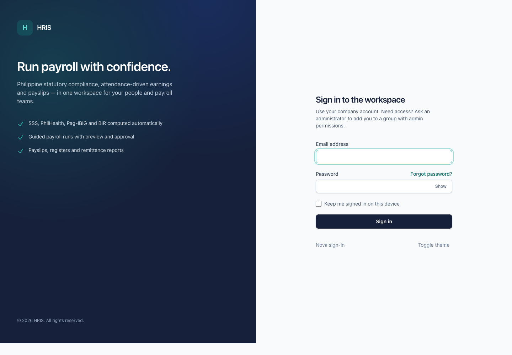

# Getting started

This page helps you sign in, find your way around, and set up your account for daily use.

## Desktop app

If you installed the OpenHR PH desktop application, the first window is a setup wizard instead of a
sign-in page. Choose whether the installation serves **Government** or **Private** organisations,
pick the payroll country, enter your company name, and create the owner account. The wizard installs
the reference data, statutory tables, and holiday calendar for you, plus a sample workspace (an
office, a department, a schedule, three sample employees and an open draft payroll), then signs you
in. Delete the `D-000x` sample employees once you add your own; empty workspaces can be filled later
from **Getting started → Load sample data**.

All data is stored on that computer. To move an installation, close the app and copy its data folder;
the path for each operating system is listed in [Desktop app](../deployment/desktop.md). Later
versions update themselves from the application's releases page.

## Before you start

- Ask your administrator for your email address and temporary password.
- Know which company you should be working in if your organisation has more than one.
- Use a current version of Chrome, Edge, Firefox, or Safari.

## Try the hosted demo

The [hosted demo](https://openhrph.laravel.cloud) gives you a disposable company with sample
employees, timesheets, and an open payroll.

1. Open [openhrph.laravel.cloud/register](https://openhrph.laravel.cloud/register).
2. Enter your name, a company name, and your email address, then choose a password.
3. Open the verification email and select the link. The demo workspace opens after verification.
4. On later visits, sign in at `/app/login` with the same email address and password.

Every demo sign-up gets its own isolated company, so you can change or delete the sample records
without affecting other visitors. The demo is not a place for real employee or payroll data.

## Sign in to the admin workspace

1. Open `/app/login` in your browser.
2. Enter your email address.
3. Enter your password. Use the **Show** button if you need to check what you typed.
4. Leave **Keep me signed in on this device** ticked only on a computer you trust.
5. Select **Sign in**.

If your credentials are correct but you do not have access, OpenHR PH explains that your account does not have admin access. Contact your administrator.

## Installation sector and country

A new installation is configured once with `php artisan openhr:install`: choose whether the whole
installation serves **Government** or **Private** organisations, then choose the payroll country.
Every company in the installation is marked with that sector, and companies created later inherit
it automatically. The country selects the statutory rules payroll uses.

If your installation has already been configured, an administrator can review the country,
currency, locale, and timezone under **Settings → Country & statutory**. The sector is fixed; change
it with `php artisan openhr:install --force`.

## Switch companies

If your account belongs to more than one company, a company switch appears at the top of the screen.

1. Select the company name in the header.
2. Choose the company you want from the list.
3. Wait for the page to reload. The active company is used for every screen until you switch again.

If you only belong to one company, the switch is not shown.

## Find your way around

The left sidebar contains the areas your group allows:

- **Dashboard** — an overview of the workspace.
- **Requests** — leave, attendance, schedule adjustment, overtime, undertime, and official business requests.
- **Settings** — company settings, offices, departments, announcements, job vacancies, employment types, groups, employees, users, certificates, and trainings.
- **Time and Attendance** — attendance settings, devices, holidays, rates, tardiness, schedules, and timesheets.
- **Leave Management** — leave settings and leave records.
- **Payroll Management** — compensations, deductions, loans, payroll groups, payroll runs, employee compensation, employee loans, and payslips.
- **Statutory (PH)** — PhilHealth, SSS, Pag-IBIG, and minimum-wage reference tables.

**Settings → Sector** shows the defaults for the installation sector: GSIS and the government
bonus catalogue for Government, or SSS/Pag-IBIG bases and 13th month for Private. The sector itself
is fixed for the installation; change it with `php artisan openhr:install --force`.

Some entries may be hidden because your group does not have permission. That is expected.

## Change your password

1. Select your name or avatar in the top-right corner.
2. Choose **Change password**.
3. Enter your current password and your new password.
4. Save the form.

Use a password you do not use anywhere else. If your administrator gave you a temporary password, change it after your first sign-in.

## Use dark mode

Select the sun or moon icon in the header to switch between light and dark mode. The choice is remembered in your browser.

## Sign out

1. Select your name or avatar in the top-right corner.
2. Choose **Sign out**.

Always sign out on a shared computer.

## If you cannot sign in

- Check that you typed the email address exactly as your administrator gave it.
- Check that Caps Lock is off.
- Use **Forgot password** if your organisation has enabled password reset.
- Ask your administrator to confirm that your account is active and that your group has admin access.
- After several failed attempts, OpenHR PH temporarily blocks sign-in for a short time. Wait and try again.

See [Troubleshooting](troubleshooting.md) for more help.
