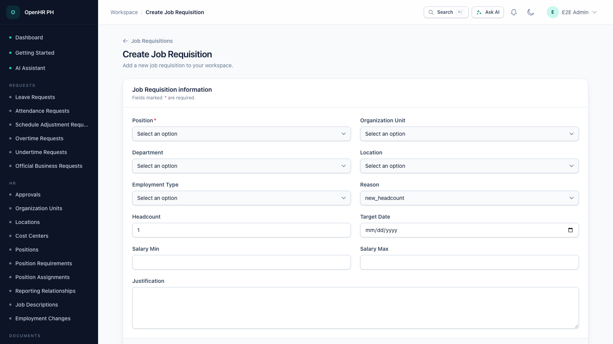
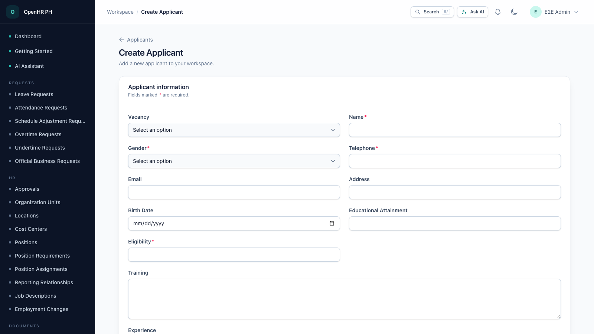

# Private recruitment to hire

This page covers the **Recruitment** menu for Private-sector organisations. For the sector overview, see
[Private-sector HR](private-hr.md). Employment after hire is covered in
[Private employment](private-employment.md).

## Pipeline at a glance

```text
requisition → vacancy → application → screening → assessment/interview
            → recommendation → offer → hired → onboarding
```

Each step is a separate record so the hiring decision and its evidence remain auditable.

## Requisitions

**Recruitment → Requisitions**

1. Create the requisition with:
   - position and employment type,
   - headcount,
   - salary range,
   - reason (new headcount, replacement, project, or another reason),
   - target start date and notes.
2. Use **Change Status** to submit, move under review, and approve it.
3. A requisition must be approved before a vacancy is published against it.

Statuses: `draft`, `submitted`, `under_review`, `approved`, `rejected`, `on_hold`, `closed`, `cancelled`.
Invalid transitions are rejected.



## Vacancies

**Recruitment → Vacancies**

1. Create the vacancy for an approved requisition.
2. Set the title, description, requirements, location, closing date, and visibility.
3. Use **Publish Vacancy** when it is ready. Published vacancies are visible to applicants.

If the requisition is on hold or closed, the vacancy cannot be published.

## Applicants and applications

**Recruitment → Applicants** and **Recruitment → Applications**

1. Create the applicant with name and contact details.
2. Record the application against a published vacancy. The application starts as `received`.
3. Attach the résumé and supporting documents in **Application Documents**.

Applications progress through `screening`, `shortlisted`, `assessment`, `interview`, `recommended`,
`offer`, and `hired`. Other outcomes are `rejected`, `withdrawn`, `offer_declined`, `offer_expired`, and
`talent_pool`.



## Screening

**Recruitment → Screening**

Use **Screen** on an application to record the result. A shortlisted application moves to `shortlisted`;
a rejection ends the pipeline for that vacancy. Record the reason so the decision can be reviewed.

## Interviews and evaluations

**Recruitment → Interviews**

1. Schedule the interview with date, time, location or link, and panel.
2. Record the interview stage and status.

**Recruitment → Evaluations**

1. Record each interviewer's scores and comments.
2. Keep evaluations separate from the interview schedule; this preserves who said what.

## Assessments

**Recruitment → Assessments**

Record the assessment type, score, result, and notes. Assessments can be tests, work samples, or
background checks.

## Recommendation and offer

1. Move the application to `recommended` when the selection decision is made.
2. **Recruitment → Offers** — use **Issue Offer** to record salary, start date, terms, and expiry.
3. Use **Record Offer Response** to record `accepted`, `declined`, `expired`, or `withdrawn`.
4. On acceptance, use **Hire / Convert** on the application.

Hire conversion:

- creates or links the employee record,
- creates the employment,
- moves the application to `hired`,
- generates the onboarding checklist.

If the applicant already has an employee record, the conversion links to it instead of creating a
duplicate.

## Onboarding

**Employment → Onboarding Checklists** and **Onboarding Tasks**

1. Confirm the generated checklist.
2. Assign owners and due dates for each task.
3. Mark tasks completed or waived.
4. Complete onboarding before the employee's first payroll.

## Common problems

| Problem | What to check |
| --- | --- |
| Recruitment menu is missing | The installation sector must be Private. |
| Vacancy cannot be published | The requisition must be approved and active. |
| Application cannot be screened | It must belong to an open vacancy and be in a screenable status. |
| Offer cannot be issued | The application should be at `recommended`. |
| Hire conversion fails | The offer must be accepted and the applicant must not already be hired. |
| Onboarding checklist is missing | The hire conversion must complete successfully. |

## Related documentation

- [Private-sector HR](private-hr.md)
- [Private employment](private-employment.md)
- [Private separation](private-separation.md)
