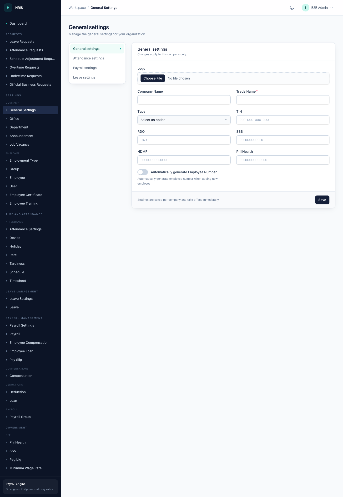

# Settings and access

This page helps company owners and administrators configure the workspace and control who can see what.

## Company settings

Open **Settings** in the sidebar. The available sections depend on your permissions.

### General settings

Use **Settings → Company → General Settings** for company-level details such as the trade name, contact details, and other workspace defaults.

### Attendance settings

Use **Time and Attendance → Attendance Settings** for rules that affect attendance, such as work hours and attendance behaviour.

### Payroll settings

Use **Payroll Management → Payroll Settings** for payroll defaults that apply to the company.

### Leave settings

Use **Leave Management → Leave Settings** for leave types and leave-related defaults.

## Reference data

Keep reference data tidy before adding employees and running payroll.

| Area | Where to manage it | Examples |
| --- | --- | --- |
| Offices | **Settings → Company → Office** | Head office, branches, locations |
| Departments | **Settings → Company → Department** | HR, Finance, Operations |
| Employment types | **Settings → Employee → Employment Type** | Regular, probationary, contractual |
| Schedules | **Time and Attendance → Schedule** | Office hours, shifts, rest days |
| Holidays | **Time and Attendance → Holiday** | Regular and special holidays |
| Rates | **Time and Attendance → Rate** | Overtime, night differential, rest-day rates |
| Tardiness | **Time and Attendance → Tardiness** | Tardiness rules |
| Devices | **Time and Attendance → Device** | Biometric devices and locations |
| Compensations | **Payroll Management → Compensation** | Allowances and other earnings |
| Deductions | **Payroll Management → Deduction** | Recurring deductions |
| Loans | **Payroll Management → Loan** | Loan types |
| Payroll groups | **Payroll Management → Payroll Group** | Semi-monthly, monthly, and their rules |
| Government tables | **Government** | SSS, PhilHealth, Pag-IBIG, minimum wage |

## Users, groups, and permissions

### Users

Use **Settings → Employee → User** to manage admin and portal accounts. A user is linked to a company and, optionally, a group.

### Groups

Use **Settings → Employee → Group** to define what a group can do. A group stores permissions for areas such as:

- company settings
- offices
- employees
- users
- departments
- devices
- holidays

The exact list depends on your configuration. A user in a group sees the menu entries and records the group allows.

### Owners

A company owner can access the admin workspace and can reopen approved payrolls. Owners do not need a group to sign in, but a group can still be useful for keeping their menu tidy.

### The access rule in plain language

- **Owner:** usually sees everything for the company.
- **Group member:** sees only the areas their group permits.
- **No access:** if the user has neither owner status nor a group with admin permissions, the admin workspace rejects the sign-in.

If someone can sign in to the portal but cannot sign in to the admin workspace, their group probably does not grant admin access.

## Announcements and job vacancies

Use **Settings → Company → Announcement** and **Job Vacancy** if your group has those permissions. These are useful for internal communication and public job postings.

## Certificates and trainings

Use **Settings → Employee → Employee Certificate** and **Employee Training** to record employee documents and development. These records appear on the employee detail page.

## Common questions

**A menu item is missing.**
Your group does not have that permission. Ask a company owner or administrator to update the group.

**A user can sign in but sees no records.**
Check the user's company, group, and group permissions. Also confirm the records belong to the active company.

**Can I hide a menu item for everyone?**
Menu visibility is configured by the workspace administrator. Ask them to review the hidden-menu configuration.

**Can I delete a group or user?**
Deletion depends on your permissions and on whether the record is used by payroll or attendance history. Prefer deactivating or reassigning instead of deleting when history matters.

**Who can reopen an approved payroll?**
Only a company owner. See [Payroll](payroll.md).
