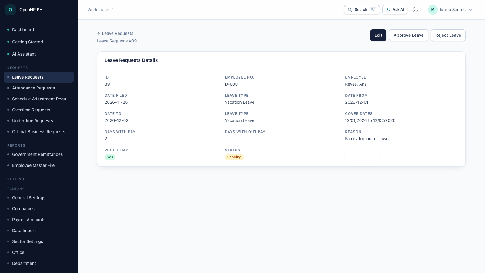
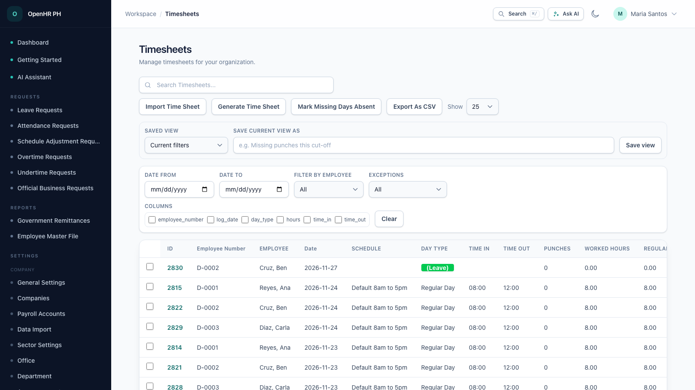
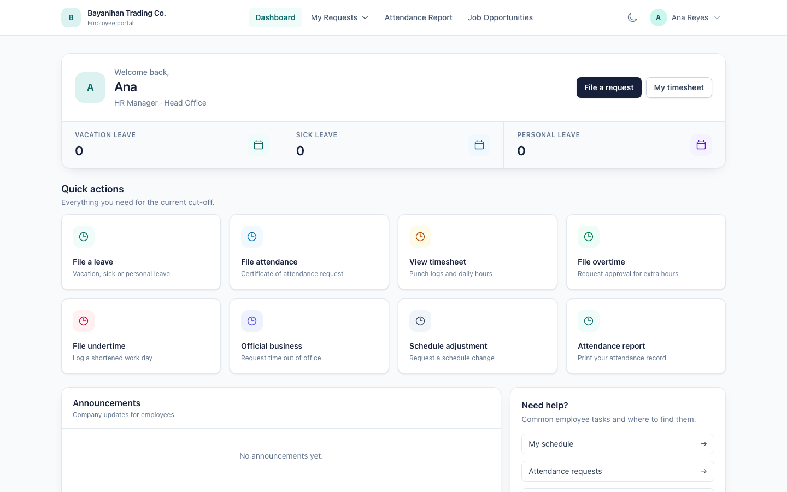

# Attendance and requests

This page helps you review employee requests and keep attendance records ready for payroll.

## Before you start

- Confirm the employee's schedule and attendance device are set up.
- Confirm who is allowed to approve requests in your organisation.
- Make sure employees know how to submit requests from the employee portal.

## Requests in the admin workspace

Open **Requests** in the sidebar. The list includes:

- **Leave Request**
- **Attendance Request**
- **Schedule Adjustment Request**
- **Overtime Request**
- **Undertime Request**
- **Official Business Request**

Each request has a status such as pending, approved, or rejected. Use the search and filters to find a request, then open the row to review the details.

### Approve or reject a request

1. Open the request from the list.
2. Check the employee, date, reason, and supporting details.
3. Choose the approve or reject action.
4. Confirm the action.

The action names depend on the request type, for example **Approve Leave**, **Reject Leave**, **Approve Overtime**, or **Approve Attendance**. Some actions can be run on several selected rows at once.

If a request is wrong, reject it and ask the employee to submit a corrected request instead of editing the original.

## Timesheets

Timesheets are the attendance summary used by payroll. Open **Time and Attendance → Timesheet**.

Typical actions include:

- **Generate Timesheet** — build timesheets for a payroll period.
- **Import Timesheet** — load attendance from a file.
- **Export As CSV** — download the selected rows.
- **Mark Missing Days Absent** — flag scheduled working days with no attendance.

Each row shows time in/out, **Worked Hours** and a status badge: **Open**, **Missing punch**, **Absent** or **Locked**. Approving a payroll locks the timesheets in its date range; only the company owner can reopen the payroll.

Always review the timesheet before processing payroll. Look for missing days, duplicate entries, and unusual overtime. See [Timesheet management](timesheet-management.md) for the common problems and the full cut-off checklist.

## Attendance devices

Open **Attendance → Devices** to register and monitor the time clocks that send punches.

1. Choose **Create** and pick the **Protocol** that matches the device:
   - *ZKTeco / eSSL ADMS push (iClock)* — the device sends its logs to the app.
   - *ZKTeco UDP pull (port 4370)*, *Hikvision ISAPI pull*, *Dahua CGI pull*, or *Suprema BioStar 2 API pull* — the app (or an on-premise agent) reads the device on the local network.
   - *Export file upload (CSV / DAT)* — for terminals that only produce a file.
   - *Generic JSON push API* — for middleware or a custom terminal.
2. Fill in the **Name** and, for push devices, the **Serial Number** exactly as the device reports it.
3. For pull devices, fill in the **IP Address**, the port when it is not the default, and the credentials (`{"username":"…","password":"…"}`). Credentials are stored encrypted.
4. Turn on **Sync Enabled** so the scheduler or the agent may read the device, and set the **Sync Interval**.
5. Save, then use **Test Connection** and **Sync Now** to confirm the device answers.

The list shows the last time the app saw the device, the last sync status, and any error message. Row actions also let you:

- **Rotate API Key** — issue a new key for `POST /api/attendance/logs`; copy it immediately, it is shown once.
- **Rotate Push Key** — issue an ADMS push key that must be entered on the device.
- **Import Device Log** — upload a CSV or ZKTeco `.dat` export from the toolbar and review the accepted, duplicate and unmatched counts in the result.

**Attendance → Device Events** keeps a read-only trail of pushes, imports, sync results and failures, which is the fastest place to look when a terminal stops sending punches. Keepalive traffic is not stored.

Vendor setup details, the ADMS endpoints, and the on-premise agent are documented in the developer guide: [Attendance devices](/docs/developer-guide/attendance-devices).

## Employee portal requests

Employees use `/portal` to submit their own requests:

- leave
- attendance corrections
- schedule changes and schedule adjustments
- overtime
- undertime
- official business

Employees can view their dashboard, schedules, attendance report, and request history. They can only submit requests for themselves.

## What happens after approval

Approved requests feed into attendance and payroll calculations. For example:

- Approved overtime can add overtime pay.
- Approved leave is counted in scheduled working days (weekends and holidays are skipped), supports half-days, and is posted to attendance as paid or unpaid so payroll pays it correctly.
- Approved undertime is recorded on the timesheet for attendance reporting.
- Approved official business can keep the employee paid while away from the usual worksite.
- Approved schedule adjustments change the expected hours for the affected dates.

The exact effect depends on the payroll group, rates, and company settings. Review the payroll preview before approving a payroll run.

## Leave balances, accrual and carry-over

Leave is tracked in a ledger, not just a number on the employee record.

- Opening balances are seeded from the legacy employee columns with
  `php artisan leave:rebuild-balances 2026 --opening`.
- Accrue the year with `php artisan leave:accrue 2026`. Credit-based types
  accrue annually or monthly according to their policy; event-based statutory
  leaves (maternity, paternity, VAWC, special leave for women, adoption) do not
  accrue.
- Close the year with `php artisan leave:carry-over 2026 2027`. The policy's
  carry-over cap moves forward and the excess expires.
- Rebuild the balance projection after any manual ledger correction with
  `php artisan leave:rebuild-balances 2026`.

The portal shows the ledger balance when one exists and falls back to the
legacy column until opening balances are seeded. Approved leave posts an
availment once; re-approving the same request cannot double-deduct.

## Common questions

**An employee says their request is missing.**
Confirm that the employee submitted it in the correct portal and that it appears in the matching admin request list. Check the request status and the employee's company.

**A request was approved by mistake.**
Reject or reverse the request if your permissions allow it. If the request has already affected a processed payroll, reopen the payroll before making changes. Only a company owner can reopen an approved payroll.

**Attendance is missing for a day.**
Ask the employee to submit an attendance request, or correct the attendance record if your group has the attendance permission. Then regenerate or update the timesheet before payroll.

**Overtime does not appear in payroll.**
Check that the overtime request was approved, that the timesheet includes the overtime hours, and that the payroll period covers the date.
