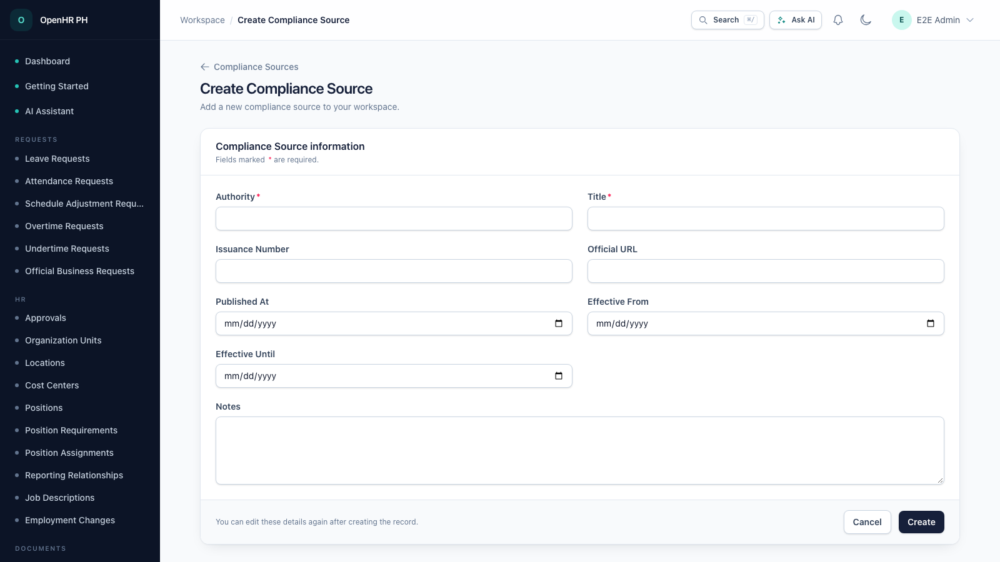

# Compliance

This page covers the shared **Compliance** menu. The register records where a rule comes from, which
version applies, and who reviewed and approved it.

## Sources

**Compliance → Sources**

Record the authoritative source before creating a rule:

- authority (for example, DOLE, CSC, BIR, GSIS, or an internal policy owner),
- title,
- issuance number,
- official URL,
- publication and effective dates,
- notes.

Use the official URL and issuance number so a future reviewer can trace the rule. Internal company
policies can also be registered as sources when they are formally approved.



## Rules

**Compliance → Rules**

Use **Register Rule** to create a rule:

1. Select the source.
2. Enter a unique code (for example `OT_PREMIUM` or `NIGHT_DIFF`).
3. Enter the name.
4. Choose the sector and, where relevant, the organization type and classification.
5. Set the effective-from and optional effective-until dates.
6. Enter the version (default `1.0.0`).
7. Enter the configuration as JSON.

The configuration is inert data. It must be a non-empty JSON object. Keys named `php`, `eval`, or `script`
are rejected; the system never executes user-supplied code.

Example configuration:

```json
{
  "rate": 1.25,
  "basis": "daily_rate"
}
```

## Rule versions

**Compliance → Rule Versions**

Each rule starts with a draft version. The lifecycle is:

```text
draft → reviewed → approved
```

1. Use **Review Version** and choose **Submit for review**. This records the reviewer and moves the rule
   to `in_review`.
2. Review the configuration and the source.
3. Use **Review Version** again and choose **Approve**. This records the approver and time, marks the
   version approved, and updates the rule's current version.
4. Approved versions are immutable and cannot be deleted. Create a new version for a change.

Versions are tenant-scoped. One company cannot see another company's configurations.

## How rules are resolved

Consumers resolve a rule by code, sector, and as-of date. Resolution:

1. finds approved rules with a matching code,
2. filters by effective dates,
3. prefers a sector-specific rule over a sector-neutral rule,
4. returns the approved configuration for the rule's current version.

If no approved rule is effective, or if multiple approved rules conflict, resolution raises a validation
error. Compliance-sensitive code should stop and ask for expert review rather than falling back to a
default.

## Effective-date behaviour

Every calculation should resolve the rule as of the event date or pay period, not today's date. When a
rule changes:

1. create a new version with a new effective date,
2. approve it,
3. keep the old version for historical calculations.

Do not edit an approved version to change history. Re-run a historical transaction only after deciding
which rule version should apply.

## Reminders and analytics

- `hr:reminders` reports compliance rules expiring within 90 days.
- **Reports → Workforce Analytics** shows approved rule counts and rules expiring in the next 90 days.

## Common problems

| Problem | What to check |
| --- | --- |
| A rule cannot be registered | The code must be unique and the source must exist. |
| The configuration is rejected | It must be valid JSON, non-empty, and must not contain executable keys. |
| A version cannot be approved | It must be submitted for review first. |
| An approved version cannot be edited | Approved versions are immutable; add a new version. |
| Resolution says no effective rule | Check status, effective dates, sector, and as-of date. |
| Resolution says rules conflict | More than one approved rule matches; ask for expert review and retire the obsolete rule. |

## Related documentation

- [Retirement](retirement.md)
- [Payroll](payroll.md)
- [Workforce analytics](workforce-analytics.md)
