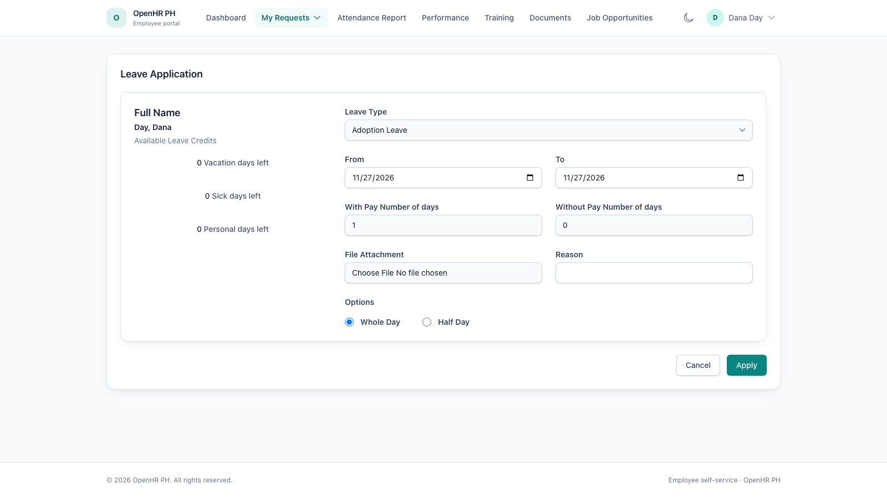

# Employee self-service

The employee portal at `/portal` is the employee-facing side of OpenHR PH. Employees use their own login
and see only their own records.

## Sign in and navigation

1. Open `/portal` and sign in with the employee's account.
2. The dashboard shows the employee's current schedule, attendance summary, and available leave credits.
3. The top navigation groups requests under **My Requests**:
   - My Leaves,
   - My Certificate of Attendance,
   - My Timesheet,
   - My Schedules,
   - My Schedule Adjustments,
   - My Overtimes,
   - My Undertimes,
   - My Official Business.
4. Use the theme toggle for light or dark mode, and the user menu to sign out.

If an employee cannot sign in, check that the account has portal access and is linked to an employee
record. See [the company-to-payslip walkthrough](end-to-end-walkthrough.md) and
[Troubleshooting](troubleshooting.md).

## Requests and attendance

- **Leaves** — view credits, submit a leave request, and track its status.
- **Certificate of Attendance** — submit and view attendance certificate requests.
- **Timesheet** — view the day's punches and request corrections where enabled.
- **Schedules / Schedule Adjustments** — view the schedule and request a change.
- **Overtimes / Undertimes / Official Business** — submit and track requests.

Requests follow the company's approval workflow. The employee sees pending, approved, and rejected states.
Approved requests flow into attendance and payroll.

## Performance

**Portal → Performance**

- View goals for active cycles and their status.
- View reviews, reviewer, overall rating, and finalization date.
- Acknowledge a finalized review. Acknowledgment is recorded once and cannot be undone.
- View development plans and due dates.

## Training

**Portal → Training**

- View enrolled sessions, course, schedule, status, and score.
- View certifications, issuer, issue date, expiry date, and status.

Expiring certifications are also reported to HR; employees should upload a renewed certificate through HR.

## Documents

**Portal → Documents**

- View documents owned by the employee.
- Download a document through the authorized portal download route.
- Acknowledge a document. The acknowledgment records the user, employee, timestamp, and IP.

Employees cannot see another employee's documents. Confidential and restricted documents are visible only
to their owner, the uploader, and users with document-management permission.

## Attendance report

**Portal → Attendance Report**

The report shows the employee's daily attendance for the selected period, including time in/out, worked
hours, and exceptions. Use it before submitting a correction or asking payroll about a discrepancy.

## Permissions and privacy

- Portal users are authenticated with the `portal` guard.
- Portal records are filtered to the signed-in employee.
- If a page is missing, the employee's account may not have portal access or the feature may be disabled
  for the company.

## Common problems

| Problem | What to check |
| --- | --- |
| Cannot sign in | Account exists, has portal access, and is linked to an employee. |
| No leave credits shown | Leave balances may not be assigned for the year. |
| A review cannot be acknowledged | The review must be finalized first. |
| A document is missing | The document must be owned by the employee or shared through the correct owner. |
| Download returns 403 | The employee does not own the document and lacks document access. |
| Requests are not visible in admin | Check the request's status and the approver's workflow tasks. |

## Related documentation

- [Attendance and requests](attendance-and-requests.md)
- [Performance](performance.md)
- [Learning](learning.md)
- [Documents and workflow](documents-and-workflow.md)
- [Getting started](getting-started.md)
