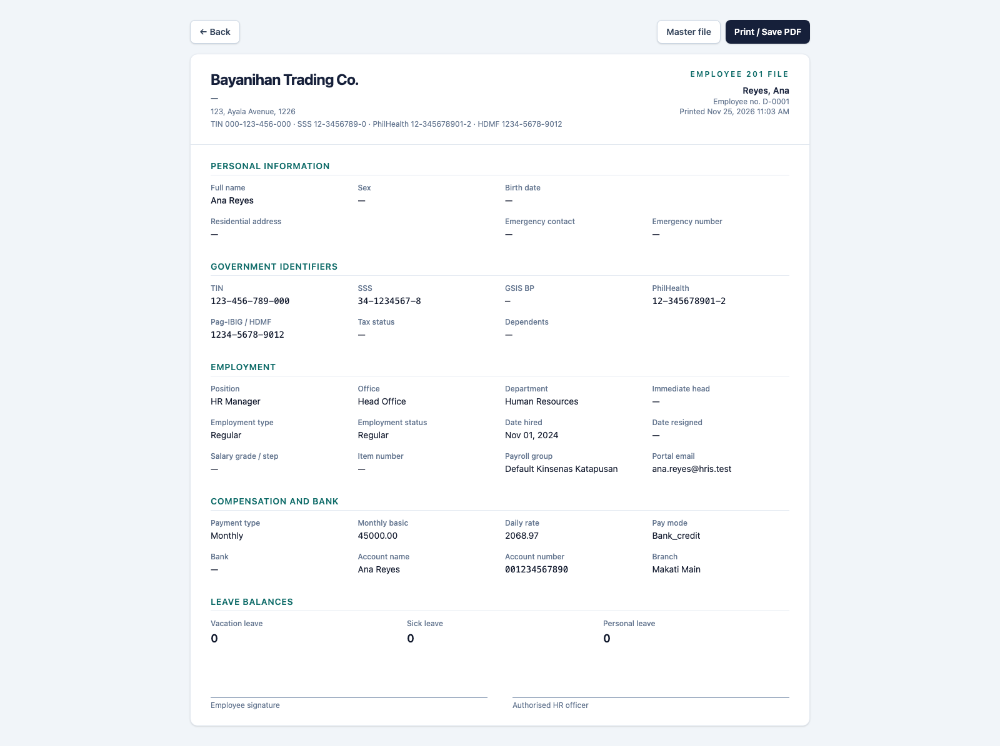
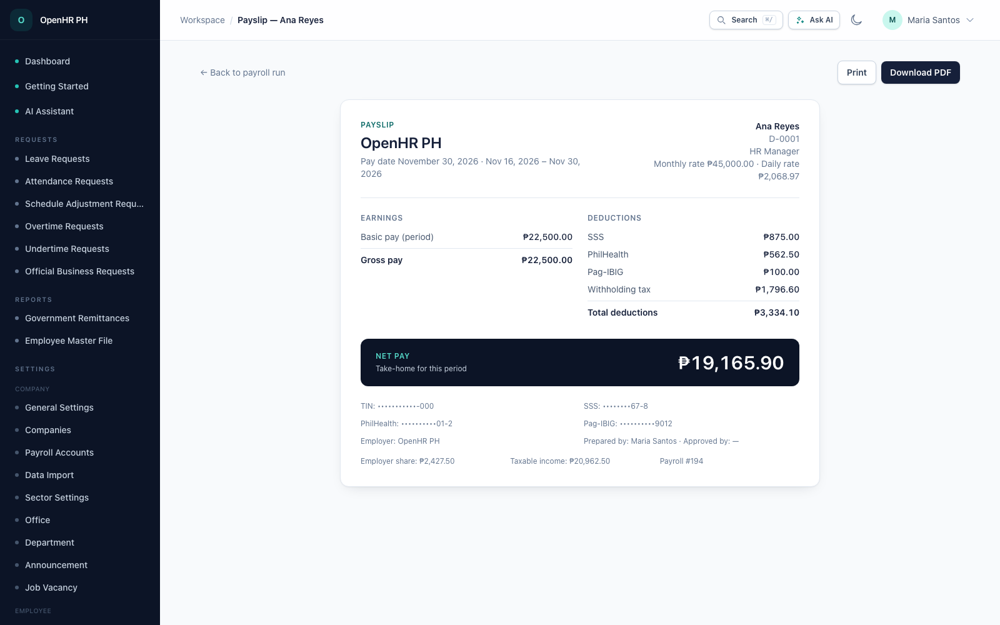
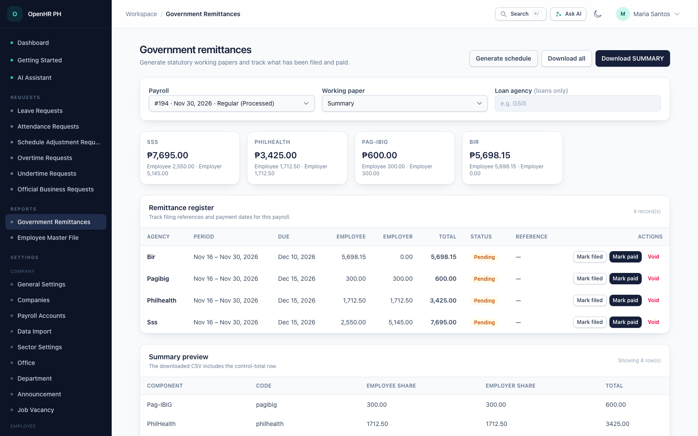

# Reports and payslips

This page helps you export lists, review payroll totals, and give employees their payslips.

## Report centre

**Reports** in the sidebar gives you three working areas:

| Report | What it is for |
| --- | --- |
| **Government Remittances** | Statutory working papers plus a filing and payment register for a payroll. |
| **Employee Master File** | A filterable, printable, CSV-exportable list of every employee with statutory IDs and bank details. |
| **201 File** | A printable employee dossier opened from the master file or an employee record. |

## Employee master file

1. Open **Reports → Employee Master File**.
2. Filter by search, office, department, employment type, payroll group, employment status, or active/resigned.
3. Sort by employee number, name, date hired, or monthly basic.
4. Select **Export CSV** to download the filtered rows, or **Print** for a paper copy.
5. Select **Open** on a row to view the employee's 201 file.

The list includes each employee's statutory identifiers, bank account (masked to the last four
digits), portal e-mail, and employment details. Use it as the HR masterlist for audits, payroll
reconciliation, and bank-file preparation.

## 201 file

The 201 file is a single printable dossier for one employee. It contains:

- company header with the company's statutory identifiers
- personal and contact information
- government identifiers (TIN, SSS, GSIS BP, PhilHealth, Pag-IBIG/HDMF)
- employment details, including office, department, immediate head, and payroll group
- compensation and bank details
- leave balances
- compensations, deductions, and loans
- certificates and trainings
- signature lines for the employee and the HR officer



Open it from **Employee Master File → Open** or from an employee record's **Documents** section.
Select **Print / Save PDF** and use the browser's print dialog. Only users in the employee's company
can open it.

## Export a list as CSV

Many admin lists include an **Export As CSV** action.

1. Open the list you need, for example Employees, Timesheet, or Payroll.
2. Use the search and filters to narrow the rows.
3. Select the rows you want. If the action works on all filtered rows, select them all.
4. Choose **Export As CSV** from the toolbar or bulk-action bar.
5. Confirm the download.
6. Open the file in a spreadsheet application.

The exported file contains the visible or selected records. It deliberately leaves out passwords and remember-me tokens.

## Payroll register

The payroll run page shows a register of employees and their pay for the period. Use it to review:

- employee name and number
- gross pay
- deductions
- net pay
- payslip access

The register is the best place to check the run before approving it.

## Payslips in the admin workspace

After a payroll is processed or approved:

1. Open the payroll run.
2. Find the employee in the register.
3. Select the payslip link.



The payslip page is print-ready. Use your browser's print command to print it or save it as a PDF.

### Debug tax breakdown

When the installation runs with `APP_DEBUG=true`, the payslip page also shows a **Debug · earnings tax treatment** panel. It lists each earning and states whether it is taxable or non-taxable, the maximum that applies to it (the statutory de minimis ceiling, or the `maximum_non_tax` value on the company's `compensations` catalogue row), and how much of a non-taxable earning went above the ceiling still available for its month, semester or year and became taxable. The panel is hidden when printing and never appears in the PDF payslip.

## Payslip PDFs

A payslip PDF opens from the protected payslip route. A user with admin access can open any payslip in the active company; an employee can open only the payslip that belongs to them, and only with an admin-workspace sign-in. Employee-portal accounts cannot open payslips.

The PDF is drawn by the application, so it follows the installation sector. A government payroll
shows the **GSIS** premium and the employee's **GSIS BP** number; a private payroll shows the SSS
contributions and SSS number. The evidence pack can also write one PDF per employee:
`php artisan payroll:evidence-pack {payroll} --path=storage/app/payroll-evidence/{payroll} --payslips`.

If a PDF does not open:

- Confirm you are signed in to the admin workspace.
- Confirm the payroll has been processed.
- Confirm the employee belongs to the current company.
- Ask your administrator to check file storage and permissions.

## Government remittances in the admin workspace

The admin report centre is the day-to-day way to produce remittances and record what was filed.

1. Open **Reports → Government Remittances** (or select **Remittances** on a payroll).
2. Choose the payroll and working paper.
3. Review the agency summary cards and the preview.
4. Select **Download CSV** for one format or **Download all** for the sector's set.
5. Select **Generate schedule** to create the filing/payment rows.
6. Use **Mark filed** and **Mark paid** to record references and dates. Filed and paid rows survive a
   schedule refresh; use **Void** for rows that should not be remitted.



The register is a working record, not an agency e-filing submission. The due dates shown are
editable defaults; confirm them with each agency.

### Command-line working papers

`payroll:remittance` can produce the same employee-level working papers in addition to the four-row summary:

```bash
php artisan payroll:remittance {payroll} --format=summary
php artisan payroll:remittance {payroll} --format=sss --path=sss.csv
php artisan payroll:remittance {payroll} --format=philhealth --path=philhealth.csv
php artisan payroll:remittance {payroll} --format=pagibig --path=pagibig.csv
php artisan payroll:remittance {payroll} --format=gsis --path=gsis.csv
php artisan payroll:remittance {payroll} --format=bir --path=bir.csv
php artisan payroll:remittance {payroll} --format=coa --path=coa.csv
php artisan payroll:remittance {payroll} --format=sector --path=remittance/
php artisan payroll:remittance {payroll} --format=loans --path=loans.csv
php artisan payroll:remittance {payroll} --format=loans --agency=GSIS --path=gsis-loans.csv
php artisan payroll:remittance {payroll} --format=all --path=remittance/
```

`--format=sector` writes the set the installation actually remits: GSIS, PhilHealth, Pag-IBIG and BIR for a Government installation, or SSS, PhilHealth, Pag-IBIG and BIR for Private. It also writes the loans working paper, and the COA register for Government.

Each agency file lists the employees and ends with a `TOTAL` control row. Reconcile that total to the payroll register and the general ledger payable before filing. These are working papers, not the agency's e-filing file; verify the current form mapping before submission.

| File | Columns |
| --- | --- |
| SSS | Employee no, Name, SSS number, Monthly salary credit, Employee share, Employer share, Total |
| PhilHealth | Employee no, Name, PhilHealth number, Monthly basic, Employee share, Employer share, Total |
| Pag-IBIG | Employee no, Name, Pag-IBIG number, Fund salary, Employee share, Employer share, Total |
| GSIS | Employee no, Name, GSIS BP number, Employee share, Employer share, Total, Monthly compensation |
| BIR | Employee no, Name, TIN, Taxable income, Tax withheld |
| COA | Employee no, Name, Basic, Gross, GSIS/SSS shares, PhilHealth, Pag-IBIG, Tax, Loans, Other deductions, Net pay |
| Loans | Employee no, Name, Loan agency, Loan code, Loan name, Deducted this period |
| Summary | Agency, Employee share, Employer share, Total |

GSIS premium and GSIS loans are reported separately. A GSIS loan (policy, emergency, or real
estate) is a salary deduction, not a statutory contribution, so it appears in the loans working
paper and never in the GSIS premium paper. Use `--agency=GSIS` to produce only the GSIS loans
file for remittance.

`payroll:bir-2316` writes the year-to-date BIR 2316 data with a control total. It rejects rows with an invalid TIN unless `--allow-invalid-tin` is passed; use `--rejects=path.csv` to capture the rejected rows.

## Period-close evidence pack

Build the evidence pack after approval:

```bash
php artisan payroll:evidence-pack {payroll} --path=storage/app/payroll-evidence/{payroll}
```

The pack contains the payroll register, the remittance summary and per-agency files, the BIR 2316 data (when year-to-date records exist), a `manifest.json` with SHA-256 hashes, and a `README.txt` retention note. Confirm the retention period with your CPA or tax adviser before disposing of any file.

## Employee portal

Employees can use the portal to view their own attendance report, request history, and to submit leave, attendance, schedule adjustment, overtime, undertime, and official business requests.

The portal has no payslip screen. Print or download payslips from the admin workspace and hand them to employees.

## Printing tips

- Use **Landscape** for wide payroll registers.
- Set margins to **Default** or **Minimum**.
- Turn off browser headers and footers if the payslip has its own header.
- Use **Save as PDF** to keep an electronic copy.
- Print a test copy for one employee before printing a batch.

## Common questions

**The CSV is empty.**
Make sure rows are selected and that the filters return results.

**The payslip is missing.**
Process the payroll first. Payslips are available after processing.

**The PDF or printout is cut off.**
Try landscape orientation, smaller margins, or a different paper size. Check the print preview before printing a batch.

**Can employees see other employees' payslips?**
No. A payslip opens only for the employee it belongs to, or for a user with admin access to the company.
