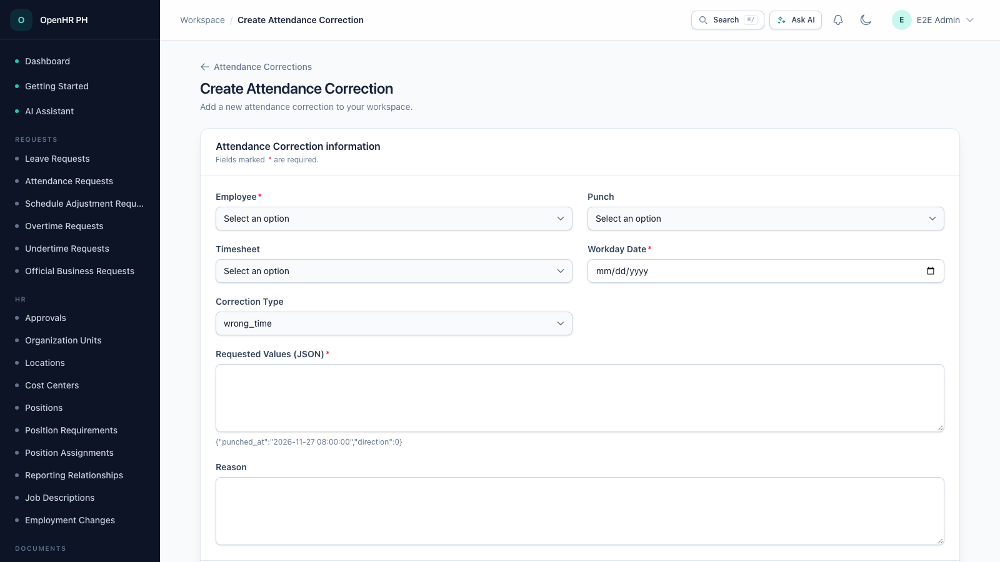

# Workforce corrections and approvals

This page covers the shared **Workforce** menu: attendance corrections and timesheet approvals. For
timesheet generation, night shifts, device imports, and absence handling, see
[Timesheet management](timesheet-management.md).

## Attendance corrections

**Workforce → Attendance Corrections**

A correction fixes an attendance problem without rewriting the original punch. The workflow is:

```text
requested → approved or rejected → applied
```



### Review a correction

1. Open **Workforce → Attendance Corrections**.
2. Check the employee, workday, correction type, requested values, and reason.
3. Open **Review Correction** and choose:
   - **Approve** — records an approval decision.
   - **Reject** — records a rejection and requires comments.
   - **Apply approved correction** — writes the corrected punch.
4. Applying creates a new punch with source `correction` and links it to the correction record. The
   original punch stays untouched and visible for audit.

Correction types include wrong time, missing punch, late, undertime, absence, and other. If the requested
JSON is invalid, the correction is rejected before it reaches the approval step.

### Things to remember

- An approved correction is not yet applied; apply it to affect attendance and payroll.
- A rejected or cancelled correction cannot be applied.
- A correction can be applied only once. Reapplying returns the existing applied correction.
- Decisions are immutable. Corrections and decisions keep the requester and reviewer.

## Timesheet approvals

**Workforce → Timesheet Approvals** or **Time and Attendance → Timesheet → Approval Workflow**

The approval workflow is:

```text
submitted → approved or rejected → locked for payroll
```

1. **Submit** the timesheet for review. A locked timesheet cannot be resubmitted.
2. **Approve** only a submitted timesheet. Approval records the approver and time.
3. **Reject** a submitted timesheet and add the reason. The timesheet returns to the employee for
   correction.
4. **Lock** an approved timesheet for payroll. Locking sets `is_locked` and records the lock time.

Every action creates an immutable `timesheet_approvals` row with the actor, action, comments, and
timestamp. Use **Workforce → Timesheet Approvals** to review that history.

### Before you lock

- Confirm the timesheet has no missing punches.
- Confirm corrections for the period are applied.
- Confirm leave, overtime, undertime, and official business records are reflected.
- Check that the payroll period has not already been processed.

Reopening a locked timesheet requires a payroll reopen or an authorized correction process; do not edit
the timesheet directly.

## Who can do this

- **Employees** permission is required for the Workforce menu.
- Corrections normally come from the employee or HR; supervisors can be given approval access through
  their group.
- Timesheet approval and locking should be limited to payroll or HR staff.

## Common problems

| Problem | What to check |
| --- | --- |
| Correction cannot be applied | It must be approved first. |
| Correction approve/reject fails | Only a submitted correction can be reviewed. |
| Timesheet approve fails | The timesheet must be submitted. |
| Timesheet lock fails | The timesheet must be approved. |
| Timesheet cannot be resubmitted | It is locked for payroll. |
| Attendance still shows the old time | The correction was approved but not applied. |
| Approval history is missing | Check that the action ran through the service; direct edits do not create approval rows. |

## Related documentation

- [Timesheet management](timesheet-management.md)
- [Attendance and requests](attendance-and-requests.md)
- [Payroll](payroll.md)
- [HR, workforce and talent overview](hr-and-workforce.md)
