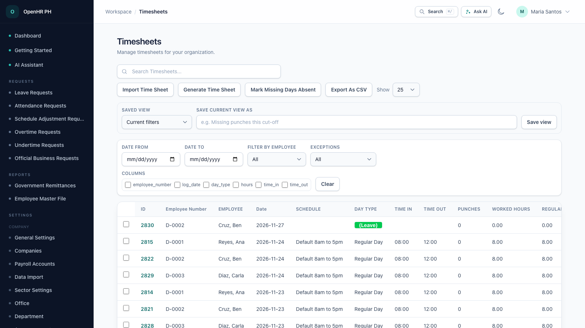

# Timesheet management

This page covers the day-to-day problems that make timesheets unreliable, and how OpenHR PH resolves each one. Use it as the HR playbook for the person who owns attendance before every payroll cut-off.

## The twelve problems that cause most timesheet disputes

These are the recurring issues HR teams report in large, multi-shift organisations. Each one has a matching control in OpenHR PH.

| # | Problem | What it looks like in practice | How OpenHR PH handles it |
|---|---------|-------------------------------|--------------------------|
| 1 | **Missing punches** | One time-in with no time-out, so hours silently shrink | Punches are stored as an in/out sequence. The timesheet list flags rows with `Missing punch`, and an approved attendance request writes the missing punch into the same log |
| 2 | **Overnight and night shifts** | A 22:00–06:00 shift records its time-out on the next calendar day and becomes an orphan `out` | The punch is attributed to the **shift's workday** (the day the shift started) whenever it arrives before the shift start |
| 3 | **Double punches** | A double tap on the portal, or a device retry, creates a time-out seconds after the time-in | A punch inside the debounce window (60 seconds by default, `ATTENDANCE_PUNCH_DEBOUNCE_SECONDS`) is treated as a duplicate and not stored |
| 4 | **Edits after payroll** | Someone changes a day after the payroll was approved; pay and attendance no longer agree | Approving a payroll **locks** every timesheet in its date range; only reopening the payroll (company owner) unlocks them |
| 5 | **No audit trail** | Nobody can answer "who changed this day and why?" | Every manual timesheet edit, approval, lock and unlock writes an entry to the HR audit trail (`hr_audit_events`) |
| 6 | **Wrong day type** | A rest day, holiday or special holiday is paid as a regular day | Generation classifies each day as regular/rest day and applies the holiday code; the day type is visible on every row |
| 7 | **Regeneration wipes corrections** | The nightly job resets a corrected day | Generation only fills days that have no classification yet and never overwrites an existing day type or rate |
| 8 | **Silent import loss** | A biometric file is imported, but some employees are missing | The import reports accepted, duplicate, unmatched, blocked and invalid punches, and merges instead of replacing logs |
| 9 | **Leave and rest days marked absent** | A paid leave or rest day is deducted as an absence | Absence marking only touches scheduled regular working days with no punch, no leave, no holiday and no lock |
| 10 | **"Hours" that are not hours** | A night-shift employee sees 8.8 hours for an 8-hour shift | `Worked hours` shows actual attendance; premium-equivalent hours (night differential and overtime weighting) are kept separately |
| 11 | **No visibility of gaps** | Payroll runs before anyone notices missing days | The timesheet list is ordered newest first, shows punches, worked hours and a status badge, and filters by employee and date |
| 12 | **Empty rows that look complete** | Blank rows satisfy the payroll checklist even though nobody worked | Generation skips employees without a work schedule, so a missing schedule is visible before payroll |

## Roles and expectations

- **Employees** record time in/out in the portal and submit an attendance request when a punch is missing or wrong.
- **Immediate heads** receive the request and can review it; HR or payroll approves it.
- **HR/payroll administrators** review the timesheet list before the cut-off, resolve missing punches, and run payroll.
- **The company owner** is the only role that can reopen an approved payroll.

## Daily routine

1. Open **Attendance → Timesheet**.
2. Filter **Date From** / **Date To** to the current cut-off and optionally pick an employee.
3. Look at the **Status** column:
   - **Missing punch** — the day has an odd number of punches. Ask the employee to file an attendance request, then approve it.
   - **Absent** — a scheduled working day with no punch, no leave and no holiday.
   - **Locked** — payroll for that period is approved. Do not attempt to edit; reopen the payroll first.
   - **Open** — nothing to review.
4. Compare **Worked hours** against the schedule. The old 8.8-hour night-shift display is gone; 8 actual hours now read as `8.00`.
5. Use **Export As CSV** (select rows first) for payroll reconciliation or a dispute.

## Generating timesheets

Two equivalent actions exist:

- **Admin → Attendance → Timesheet → Generate Time Sheet** — pick a start date, end date and office.
- `php artisan blank_timesheet:generate {from_date?} {to_date?} {--company=}` — the scheduled daily job. Without arguments it fills the current month.

Rules the generator follows:

- Employees without a work schedule are **skipped**. Assign a schedule (Admin → Employees) before generating.
- Days that already have a day type and rate are **skipped**. This is what protects manual corrections; re-running generation is always safe.
- Holidays are read for the whole range in one pass, so a holiday created later is applied by the holiday observer.

To rebuild a misclassified range deliberately, clear those rows first or edit the individual day with the **Time** row action.

## Night shifts and overnight schedules

OpenHR PH decides which day a punch belongs to from the employee's schedule:

- A shift whose start time is later than its end time (for example 22:00–06:00) crosses midnight.
- Any punch that arrives **before the shift start** is attributed to the **previous day's** timesheet, provided that day still has an outstanding time-in.
- The overnight time-out is mirrored to the legacy `am_out_morning` field so printed forms keep working.

Example: an employee times in at 22:00 on 10 November and times out at 06:05 on 11 November. Both punches are stored on the 10 November timesheet, and 11 November has no phantom `out` row.

If a punch is genuinely ambiguous (for example a forgotten time-out followed by a very early arrival), the day is flagged as a missing punch and the employee files an attendance request.

## Correcting a day

Employees submit a correction from **Portal → Attendance → Certificate of Attendance** (type `Biometric Malfunction`, date, time, in/out). The flow is:

1. The request appears in **Attendance → Attendance Requests**.
2. HR chooses **Approve** and enters remarks.
3. Approval writes the punch into the timesheet `logs` with source `attendance_request`, sets the approver to the acting HR user, and records an audit event.
4. If the period is locked or closed, nothing is written and the request stays pending. Reopen the payroll first.

The approval is applied immediately, so refreshing the timesheet list shows the new punch and the missing-punch badge disappears.

Approval restores the punch, not the computed pay hours. If the day has not been computed yet, open the row's **Time** action and confirm the day type, rate and hours before processing payroll. This keeps a correction from silently changing pay.

## Locking and reopening

- Approving a payroll locks all timesheets in the payroll date range. The lock blocks portal punches, biometric/API punches, imports and manual edits.
- Only the company owner can **Reopen** an approved payroll. Reopening unlocks the same date range and records the reason in both the payroll and HR audit trails.
- Re-lock by approving the payroll again after corrections.

This is the control that keeps attendance and pay consistent: no silent retroactive edits after sign-off.

## Importing biometric logs

Use **Import Timesheet** on the timesheet list. The file is the usual tab-separated machine export (employee id, date-time, status, in/out, and two device columns).

The result message reports:

| Counter | Meaning |
|---------|---------|
| Accepted | New punches merged into the timesheet |
| Duplicates | The punch already existed at the same time and type |
| Unmatched | The biometric id has no employee |
| Blocked | The timesheet is locked or the period is closed |
| Invalid | Malformed or undated lines |
| Days | Number of employee-days touched |

Imports never replace existing logs, so re-uploading the same file is safe.

## Marking absences

**Mark Missing Days Absent** on the timesheet list processes a date range (optionally one office) and flags scheduled working days that have:

- no punches and no legacy time-in,
- no leave,
- no holiday,
- no rest-day classification,
- no lock,
- and an assigned schedule.

It reports how many days it changed. It never touches a day that already has any attendance.

## Punch sources and controls

| Source | Where it is captured | Locks honoured | Notes |
|--------|---------------------|----------------|-------|
| Portal | **Portal → My Timesheet** | Yes | Debounced, overnight-aware |
| Biometric device / API | `POST /api/attendance/logs` | Yes | Rejected punches return `rejected` with a reason |
| Import | **Import Timesheet** | Yes | Merges and reports |
| Attendance request | **Approve** action | Yes | Writes the same `logs` array |

## Troubleshooting

**An employee cannot time out.**
Confirm the time-in was recorded today. For a night shift, the time-out belongs to the previous day; check the previous day's row.

**A punch is missing after a device sync.**
Open the API response or the import summary. `unmatched` means the biometric id is not linked to an employee; `blocked` means the period is locked.

**A correction was approved but nothing changed.**
Check the payroll period. If the payroll is approved, the timesheet is locked; reopen it as the owner and apply the correction again.

**Hours look lower than before.**
`Worked hours` now shows actual attendance, not premium-equivalent hours. Night differential and overtime premiums are applied by the payroll engine from the same timesheet lines.

**Generation created nothing.**
Either the employee has no work schedule, or every day in the range is already classified. Both are intentional.
